# Database Schema - Car Rental SaaS

**Cập nhật:** 15/08/2026 — Tối ưu hóa Database Schema & Hoàn thiện Nghiệp vụ Booking Thực tế:
- **Bổ sung Cấu hình động Nhà xe (`tenant_configs`)**: Quản lý các tham số linh hoạt theo từng tenant: `hold_timeout_minutes` (thời gian giữ chỗ), `late_hourly_price` (phí phạt trễ giờ), `default_commission_rate` (tỷ lệ hoa hồng CTV).
- **Gộp Thời gian Đặt xe (`pickup_time`, `return_time`)**: Gộp 4 trường ngày/giờ riêng lẻ thành 2 trường TIMESTAMPTZ chuẩn ISO-8601 (chứa đầy đủ Ngày + Giờ), tối ưu hóa tính toán số giờ thuê, tính phụ phí trễ giờ và hỗ trợ kiểm tra xung đột lịch xe (Overlapping check) qua chỉ mục B-tree kết hợp Khóa bi quan (Pessimistic Locking) ở tầng Service.
(Hệ thống có định hướng nâng cấp lên PostgreSQL GiST index & EXCLUDE constraint trong tương lai khi quy mô giao dịch tăng cao).
- **Loại bỏ Phạt nguội, Quá KM & Vạch xăng**: Hệ thống không quản lý phạt nguội (`traffic_fines`), không theo dõi số km và mức nhiên liệu để tinh gọn tối đa cho việc học Backend và tập trung vào luồng Booking.
- **Chuẩn hóa Phụ phí Trễ giờ (`late_fee`)**: Quản lý trả trễ tính theo block giờ thực tế (1 – 4 tiếng tính lũy tiến theo `late_hourly_price` từ 80.000đ – 150.000đ/giờ), không áp dụng ân hạn, không làm tròn ngày.
- **Chuẩn hóa Mã hợp đồng (`booking_code`)**: Định dạng chuẩn `[PREFIX]_[TENANT_CODE]_[YYMMDD]_[RANDOM_4_CHAR]` (VD: `BK_ANR_260815_8F2D`), ràng buộc `UNIQUE(tenant_id, booking_code)`.
- **Ràng buộc Toàn vẹn cấp DB & Xử lý Mã lỗi Java**: Sử dụng Composite Foreign Key `(branch_id, tenant_id)` để PostgreSQL tự động validate tính hợp lệ của chi nhánh thuộc tenant; dùng `@RestControllerAdvice` ở Spring Boot để map mã lỗi DB thành JSON response an toàn, không lộ stacktrace.
- **Bảo mật Dữ liệu Khách hàng (Nghị định 13/2023/NĐ-CP)**: Mã hóa đối xứng AES-256-GCM cho CCCD (`id_card`) và GPLX (`driver_license`), che mờ (masking) trên Hóa đơn/Giao diện và thiết lập Data Retention tự động xóa ảnh scan sau thời hạn bảo lưu.

---

## Mục lục
1. [ER Diagram](#1-er-diagram)
2. [Tables & Column Comments](#2-tables--column-comments)
3. [Indexes Summary](#3-indexes-summary)
4. [Multi-tenant Strategy, DB Validation & Compliance](#4-multi-tenant-strategy-db-validation--compliance)

---

## 1. ER Diagram

```mermaid
erDiagram
    tenants ||--|| tenant_configs : "has_config"
    tenants ||--o{ branches : "owns"
    tenants ||--o{ roles : "defines"
    roles ||--o{ role_permissions : "includes"
    permissions ||--o{ role_permissions : "granted_in"
    tenants ||--o{ user_tenants : "has_members"
    users ||--o{ user_tenants : "belongs_to"
    users ||--o{ user_sessions : "has_sessions"
    roles ||--o{ user_tenants : "assigned_role"
    user_tenants ||--o{ user_branches : "assigned_branch"
    branches ||--o{ user_branches : "has_staff"
    tenants ||--o{ vehicles : "owns_fleet"
    branches ||--o{ vehicles : "manages_vehicle"
    vehicle_types ||--o{ vehicles : "categorizes"
    tenants ||--o{ customers : "manages_customers"
    tenants ||--o{ bookings : "has_bookings"
    branches ||--o{ bookings : "handles_booking"
    customers ||--o{ bookings : "places_booking"
    vehicles ||--o{ bookings : "booked_vehicle"

    tenants {
        uuid id PK "Ma ID nha xe"
        string name "Ten nha xe"
        string domain UK "Domain truy cap"
        smallint plan_tier "Goi dich vu (1:FREE, 2:BASIC, 3:PRO, 4:ENTERPRISE)"
        string logo_url "URL logo nha xe"
        string contact_email "Email lien he"
        string contact_phone "So dien thoai"
        jsonb settings "Cau hinh rieng (JSONB)"
        boolean is_active "Trang thai hoat dong / khoa nha xe"
        timestamptz created_at "Thoi diem tao"
        timestamptz updated_at "Thoi diem cap nhat"
    }

    tenant_configs {
        uuid tenant_id PK,FK "Ma ID nha xe"
        int hold_timeout_minutes "Thoi gian giu xe cho coc (phut)"
        decimal late_hourly_price "Phi tre gio (VND/gio)"
        decimal default_commission_rate "Ty le hoa hong CTV (%)"
        timestamptz created_at "Thoi diem tao"
        timestamptz updated_at "Thoi diem cap nhat"
    }

    branches {
        uuid id PK "Ma ID chi nhanh"
        uuid tenant_id FK "Ma ID nha xe"
        string name "Ten chi nhanh"
        text address "Dia chi chi tiet"
        string phone "SDT chi nhanh"
        string email "Email chi nhanh"
        decimal latitude "Toa do vi do"
        decimal longitude "Toa do kinh do"
        boolean is_active "Trang thai hoat dong"
        timestamptz created_at "Thoi diem tao"
        timestamptz updated_at "Thoi diem cap nhat"
    }

    roles {
        uuid id PK "Ma ID nhom quyen"
        uuid tenant_id FK "Ma ID nha xe"
        string name "Ten nhom quyen"
        string code "Ma nhom quyen (TENANT_ADMIN...)"
        text description "Mo ta quyen"
        boolean is_system_default "Co mac dinh he thong"
        timestamptz created_at "Thoi diem tao"
        timestamptz updated_at "Thoi diem cap nhat"
    }

    permissions {
        uuid id PK "Ma ID quyen"
        string code UK "Ma dinh danh quyen (vehicle:create...)"
        string name "Ten hien thi quyen"
        string category "Nhom chuc nang"
        text description "Mo ta quyen"
    }

    role_permissions {
        uuid role_id PK,FK "Ma ID nhom quyen"
        uuid permission_id PK,FK "Ma ID quyen nguyen tu"
    }

    users {
        uuid id PK "Ma ID nguoi dung"
        string email UK "Email dang nhap"
        string password_hash "Mat khau ma hoa BCrypt"
        string full_name "Ho va ten"
        string phone "So dien thoai"
        string avatar_url "URL anh dai dien"
        boolean is_active "Trang thai kich hoat"
        boolean is_super_admin "Co Super Admin SaaS"
        timestamptz last_login_at "Dang nhap gan nhat"
        uuid current_session_id "Ma phien (DEPRECATED - Chuyen sang user_sessions)"
        timestamptz created_at "Thoi diem tao"
        timestamptz updated_at "Thoi diem cap nhat"
    }

    user_sessions {
        uuid id PK "Ma ID phien dang nhap (Session ID mang trong JWT)"
        uuid user_id FK "Ma ID nguoi dung (FK users)"
        string device_name "Ten thiet bi va trinh duyet (Parse tu User-Agent)"
        string ip_address "Dia chi IP thiet bi dang nhap"
        boolean is_revoked "Trang thai thu hoi phien (true: Da dang xuat/bi da)"
        timestamptz last_active_at "Thoi diem tuong tac gan nhat (Phuc vu thuat toan LRU)"
        timestamptz expires_at "Thoi diem het han phien"
        timestamptz created_at "Thoi diem tao phien"
    }

    user_tenants {
        uuid user_id PK,FK "Ma ID nguoi dung"
        uuid tenant_id PK,FK "Ma ID nha xe"
        uuid role_id FK "Ma ID nhom quyen dong"
        timestamptz joined_at "Thoi diem gia nhap"
    }

    user_branches {
        uuid user_id PK,FK "Ma ID nguoi dung"
        uuid tenant_id FK "Ma ID nha xe"
        uuid branch_id PK,FK "Ma ID chi nhanh"
        smallint status "Trang thai (1:ACTIVE, 2:SUSPENDED, 3:RESIGNED)"
        timestamptz started_at "Ngay bat dau lam"
        timestamptz ended_at "Ngay ket thuc lam"
        uuid updated_by FK "ID Admin cap nhat"
    }

    vehicle_types {
        uuid id PK "Ma ID loai xe System-wide"
        string name UK "Ten loai xe (Sedan 4 cho, SUV 7 cho...)"
        text description "Mo ta loai xe"
        boolean is_active "Trang thai hoat dong"
        timestamptz created_at "Thoi diem tao"
        timestamptz updated_at "Thoi diem cap nhat"
    }

    vehicles {
        uuid id PK "Ma ID chiec xe"
        uuid tenant_id FK "Ma ID nha xe"
        uuid branch_id FK "Ma ID chi nhanh chu quan"
        uuid vehicle_type_id FK "Ma ID loai xe"
        string license_plate "Bien so xe"
        string model "Dong xe / Mau xe"
        string color "Mau son xe"
        int year "Nam san xuat / Doi xe"
        decimal price_per_day "Gia thue ngay thuong"
        decimal weekend_price_per_day "Gia thue cuoi tuan"
        text parking_location "Vi tri do thuc te (kho, bai ngoai)"
        date inspection_expiry_date "Han dang kiem"
        date insurance_expiry_date "Han bao hiem"
        text description "Mo ta tinh trang"
        smallint status "Trang thai xe (1:AVAILABLE, 2:RENTED, 3:MAINTENANCE, 4:TRANSFERRED, 5:INACTIVE)"
        bigint version "Optimistic Lock (@Version)"
        timestamptz created_at "Thoi diem tao"
        timestamptz updated_at "Thoi diem cap nhat"
    }

    customers {
        uuid id PK "Ma ID khach hang"
        uuid tenant_id FK "Ma ID nha xe"
        string name "Ho va ten khach"
        string phone "So dien thoai"
        string email "Email khach"
        text address "Dia chi thuong tru"
        string id_card "So CCCD (Ma hoa AES-256)"
        string driver_license "So GPLX (Ma hoa AES-256)"
        jsonb id_card_images "Mang URL anh CCCD"
        jsonb driver_license_images "Mang URL anh GPLX"
        boolean is_risk "Co rui ro / Canh bao"
        text risk_reason "Ly do rui ro / canh bao"
        text notes "Ghi chu thoi quen"
        bigint version "Optimistic Lock (@Version)"
        timestamptz created_at "Thoi diem tao"
        timestamptz updated_at "Thoi diem cap nhat"
    }

    bookings {
        uuid id PK "Ma ID don hang"
        uuid tenant_id FK "Ma ID nha xe"
        uuid branch_id FK "Ma ID chi nhanh"
        uuid customer_id FK "Ma ID khach hang"
        uuid vehicle_id FK "Ma ID xe duoc thue"
        string booking_code "Ma hop dong [PREFIX]_[TENANT]_[YYMMDD]_[RANDOM]"
        timestamptz pickup_time "Thoi diem du kien nhan xe"
        timestamptz return_time "Thoi diem du kien tra xe"
        timestamptz actual_handover_at "Thoi diem giao xe thuc te"
        timestamptz actual_return_at "Thoi diem nhan xe thuc te"
        smallint status "Trang thai (1:HOLD, 2:CONFIRMED, 3:HANDED_OVER, 4:RETURNED, 5:CANCELLED)"
        timestamptz hold_expires_at "Het han giu xe tam"
        decimal daily_rate "Don gia thue/ngay chot"
        decimal total_amount "Tong gia tri hop dong"
        decimal deposit_amount "So tien coc giu xe"
        boolean is_deposit_paid "Co da nhan coc"
        smallint payment_method "Phuong thuc TT (1:CASH, 2:BANK_TRANSFER)"
        string bank_name "Ten ngan hang nhan"
        string bank_account_number "So tai khoan nhan"
        string sender_bank_name "Ten ngan hang gui (Cua khach)"
        string sender_account_number "So tai khoan gui (Cua khach)"
        string sender_account_name "Ten chu tai khoan gui (Cua khach)"
        string transfer_reference "Ma giao dich chuyen khoan"
        smallint payment_status "Trang thai TT (1:UNPAID, 2:DEPOSIT_PAID, 3:FULLY_PAID)"
        smallint collateral_type "Tai san the chap (1:XE_MAY, 2:TIEN_MAT, 3:KHAC)"
        text collateral_notes "Ghi chu tai san the chap"
        jsonb handover_images "Anh hien trang giao xe"
        jsonb return_images "Anh hien trang nhan xe"
        decimal late_fee "Phi tre gio (tinh theo late_hourly_price)"
        text notes "Ghi chu"
        text cancellation_reason "Ly do huy don"
        uuid created_by FK "ID Sale/CTV chot don"
        uuid handover_by FK "ID Nhan vien giao xe"
        uuid returned_by FK "ID Nhan vien nhan xe"
        decimal commission_amount "Hoa hong Sale/CTV"
        bigint version "Optimistic Lock (@Version)"
        timestamptz created_at "Thoi diem tao"
        timestamptz updated_at "Thoi diem cap nhat"
    }
```



---

## 2. Tables & Column Comments

### 2.1 tenants (Nhà xe / Doanh nghiệp cho thuê xe)

```sql
CREATE TABLE tenants (
    id UUID PRIMARY KEY DEFAULT gen_random_uuid(),               -- Mã ID định danh nhà xe (UUID PK)
    name VARCHAR(255) NOT NULL,                                  -- Tên nhà xe / doanh nghiệp cho thuê xe
    domain VARCHAR(255) NOT NULL,                         -- Tên miền / Subdomain truy cập riêng của nhà xe
    plan_tier SMALLINT NOT NULL DEFAULT 1                        -- Gói dịch vụ: 1: FREE, 2: BASIC, 3: PRO, 4: ENTERPRISE
        CHECK (plan_tier IN (1, 2, 3, 4)),
    logo_url VARCHAR(500),                                       -- Đường dẫn ảnh logo của nhà xe
    contact_email VARCHAR(255),                                  -- Email liên hệ chính của nhà xe
    contact_phone VARCHAR(20),                                   -- Số điện thoại liên hệ chính của nhà xe
    settings JSONB DEFAULT '{}',                                 -- Cấu hình hệ thống mở rộng (JSONB)
    is_active BOOLEAN NOT NULL DEFAULT TRUE,                     -- Trạng thái hoạt động (TRUE: Active, FALSE: Khóa / Tạm dừng dịch vụ)
    created_at TIMESTAMP WITH TIME ZONE DEFAULT CURRENT_TIMESTAMP, -- Thời điểm khởi tạo tài khoản tenant
    updated_at TIMESTAMP WITH TIME ZONE DEFAULT CURRENT_TIMESTAMP  -- Thời điểm cập nhật thông tin tenant gần nhất
);

CREATE UNIQUE INDEX idx_tenants_domain ON tenants(domain);
```

### 2.2 tenant_configs (Cấu hình Động theo Nhà xe - Quan hệ 1-1 với tenants)

```sql
CREATE TABLE tenant_configs (
    tenant_id UUID PRIMARY KEY REFERENCES tenants(id) ON DELETE CASCADE, -- Mã ID nhà xe chủ quản (PK, FK tenants - 1-1)
    hold_timeout_minutes INTEGER NOT NULL DEFAULT 30 CHECK (hold_timeout_minutes > 0),             -- Thời gian hold giữ chỗ chờ cọc (mặc định: 30 phút)
    late_hourly_price DECIMAL(12, 2) NOT NULL DEFAULT 100000 CHECK (late_hourly_price >= 0),     -- Đơn giá phạt trễ giờ (mặc định: 100.000 VNĐ/giờ)
    default_commission_rate DECIMAL(5, 2) NOT NULL DEFAULT 5.00 CHECK (default_commission_rate >= 0 AND default_commission_rate <= 100),  -- Tỷ lệ hoa hồng mặc định cho Sale/CTV (mặc định: 5.00%)
    created_at TIMESTAMP WITH TIME ZONE DEFAULT CURRENT_TIMESTAMP, -- Thời điểm tạo bản ghi cấu hình
    updated_at TIMESTAMP WITH TIME ZONE DEFAULT CURRENT_TIMESTAMP  -- Thời điểm cập nhật cấu hình gần nhất
);
```

### 2.3 branches (Chi nhánh / Bãi xe)

```sql
CREATE TABLE branches (
    id UUID PRIMARY KEY DEFAULT gen_random_uuid(),               -- Mã ID định danh chi nhánh (UUID PK)
    tenant_id UUID NOT NULL REFERENCES tenants(id) ON DELETE CASCADE, -- Mã ID nhà xe chủ quản (FK tenants)
    name VARCHAR(255) NOT NULL,                                  -- Tên chi nhánh / bãi xe
    address TEXT,                                                -- Địa chỉ chi tiết của chi nhánh
    phone VARCHAR(20),                                           -- Số điện thoại liên hệ chi nhánh
    email VARCHAR(255),                                          -- Email liên hệ chi nhánh
    latitude DECIMAL(10, 8),                                     -- Tọa độ vĩ độ (GPS Latitude)
    longitude DECIMAL(11, 8),                                    -- Tọa độ kinh độ (GPS Longitude)
    is_active BOOLEAN NOT NULL DEFAULT TRUE,                              -- Trạng thái hoạt động (TRUE: Active, FALSE: Inactive)
    created_at TIMESTAMP WITH TIME ZONE DEFAULT CURRENT_TIMESTAMP, -- Thời điểm tạo chi nhánh
    updated_at TIMESTAMP WITH TIME ZONE DEFAULT CURRENT_TIMESTAMP, -- Thời điểm cập nhật chi nhánh gần nhất
    CONSTRAINT unique_branch_tenant UNIQUE (id, tenant_id)
);

CREATE INDEX idx_branches_tenant_id ON branches(tenant_id);
```

### 2.4 roles (Danh mục Nhóm quyền trong Tenant)

```sql
CREATE TABLE roles (
    id UUID PRIMARY KEY DEFAULT gen_random_uuid(),               -- Mã ID nhóm quyền (UUID PK)
    tenant_id UUID NOT NULL REFERENCES tenants(id) ON DELETE CASCADE,   -- Mã ID nhà xe chủ quản
    name VARCHAR(100) NOT NULL,                                  -- Tên hiển thị nhóm quyền (VD: Chủ bãi, Quản lý chi nhánh, Sale)
    code VARCHAR(50) NOT NULL,                                   -- Mã định danh nhóm quyền (VD: TENANT_ADMIN, BRANCH_MANAGER, STAFF, SALE)
    description TEXT,                                            -- Mô tả chi tiết phạm vi trách nhiệm của nhóm quyền
    is_system_default BOOLEAN DEFAULT FALSE,                     -- Cờ đánh dấu nhóm quyền mặc định hệ thống (không cho xóa)
    created_at TIMESTAMP WITH TIME ZONE DEFAULT CURRENT_TIMESTAMP, -- Thời điểm tạo nhóm quyền
    updated_at TIMESTAMP WITH TIME ZONE DEFAULT CURRENT_TIMESTAMP,  -- Thời điểm cập nhật nhóm quyền gần nhất
    CONSTRAINT unique_role_tenant UNIQUE (id, tenant_id)
);

CREATE INDEX idx_roles_tenant_id ON roles(tenant_id);
CREATE UNIQUE INDEX idx_roles_tenant_code ON roles(tenant_id, code);
```

### 2.5 permissions (Danh mục Quyền nguyên tử toàn hệ thống)

```sql
CREATE TABLE permissions (
    id UUID PRIMARY KEY DEFAULT gen_random_uuid(),               -- Mã ID quyền nguyên tử (UUID PK)
    code VARCHAR(100) NOT NULL,                           -- Mã định danh quyền (VD: vehicle:create, booking:handover)
    name VARCHAR(255) NOT NULL,                                  -- Tên hiển thị của quyền
    category VARCHAR(50) NOT NULL,                               -- Nhóm chức năng (VD: VEHICLE, BOOKING, REPORT, SYSTEM)
    description TEXT                                             -- Mô tả chi tiết hành động được phép thực hiện
);

CREATE UNIQUE INDEX idx_permissions_code ON permissions(code);
```

### 2.6 role_permissions (Bảng liên kết N-N Nhóm quyền & Quyền)

```sql
CREATE TABLE role_permissions (
    role_id UUID NOT NULL REFERENCES roles(id) ON DELETE CASCADE, -- Mã ID nhóm quyền (FK roles - Xóa role tự dọn bảng N-N)
    permission_id UUID NOT NULL REFERENCES permissions(id) ON DELETE CASCADE, -- Mã ID quyền (FK permissions - Xóa permission tự dọn bảng N-N)
    PRIMARY KEY (role_id, permission_id)
);

CREATE INDEX idx_role_permissions_permission_id ON role_permissions(permission_id);
```

### 2.7 users (Tài khoản người dùng trung tâm)

```sql
CREATE TABLE users (
    id UUID PRIMARY KEY DEFAULT gen_random_uuid(),               -- Mã ID người dùng (UUID PK)
    email VARCHAR(255) NOT NULL,                          -- Địa chỉ email đăng nhập tập trung (UNIQUE)
    password_hash VARCHAR(255) NOT NULL,                         -- Mật khẩu mã hóa BCrypt
    full_name VARCHAR(255),                                      -- Họ và tên người dùng
    phone VARCHAR(20),                                           -- Số điện thoại liên hệ
    avatar_url VARCHAR(500),                                     -- Đường dẫn ảnh đại diện
    is_active BOOLEAN NOT NULL DEFAULT TRUE,                              -- Trạng thái kích hoạt tài khoản
    is_super_admin BOOLEAN DEFAULT FALSE,                        -- Cờ đánh dấu Super Admin toàn hệ thống SaaS (Bypasses RLS)
    last_login_at TIMESTAMP WITH TIME ZONE,                      -- Thời điểm đăng nhập thành công gần nhất
    current_session_id UUID,                                     -- [DEPRECATED] Giữ nguyên để tương thích ngược khi merge nhánh, chuyển sang quản lý đa thiết bị qua bảng user_sessions
    created_at TIMESTAMP WITH TIME ZONE DEFAULT CURRENT_TIMESTAMP, -- Thời điểm tạo tài khoản
    updated_at TIMESTAMP WITH TIME ZONE DEFAULT CURRENT_TIMESTAMP  -- Thời điểm cập nhật thông tin gần nhất
);

CREATE UNIQUE INDEX idx_users_email ON users(email);
```

### 2.8 user_tenants (N-N: Người dùng thuộc Tenant nào, Role nào)

```sql
CREATE TABLE user_tenants (
    user_id UUID NOT NULL REFERENCES users(id) ON DELETE CASCADE, -- Mã ID người dùng (FK users)
    tenant_id UUID NOT NULL REFERENCES tenants(id) ON DELETE CASCADE, -- Mã ID nhà xe (FK tenants)
    role_id UUID NOT NULL REFERENCES roles(id),                   -- Mã ID nhóm quyền động (FK roles)
    joined_at TIMESTAMP WITH TIME ZONE DEFAULT CURRENT_TIMESTAMP, -- Thời điểm người dùng gia nhập tenant
    PRIMARY KEY (user_id, tenant_id),
    CONSTRAINT fk_user_tenant_role FOREIGN KEY (role_id, tenant_id) REFERENCES roles(id, tenant_id)
);

CREATE INDEX idx_user_tenants_tenant_id ON user_tenants(tenant_id);
CREATE INDEX idx_user_tenants_role_id ON user_tenants(role_id);
```

### 2.9 user_branches (N-N: Người dùng gán vào Chi nhánh nào trong Tenant)

```sql
CREATE TABLE user_branches (
    user_id UUID NOT NULL,                                       -- Mã ID người dùng (FK user_tenants)
    tenant_id UUID NOT NULL,                                     -- Mã ID nhà xe (FK user_tenants)
    branch_id UUID NOT NULL,                                     -- Mã ID chi nhánh được gán (FK branches)
    status SMALLINT NOT NULL DEFAULT 1                           -- Trạng thái làm việc: 1: ACTIVE (Đang làm), 2: SUSPENDED (Tạm dừng), 3: RESIGNED (Nghỉ việc)
        CHECK (status IN (1, 2, 3)),
    started_at TIMESTAMP WITH TIME ZONE DEFAULT CURRENT_TIMESTAMP, -- Ngày bắt đầu làm việc tại chi nhánh này
    ended_at TIMESTAMP WITH TIME ZONE,                           -- Ngày kết thúc làm việc tại chi nhánh (NULL nếu đang làm)
    updated_by UUID REFERENCES users(id) ON DELETE SET NULL,     -- ID Admin thực hiện cập nhật trạng thái/gán chi nhánh
    PRIMARY KEY (user_id, branch_id),
    CONSTRAINT fk_user_branch_user_tenant FOREIGN KEY (user_id, tenant_id)
        REFERENCES user_tenants(user_id, tenant_id) ON DELETE CASCADE,
    CONSTRAINT fk_user_branch_branch_tenant FOREIGN KEY (branch_id, tenant_id)
        REFERENCES branches(id, tenant_id) ON DELETE CASCADE
);

CREATE INDEX idx_user_branches_branch_id ON user_branches(branch_id);
CREATE INDEX idx_user_branches_tenant_id ON user_branches(tenant_id);
CREATE INDEX idx_user_branches_updated_by ON user_branches(updated_by);
```

### 2.10 vehicle_types (Danh mục Loại xe System-wide — Super Admin quản lý)

```sql
CREATE TABLE vehicle_types (
    id UUID PRIMARY KEY DEFAULT gen_random_uuid(),               -- Mã ID loại xe (UUID PK)
    name VARCHAR(50) NOT NULL,                            -- Tên loại xe (VD: SEDAN 4 chỗ, SUV 7 chỗ, MPV 7 chỗ, Bán tải, Xe điện...)
    description TEXT,                                            -- Mô tả chi tiết phân loại xe
    is_active BOOLEAN DEFAULT TRUE,                              -- Trạng thái cho phép chọn (TRUE: Active, FALSE: Inactive)
    created_at TIMESTAMP WITH TIME ZONE DEFAULT CURRENT_TIMESTAMP, -- Thời điểm tạo loại xe
    updated_at TIMESTAMP WITH TIME ZONE DEFAULT CURRENT_TIMESTAMP  -- Thời điểm cập nhật loại xe
);

CREATE UNIQUE INDEX idx_vehicle_types_name ON vehicle_types(name);
```

### 2.11 vehicles (Thông tin Xe cho thuê)

```sql
CREATE TABLE vehicles (
    id UUID PRIMARY KEY DEFAULT gen_random_uuid(),               -- Mã ID chiếc xe (UUID PK)
    tenant_id UUID NOT NULL REFERENCES tenants(id) ON DELETE CASCADE, -- Mã ID nhà xe chủ quản (FK tenants)
    branch_id UUID,                                              -- Mã ID chi nhánh chịu trách nhiệm quản lý xe (FK branches)
    vehicle_type_id UUID NOT NULL REFERENCES vehicle_types(id),  -- Mã ID loại xe hệ thống (FK vehicle_types)
    license_plate VARCHAR(20) NOT NULL,                          -- Biển số xe (VD: 30F-123.45)
    model VARCHAR(100),                                          -- Dòng xe / Tên mẫu xe chi tiết (VD: Mazda 3, VF8)
    color VARCHAR(30),                                           -- Màu sơn xe
    year INTEGER,                                                -- Năm sản xuất / Đời xe
    price_per_day DECIMAL(12, 2) NOT NULL DEFAULT 0 CHECK (price_per_day >= 0),             -- Giá thuê ngày thường niêm yết (VNĐ/ngày)
    weekend_price_per_day DECIMAL(12, 2) CHECK (weekend_price_per_day IS NULL OR weekend_price_per_day >= 0),                        -- Giá thuê cuối tuần niêm yết (tùy chọn, VNĐ/ngày)
    parking_location TEXT,                                       -- Ghi chú vị trí đỗ thực tế (bãi ngoài, gửi nhà anh A/B/C, kho phụ)
    inspection_expiry_date DATE,                                 -- Ngày hết hạn đăng kiểm xe
    insurance_expiry_date DATE,                                  -- Ngày hết hạn bảo hiểm TNDS / Thân vỏ
    description TEXT,                                            -- Mô tả thêm về tình trạng xe
    status SMALLINT NOT NULL DEFAULT 1                           -- Trạng thái xe: 1: Sẵn sàng (AVAILABLE), 2: Đang thuê (RENTED), 3: Bảo dưỡng (MAINTENANCE), 4: Điều phối (TRANSFERRED), 5: Tạm ngưng (INACTIVE)
        CHECK (status IN (1, 2, 3, 4, 5)),
    images JSONB DEFAULT '[]',                                   -- Danh sách ảnh thực tế của xe (JSONB)
    version BIGINT NOT NULL DEFAULT 0,                           -- Phiên bản Optimistic Lock (@Version) — bổ sung bằng migration riêng (không sửa V1)
    created_at TIMESTAMP WITH TIME ZONE DEFAULT CURRENT_TIMESTAMP, -- Thời điểm thêm xe vào hệ thống
    updated_at TIMESTAMP WITH TIME ZONE DEFAULT CURRENT_TIMESTAMP, -- Thời điểm cập nhật thông tin xe gần nhất
    CONSTRAINT fk_vehicle_branch_tenant FOREIGN KEY (branch_id, tenant_id)
        REFERENCES branches(id, tenant_id) ON DELETE SET NULL (branch_id),
    CONSTRAINT unique_vehicle_tenant UNIQUE (id, tenant_id)
);

CREATE INDEX idx_vehicles_tenant_branch ON vehicles(tenant_id, branch_id);
CREATE INDEX idx_vehicles_status ON vehicles(tenant_id, status);
CREATE UNIQUE INDEX idx_vehicles_tenant_license ON vehicles(tenant_id, license_plate);
```

### 2.12 customers (Khách hàng thuê xe & Quản lý rủi ro)

```sql
CREATE TABLE customers (
    id UUID PRIMARY KEY DEFAULT gen_random_uuid(),               -- Mã ID khách hàng (UUID PK)
    tenant_id UUID NOT NULL REFERENCES tenants(id) ON DELETE CASCADE, -- Mã ID nhà xe chủ quản (FK tenants)
    name VARCHAR(255) NOT NULL,                                  -- Họ và tên khách hàng
    phone VARCHAR(20),                                           -- Số điện thoại liên hệ
    email VARCHAR(255),                                          -- Email khách hàng
    address TEXT,                                                -- Địa chỉ hộ khẩu / thường trú
    id_card VARCHAR(255),                                        -- Số CCCD / CMND (Mã hóa đối xứng AES-256-GCM)
    driver_license VARCHAR(255),                                 -- Số Giấy phép lái xe (Mã hóa đối xứng AES-256-GCM)
    id_card_images JSONB DEFAULT '[]',                           -- Mảng URL ảnh CCCD lưu trên S3/MinIO (JSONB)
    driver_license_images JSONB DEFAULT '[]',                    -- Mảng URL ảnh GPLX lưu trên S3/MinIO (JSONB)
    is_risk BOOLEAN NOT NULL DEFAULT FALSE,                      -- Cờ đánh dấu khách hàng có rủi ro (TRUE: Có rủi ro/Cảnh báo, FALSE: An toàn)
    risk_reason TEXT,                                            -- Mô tả chi tiết lý do rủi ro / cảnh báo (nợ tiền, làm hỏng xe, chậm trả...)
    notes TEXT,                                                  -- Ghi chú thói quen/lịch sử thuê của khách
    version BIGINT NOT NULL DEFAULT 0,                           -- Phiên bản Optimistic Lock (@Version) — bổ sung bằng migration riêng (không sửa V1)
    created_at TIMESTAMP WITH TIME ZONE DEFAULT CURRENT_TIMESTAMP, -- Thời điểm khởi tạo hồ sơ
    updated_at TIMESTAMP WITH TIME ZONE DEFAULT CURRENT_TIMESTAMP, -- Thời điểm cập nhật hồ sơ gần nhất
    CONSTRAINT unique_customer_tenant UNIQUE (id, tenant_id)
);

CREATE INDEX idx_customers_tenant_id ON customers(tenant_id);
CREATE UNIQUE INDEX idx_customers_tenant_phone ON customers(tenant_id, phone);
CREATE INDEX idx_customers_email ON customers(tenant_id, email);
CREATE INDEX idx_customers_is_risk ON customers(tenant_id, is_risk);
```

### 2.13 bookings (Đơn hàng thuê xe & Thanh toán)

```sql
CREATE TABLE bookings (
    id UUID PRIMARY KEY DEFAULT gen_random_uuid(),               -- Mã ID đơn hàng (UUID PK)
    tenant_id UUID NOT NULL REFERENCES tenants(id) ON DELETE CASCADE, -- Mã ID nhà xe chủ quản (FK tenants)
    branch_id UUID NOT NULL,                                     -- Mã ID chi nhánh tiếp nhận và trả xe (MVP: Round-trip - Thuê đâu trả đó; Roadmap: Tách pickup_branch_id & return_branch_id để hỗ trợ trả khác chi nhánh)
    customer_id UUID NOT NULL,                                   -- Mã ID khách hàng thuê xe (FK customers)
    vehicle_id UUID,                                             -- Mã ID xe được thuê (FK vehicles)
    
    -- Mã hợp đồng: [PREFIX]_[TENANT_CODE]_[YYMMDD]_[RANDOM_4_CHAR] (VD: BK_ANR_260815_8F2D)
    booking_code VARCHAR(50) NOT NULL,                           -- Mã hợp đồng thuê xe duy nhất trong phạm vi tenant
    
    -- Khung thời gian thuê xe dự kiến (chứa cả Ngày + Giờ, chuẩn TIMESTAMPTZ)
    pickup_time TIMESTAMP WITH TIME ZONE NOT NULL,               -- Thời điểm dự kiến nhận xe
    return_time TIMESTAMP WITH TIME ZONE NOT NULL,               -- Thời điểm dự kiến trả xe
    
    actual_handover_at TIMESTAMP WITH TIME ZONE,                 -- Thời điểm thực tế giao chìa khóa cho khách
    actual_return_at TIMESTAMP WITH TIME ZONE,                   -- Thời điểm thực tế nhận lại xe (tính trễ giờ thực tế)
    status SMALLINT NOT NULL DEFAULT 1                           -- Trạng thái đơn: 1: HOLD, 2: CONFIRMED, 3: HANDED_OVER, 4: RETURNED, 5: CANCELLED
        CHECK (status IN (1, 2, 3, 4, 5)),
    -- Đơn chiếm lịch: status IN (CONFIRMED, HANDED_OVER) HOẶC (status = HOLD AND hold_expires_at > CURRENT_TIMESTAMP).
    hold_expires_at TIMESTAMP WITH TIME ZONE,                    -- Thời điểm hết hạn giữ xe tạm (lấy từ tenant_configs.hold_timeout_minutes)
    daily_rate DECIMAL(12, 2) NOT NULL DEFAULT 0,                -- Đơn giá thuê/ngày chốt tại thời điểm đặt xe (VNĐ/ngày)
    total_amount DECIMAL(12, 2) DEFAULT 0,                       -- Tổng giá trị hợp đồng thuê xe (VNĐ)
    deposit_amount DECIMAL(12, 2) DEFAULT 0,                     -- Số tiền cọc giữ xe (VNĐ)
    is_deposit_paid BOOLEAN DEFAULT FALSE,                       -- Cờ xác nhận đã nhận tiền cọc giữ xe
    payment_method SMALLINT DEFAULT 1                            -- Phương thức thanh toán: 1: CASH (Tiền mặt), 2: BANK_TRANSFER (Chuyển khoản)
        CHECK (payment_method IN (1, 2)),
    bank_name VARCHAR(100),                                      -- Tên ngân hàng nhận chuyển khoản của nhà xe (VD: MBBank, VCB)
    bank_account_number VARCHAR(50),                             -- Số tài khoản ngân hàng nhận tiền của nhà xe
    sender_bank_name VARCHAR(100),                               -- Tên ngân hàng chuyển đi của khách hàng (VD: Techcombank, VPBank)
    sender_account_number VARCHAR(50),                          -- Số tài khoản ngân hàng chuyển đi của khách hàng
    sender_account_name VARCHAR(255),                            -- Tên chủ tài khoản chuyển đi của khách hàng
    transfer_reference VARCHAR(100),                             -- Mã giao dịch / Nội dung chuyển khoản (VD: FT240807xxxx)
    payment_status SMALLINT DEFAULT 1                            -- Trạng thái thanh toán: 1: UNPAID, 2: DEPOSIT_PAID, 3: FULLY_PAID
        CHECK (payment_status IN (1, 2, 3)),
    collateral_type SMALLINT DEFAULT 1                           -- Tài sản thế chấp: 1: XE_MAY (Xe + Cavet gốc), 2: TIEN_MAT, 3: KHAC
        CHECK (collateral_type IN (1, 2, 3)),
    collateral_notes TEXT,                                       -- Ghi chú tài sản thế chấp (VD: Xe Wave BKS 29X1-12345 + Cavet chính chủ)
    handover_images JSONB DEFAULT '[]',                          -- Ảnh hiện trạng xe lúc bàn giao (vết xước, ngoại quan) dạng JSONB
    return_images JSONB DEFAULT '[]',                            -- Ảnh hiện trạng xe lúc nhận lại (vết xước mới, ngoại quan) dạng JSONB
    
    -- Phụ phí trễ giờ: Trễ từ 1 - 4 tiếng tính phí theo từng giờ (theo tenant_configs.late_hourly_price), không ân hạn, không làm tròn ngày
    late_fee DECIMAL(12, 2) DEFAULT 0,                           -- Phí trễ giờ trả xe thực tế (VNĐ)
    notes TEXT,                                                  -- Ghi chú bổ sung đơn hàng
    cancellation_reason TEXT,                                    -- Lý do hủy đơn (nếu status = CANCELLED)
    created_by UUID,                                             -- ID người tạo đơn (Sale / CTV / Admin) - Dùng tính hoa hồng
    handover_by UUID,                                            -- ID nhân viên bãi làm thủ tục giao xe
    returned_by UUID,                                            -- ID nhân viên bãi nhận lại xe
    commission_amount DECIMAL(12, 2) DEFAULT 0,               -- Số tiền hoa hồng chi trả cho Sale/CTV chốt đơn (VNĐ)
    version BIGINT NOT NULL DEFAULT 0,                           -- Phiên bản Optimistic Lock (@Version) — bổ sung bằng migration riêng (không sửa V1)
    created_at TIMESTAMP WITH TIME ZONE DEFAULT CURRENT_TIMESTAMP, -- Thời điểm tạo đơn hàng
    updated_at TIMESTAMP WITH TIME ZONE DEFAULT CURRENT_TIMESTAMP, -- Thời điểm cập nhật đơn hàng gần nhất
    
    -- RÀNG BUỘC TOÀN VẸN CẤP DB (Composite FK & Unique Constraints)
    CONSTRAINT fk_booking_branch_tenant FOREIGN KEY (branch_id, tenant_id)
        REFERENCES branches(id, tenant_id) ON DELETE RESTRICT,
    CONSTRAINT fk_booking_customer_tenant FOREIGN KEY (customer_id, tenant_id)
        REFERENCES customers(id, tenant_id) ON DELETE RESTRICT,
    CONSTRAINT fk_booking_vehicle_tenant FOREIGN KEY (vehicle_id, tenant_id)
        REFERENCES vehicles(id, tenant_id) ON DELETE RESTRICT,
    CONSTRAINT fk_booking_created_by_tenant FOREIGN KEY (created_by, tenant_id)
        REFERENCES user_tenants(user_id, tenant_id) ON DELETE SET NULL (created_by),
    CONSTRAINT fk_booking_handover_by_tenant FOREIGN KEY (handover_by, tenant_id)
        REFERENCES user_tenants(user_id, tenant_id) ON DELETE SET NULL (handover_by),
    CONSTRAINT fk_booking_returned_by_tenant FOREIGN KEY (returned_by, tenant_id)
        REFERENCES user_tenants(user_id, tenant_id) ON DELETE SET NULL (returned_by),
    CONSTRAINT unique_booking_tenant UNIQUE (id, tenant_id),
    CONSTRAINT check_booking_times CHECK (pickup_time < return_time),
    CONSTRAINT check_booking_amounts CHECK (
        daily_rate >= 0 AND total_amount >= 0 AND deposit_amount >= 0 AND
        late_fee >= 0 AND commission_amount >= 0
    )
);

CREATE INDEX idx_bookings_tenant_id ON bookings(tenant_id);
CREATE INDEX idx_bookings_branch_id ON bookings(branch_id);
CREATE INDEX idx_bookings_customer_id ON bookings(customer_id);
CREATE INDEX idx_bookings_vehicle_id ON bookings(vehicle_id);
CREATE INDEX idx_bookings_status ON bookings(tenant_id, status);
CREATE INDEX idx_bookings_times ON bookings(tenant_id, pickup_time, return_time);
CREATE UNIQUE INDEX idx_bookings_tenant_code ON bookings(tenant_id, booking_code);
CREATE INDEX idx_bookings_payment_status ON bookings(tenant_id, payment_status);
```

### 2.14 user_sessions (Quản lý Phiên & Thiết bị Đăng nhập)

> **Mục tiêu:** Cho phép 1 tài khoản đăng nhập đồng thời trên nhiều thiết bị (Multi-Session: vừa dùng máy tính quầy, vừa cầm điện thoại ra bãi xe). Quản lý tối đa 5 thiết bị hoạt động qua thuật toán đào thải LRU (Least Recently Used), hỗ trợ người dùng xem danh sách thiết bị và chủ động đăng xuất thiết bị lạ từ xa.

```sql
CREATE TABLE user_sessions (
    id UUID PRIMARY KEY DEFAULT gen_random_uuid(),               -- Mã phiên đăng nhập (Session ID) được đính kèm vào Claim current_session_id của JWT
    user_id UUID NOT NULL REFERENCES users(id) ON DELETE CASCADE,-- Khóa ngoại tham chiếu người dùng sở hữu phiên
    device_name VARCHAR(255) NOT NULL DEFAULT 'Unknown Device',  -- Tên thiết bị và trình duyệt (Backend tự bóc tách từ Header User-Agent)
    ip_address VARCHAR(45),                                      -- Địa chỉ IP của thiết bị khi đăng nhập (IPv4 hoặc IPv6)
    is_revoked BOOLEAN NOT NULL DEFAULT FALSE,                   -- Công tắc thu hồi: FALSE (đang active), TRUE (đã đăng xuất / bị đào thải)
    last_active_at TIMESTAMP WITH TIME ZONE NOT NULL DEFAULT CURRENT_TIMESTAMP, -- Thời điểm tương tác gần nhất (Throttle 5 phút, căn cứ chạy LRU)
    expires_at TIMESTAMP WITH TIME ZONE NOT NULL,                -- Thời điểm hết hạn phiên (Sliding Expiration: now + refresh-token-expiration-ms)
    created_at TIMESTAMP WITH TIME ZONE NOT NULL DEFAULT CURRENT_TIMESTAMP        -- Thời điểm phiên được khởi tạo lúc đăng nhập
);

-- Composite Index phục vụ tra cứu phiên theo user_id (left-most prefix), đếm phiên active và đào thải LRU
CREATE INDEX idx_user_sessions_lru ON user_sessions(user_id, is_revoked, last_active_at);

-- Index phục vụ Scheduled Cleanup Job quét bản ghi hết hạn hoặc đã thu hồi quá hạn audit
CREATE INDEX idx_user_sessions_cleanup ON user_sessions(expires_at, is_revoked);
```

---

## 3. Indexes Summary

| Bảng | Tên Index | Các cột | Loại Index | Mục đích |
|------|-----------|---------|------------|----------|
| tenants | idx_tenants_domain | domain | UNIQUE | Tra cứu nhanh định danh domain/subdomain tenant |
| tenant_configs | (Primary Key) | tenant_id | PRIMARY KEY | Quan hệ 1-1 với tenants, lấy tham số cấu hình nhanh |
| branches | idx_branches_tenant_id | tenant_id | Normal | Lọc chi nhánh theo nhà xe |
| roles | idx_roles_tenant_id | tenant_id | Normal | Lọc danh sách nhóm quyền theo tenant |
| roles | idx_roles_tenant_code | tenant_id, code | UNIQUE | Đảm bảo mã role không trùng trong 1 tenant |
| permissions | idx_permissions_code | code | UNIQUE | Tra cứu quyền nguyên tử theo mã định danh |
| role_permissions | idx_role_permissions_permission_id | permission_id | Normal | Tối ưu kiểm tra quan hệ quyền |
| users | idx_users_email | email | UNIQUE | Đăng nhập tập trung hệ thống |
| user_sessions | idx_user_sessions_lru | user_id, is_revoked, last_active_at | Composite | Tra cứu phiên theo user (left-most prefix), đếm phiên active và tìm phiên cũ nhất để đào thải LRU |
| user_sessions | idx_user_sessions_cleanup | expires_at, is_revoked | Composite | Phục vụ Scheduled Cleanup Job dọn phiên hết hạn & phiên thu hồi quá hạn audit |
| user_tenants | idx_user_tenants_tenant_id | tenant_id | Normal | Quét thành viên thuộc tenant |
| user_tenants | idx_user_tenants_role_id | role_id | Normal | Quét người dùng theo role |
| user_branches | idx_user_branches_branch_id | branch_id | Normal | Quét nhân viên trực tại chi nhánh |
| user_branches | idx_user_branches_tenant_id | tenant_id | Normal | Lọc gán chi nhánh trong phạm vi tenant |
| user_branches | idx_user_branches_updated_by | updated_by | Normal | Lịch sử cập nhật nhân sự chi nhánh |
| vehicle_types | idx_vehicle_types_name | name | UNIQUE | Tra cứu loại xe system-wide |
| vehicles | idx_vehicles_tenant_branch	 | tenant_id, branch_id | Normal | Lọc danh sách xe theo nhà xe và bãi xe |
| vehicles | idx_vehicles_status | tenant_id, status | Normal | Tìm xe sẵn sàng cho thuê (`AVAILABLE`) |
| vehicles | idx_vehicles_tenant_license | tenant_id, license_plate | UNIQUE | Đảm bảo biển số xe không trùng trong cùng 1 nhà xe |
| customers | idx_customers_tenant_id | tenant_id | Normal | Lọc khách hàng của tenant |
| customers | idx_customers_tenant_phone | tenant_id, phone | UNIQUE | Tra cứu và chống trùng SĐT khách trong 1 nhà xe |
| customers | idx_customers_email | tenant_id, email | Normal | Tra cứu khách qua Email |
| customers | idx_customers_is_risk | tenant_id, is_risk | Normal | Lọc/Cảnh báo khách hàng có rủi ro |
| bookings | idx_bookings_tenant_id | tenant_id | Normal | Quét toàn bộ đơn hàng của nhà xe |
| bookings | idx_bookings_branch_id | branch_id | Normal | Quét đơn hàng tiếp nhận tại chi nhánh |
| bookings | idx_bookings_customer_id | customer_id | Normal | Lịch sử thuê xe của khách hàng |
| bookings | idx_bookings_vehicle_id | vehicle_id | Normal | Lịch sử lăn bánh của từng xe |
| bookings | idx_bookings_status | tenant_id, status | Normal | Lọc đơn theo trạng thái (HOLD/CONFIRMED...) |
| bookings | idx_bookings_times | tenant_id, pickup_time, return_time | Normal | Kiểm tra xung đột lịch xe (Overlapping check) |
| bookings | idx_bookings_tenant_code | tenant_id, booking_code | UNIQUE | Tra cứu mã hợp đồng duy nhất trong tenant |
| bookings | idx_bookings_payment_status | tenant_id, payment_status | Normal | Báo cáo doanh thu & đối soát thanh toán |

---

## 4. Multi-tenant Strategy, DB Validation & Compliance

### 4.1 Row-Level Security (RLS) Policy
Nội dung cần làm rõ:
> [!NOTE]

  > **Trạng thái triển khai:** Hiện tại, cơ chế cô lập dữ liệu (Multi-tenancy) đang được thực thi ở **tầng Application** (thông qua TenantContextThreadLocal và logic kiểm tra tenant_id trong Spring Data JPA).

  > Phần đặc tả PostgreSQL RLS dưới đây là **thiết kế bảo mật mục tiêu (Target Architecture / Roadmap)** cấp Database, sẽ được kích hoạt khi hệ thống hoàn thiện bộ Hibernate Connection Interceptor gán biến phiên.

```sql
-- Kích hoạt RLS cho các bảng tenant-scoped
ALTER TABLE tenant_configs ENABLE ROW LEVEL SECURITY;
ALTER TABLE branches ENABLE ROW LEVEL SECURITY;
ALTER TABLE vehicles ENABLE ROW LEVEL SECURITY;
ALTER TABLE bookings ENABLE ROW LEVEL SECURITY;
ALTER TABLE customers ENABLE ROW LEVEL SECURITY;
ALTER TABLE roles ENABLE ROW LEVEL SECURITY;

-- Policy cô lập dữ liệu theo Tenant
CREATE POLICY tenant_isolation ON tenant_configs
    USING (
        (current_setting('app.current_user_role', true) = 'SUPER_ADMIN') OR
        (tenant_id = current_setting('app.current_tenant', true)::uuid)
    );
CREATE POLICY tenant_isolation ON branches
    USING (
        (current_setting('app.current_user_role', true) = 'SUPER_ADMIN') OR
        (tenant_id = current_setting('app.current_tenant', true)::uuid)
    );
CREATE POLICY tenant_isolation ON vehicles
    USING (
        (current_setting('app.current_user_role', true) = 'SUPER_ADMIN') OR
        (tenant_id = current_setting('app.current_tenant', true)::uuid)
    );
CREATE POLICY tenant_isolation ON bookings
    USING (
        (current_setting('app.current_user_role', true) = 'SUPER_ADMIN') OR
        (tenant_id = current_setting('app.current_tenant', true)::uuid)
    );
CREATE POLICY tenant_isolation ON customers
    USING (
        (current_setting('app.current_user_role', true) = 'SUPER_ADMIN') OR
        (tenant_id = current_setting('app.current_tenant', true)::uuid)
    );
CREATE POLICY tenant_isolation ON roles
    USING (
        (current_setting('app.current_user_role', true) = 'SUPER_ADMIN') OR
        (tenant_id = current_setting('app.current_tenant', true)::uuid)
    );
```

---

### 4.2 Validate cấp DB & Xử lý Mã lỗi ở Java Backend

#### 1. Ràng buộc toàn vẹn tầng Database (Composite Foreign Key)
Để đảm bảo không bao giờ có lỗi logic (ví dụ: Đơn booking thuộc Tenant A nhưng lại gắn branch_id của Tenant B):

Các bảng nghiệp vụ liên quan đến chi nhánh (vehicles, bookings, user_branches) đều có ràng buộc Composite FK (branch_id, tenant_id) REFERENCES branches(id, tenant_id).
Cơ chế này được PostgreSQL kiểm tra và bảo đảm tại cấp Database, giúp loại bỏ nguy cơ rò rỉ dữ liệu chéo giữa các chi nhánh khác tenant.

> [!NOTE]
> **Toàn vẹn phân quyền đa khách hàng (user_tenants.role_id)**: Mỗi khi Tenant được khởi tạo, hệ thống tự động sinh một bộ Role mặc định riêng (TENANT_ADMIN, STAFF, SALE) mang chính tenant_id của Tenant đó (roles.tenant_id NOT NULL). Nhờ đó, quan hệ phân quyền được khóa chặt ở cấp CSDL bằng Composite Foreign Key CONSTRAINT fk_user_tenant_role FOREIGN KEY (role_id, tenant_id) REFERENCES roles(id, tenant_id), loại bỏ 100% nguy cơ gán nhầm hoặc leo thang đặc quyền chéo giữa các nhà xe.

#### 2. Xử lý Exception sạch sẽ trong Java Spring Boot
Khi Database ném lỗi vi phạm ràng buộc (Unique Violation `23505`, Foreign Key Violation `23503`), hệ thống tuyệt đối **không quăng nguyên stacktrace SQL hay lỗi thô ra client** để tránh rủi ro lộ cấu trúc cơ sở dữ liệu.

Sử dụng `@RestControllerAdvice` để bắt `DataIntegrityViolationException` và chuyển đổi thành ApiResponse chuẩn:

```java
@RestControllerAdvice
@Slf4j
public class GlobalExceptionHandler {

    @ExceptionHandler(DataIntegrityViolationException.class)
    public ResponseEntity<ApiResponse<Void>> handleDataIntegrity(DataIntegrityViolationException ex) {
        // Log chi tiết nội bộ cho Developer tra cứu vết
        log.error("Database constraint violation detected: ", ex);
        
        // Trả về JSON sạch sẽ, chuẩn bảo mật cho Client
        return ResponseEntity.status(HttpStatus.CONFLICT).body(
            ApiResponse.error(
                "DATA_INTEGRITY_CONFLICT", 
                "Dữ liệu gửi lên không hợp lệ hoặc xảy ra xung đột dữ liệu (thời gian đặt xe bị trùng, chi nhánh không khớp)."
            )
        );
    }
}
```

#### 3. Chiến lược Bảo vệ Dữ liệu Vòng đời Xe (Database Constraint & Soft Delete)

Đối với các thực thể tài sản cốt lõi như Xe (vehicles), Khách hàng (customers), Hợp đồng (bookings), hệ thống áp dụng nguyên tắc Bảo vệ Toàn vẹn 2 Lớp (Defense in Depth) để tránh mất dấu dữ liệu lịch sử kế toán/pháp lý:

**Lớp 1: CSDL (Hard Constraint - ON DELETE RESTRICT):**

Ràng buộc khóa ngoại fk_booking_vehicle_tenant được cấu hình ON DELETE RESTRICT.
Nếu Developer hoặc Tool DB vô tình thực thi lệnh DELETE FROM vehicles WHERE id = ... trên một chiếc xe đã từng phát sinh booking, PostgreSQL sẽ lập tức chặn lại và ném lỗi 23503 (ForeignKeyViolation). Không bao giờ có chuyện mất dấu xe trong các hợp đồng cũ.

**Lớp 2: Ứng dụng (Application Soft Delete / Deactivate):**

Khi xe bị hư hỏng nặng, bán thanh lý hoặc ngừng kinh doanh, nhà xe không thực hiện xóa bản ghi vật lý mà chỉ cập nhật: vehicles.status = 5 (INACTIVE).
Chiếc xe sẽ tự động bị loại khỏi danh sách gợi ý đặt xe mới, nhưng toàn bộ lịch sử hợp đồng, biên bản bàn giao và doanh thu cũ vẫn được bảo lưu 100% phục vụ đối soát, kiểm toán và xử lý phạt nguội.

---

### 4.3 Bảo mật CCCD, GPLX (Nghị định 13/2023/NĐ-CP) & Invoicing

Nhằm tuân thủ **Nghị định 13/2023/NĐ-CP về Bảo vệ Dữ liệu Cá nhân** tại Việt Nam:

1. **Mục đích lưu trữ hợp pháp**:
   - Nhà xe lưu giữ bản chụp CCCD/GPLX nhằm bảo vệ tài sản (phòng ngừa rủi ro trộm cắp xe, tai nạn bỏ trốn) $\rightarrow$ Phục vụ hợp đồng kinh tế và cung cấp chứng cứ cho Cơ quan Điều tra khi có sự cố.
2. **Mã hóa Dữ liệu (Database Encryption)**:
   - Các cột nhạy cảm `id_card` và `driver_license` trong bảng `customers` được mã hóa đối xứng bằng thuật toán **AES-256-GCM** (sử dụng JPA `@Convert` / `AttributeConverter` trong Spring Boot hoặc extension `pgcrypto` trong PostgreSQL).
   - Khóa bí mật (Secret Key) được lưu trong biến môi trường / Vault, không hardcode trong mã nguồn.
3. **Che mờ Dữ liệu (Data Masking) trên Hóa đơn & Màn hình**:
   - Trên Hóa đơn (Invoice), màn hình Dashboard và danh sách: Chỉ hiển thị định dạng che mờ: `001099******` hoặc `****4567`.
   - Chỉ người dùng có thẩm quyền (`TENANT_ADMIN` khi xuất biên bản giao xe chính thức hoặc làm việc với công an) mới được cấp quyền xem dữ liệu giải mã đầy đủ.
4. **Chính sách Tự động Dọn dẹp (Data Retention)**:
   - File ảnh chụp CCCD/GPLX gốc (`id_card_images`, `driver_license_images`): Hệ thống thiết lập Background Cronjob tự động xóa tệp nhị phân trên S3/MinIO sau **60 – 90 ngày** kể từ khi hợp đồng kết thúc thành công (`status = RETURNED`) và đã hoàn tất thanh toán cọc.

### 4.4 BÀI TOÁN CHỐNG TRÙNG LỊCH XE (DOUBLE BOOKING) & CONCURRENCY
#### 📊 So sánh 3 Chiến lược Kỹ thuật Chống Trùng Lịch (Double Booking):

| Giải pháp | Cách làm | Ưu điểm | Nhược điểm (Tử huyệt) |
| :--- | :--- | :--- | :--- |
| **Cách 1: Chỉ Query ở Service** *(Naive Check)* | Java chạy: `SELECT COUNT(*) WHERE vehicle_id = ... AND trùng_giờ`. Nếu `= 0` thì gọi `save()`. | Đơn giản nhất, code dễ viết, không cần cấu hình phức tạp. | **Tử huyệt:** Bị Double Booking nếu 2 khách bấm đặt cùng 1 mili-giây do dính lỗi bất đồng bộ **TOCTOU** (Race Condition). |
| **Cách 2: Dùng Lock** *(Pessimistic Locking)* <br>👉 **LỰA CHỌN HIỆN TẠI** | Khi đặt xe, Java chạy: `SELECT * FROM vehicles WHERE id = :id FOR UPDATE;` (Khóa chiếc xe lại) rồi mới check lịch và insert. | Rất an toàn, dùng B-tree thông thường, không cần cài extension DB, dễ kiểm soát và debug ở tầng Java. | Giữ khóa chiếc xe trong suốt transaction. Tuy nhiên với quy mô vài trăm xe của dự án, thời gian khóa chỉ **2 – 5 mili-giây** nên không lo nghẽn hàng đợi. |
| **Cách 3: Dùng GiST + EXCLUDE** <br>🚀 **ĐỊNH HƯỚNG TƯƠNG LAI** | Khai báo ràng buộc `EXCLUDE USING gist` ngay trong CSDL. Java chỉ việc `INSERT`, nếu trùng lịch DB tự ném Exception `23P01`. | **Bảo vệ tuyệt đối 100% ở tầng CSDL**, hiệu năng cực cao, không phụ thuộc vào tầng code. | Phải cài extension `btree_gist`, cú pháp migration phức tạp hơn (phải loại trừ đơn hủy `status != CANCELLED`). |

---
#### 1. "Tại sao em dùng Pessimistic Lock (`SELECT ... FOR UPDATE`) thay vì để DB tự lo?"

* **Bản chất kỹ thuật:**
  Khi 2 khách hàng cùng bấm đặt 1 chiếc xe tại cùng 1 mili-giây, nếu chỉ dùng câu lệnh `SELECT COUNT(*)` kiểm tra thông thường, cả 2 luồng đều thấy xe còn trống và cùng `INSERT`. Đây là lỗi kinh điển **TOCTOU** (*Time-of-Check to Time-of-Use*) dẫn đến **Double Booking**.

* **Cơ chế khóa:**
  * Sử dụng **Khóa cấp dòng (Row-Level Lock)** trên bảng `vehicles`:
    ```sql
    SELECT * FROM vehicles WHERE id = :id FOR UPDATE;
    ```
  * Dòng xe đó đóng vai trò là vật thế chấp (**Mutex/Semaphore**). Ai đến trước cầm chìa khóa xe trước, người đến sau được đưa vào hàng đợi **FIFO (Lock Queue)** của PostgreSQL.
  * **Nguyên tắc sống còn:** Bắt buộc **Lock xe trước** $\rightarrow$ **Check lịch sau** $\rightarrow$ **Insert booking** $\rightarrow$ **Commit nhả Lock**.

---

#### 2. "Tại sao không dùng PostgreSQL GiST Index & EXCLUDE Constraint ngay bây giờ?"

> **Sếp hỏi:** *"PostgreSQL có `EXCLUDE USING gist` rất mạnh, sao em không dùng?"*

**Câu trả lời chuẩn Tech Lead:**

* *"Dạ thưa anh, GiST + EXCLUDE Constraint là vũ khí tối thượng ở tầng CSDL vì nó dùng cấu trúc cây Interval Tree kiểm tra toán tử giao nhau `&&` trong độ phức tạp $O(\log N)$ và không cần lock dòng xe."*
* *"Tuy nhiên, ở giai đoạn hiện tại của dự án, em chủ động chọn Pessimistic Lock vì 3 lý do thực tế:*
  1. *Quy mô dự án Car Rental SaaS hiện tại (vài trăm xe, giao dịch đặt xe cách nhau vài giây/phút), xác suất nghẽn hàng đợi trên 1 chiếc xe là gần như bằng 0. Khóa chỉ giữ trong 2 - 5 mili-giây.*
  2. *`EXCLUDE` constraint đòi hỏi cài extension `btree_gist` và cú pháp rất phức tạp khi phải loại trừ các đơn hủy (`WHERE status != 'CANCELLED'`).*
  3. *Pessimistic Lock giúp đội ngũ dev kiểm soát 100% luồng nghiệp vụ ở tầng Java Service một cách tường minh, dễ debug."*
* *"Hệ thống đã để ngỏ Lộ trình nâng cấp lên GiST khi lượng người dùng tăng đột biến trong tương lai."*

---

#### 3. "Đã dùng Lock rồi thì tại sao VẪN PHẢI đánh B-Tree Index trên `(tenant_id, pickup_time, return_time)`?"

> **Sếp hỏi:** *"Đã khóa xe rồi thì cần gì index nữa?"*

**Câu trả lời:**

* **Lock** chỉ làm nhiệm vụ giữ trật tự (xếp hàng), Lock không tìm kiếm dữ liệu.
* **B-tree Index** đóng vai trò là ngọn đèn soi sáng: Khi khách hàng cầm chìa khóa bước vào phòng kiểm tra lịch, Index giúp câu query `SELECT COUNT(*)` chạy vèo trong **1 - 2 mili-giây** thay vì mất **500 mili-giây** quét toàn bảng (*Full Table Scan*).
* **Càng có Index tốt $\rightarrow$ Thời gian giữ Lock càng ngắn $\rightarrow$ Người xếp hàng phía sau không phải chờ!**

---

#### 4. "Tại sao B-tree index lại xử lý được câu query có 2 điều kiện thời gian `<` và `>`?"

**Câu query:**
```sql
WHERE tenant_id = :tenantId 
  AND pickup_time < :newReturnTime 
  AND return_time > :newPickupTime;
```

**Cơ chế Index Filter trên RAM:**
* B-tree nhảy nhị phân khớp chính xác `tenant_id` ($O(\log N)$).
* Quét dải `pickup_time < :newReturnTime` bằng **Index Range Scan**.
* Vì cột thứ 2 đã là khoảng `<` nên B-tree không nhảy nhị phân ở cột `return_time` được nữa. Nhưng do `return_time` đã nằm sẵn trong trang Index trên RAM (**Buffer Pool**), PostgreSQL sẽ thực hiện **Index Filter** trực tiếp trên RAM, loại bỏ các bản ghi không khớp mà không cần đọc bảng chính (*Heap Table*) dưới đĩa cứng. Rút ngắn thời gian truy vấn hàng trăm lần!

---

#### 5. "Tại sao công thức check trùng lịch lại viết là `pickup_time < :newReturn` AND `return_time > :newPickup`?"

**Chứng minh toán học (Định luật De Morgan - Tư duy ngược):**

* Thay vì chia 4 trường hợp trùng nhau rất phức tạp, ta tìm điều kiện để 2 đơn **HOÀN TOÀN KHÔNG CHẠM NHAU**:
  1. Đơn mới trả xe trước khi đơn cũ bắt đầu: `:newReturnTime <= pickup_time`
  2. **HOẶC** Đơn mới lấy xe sau khi đơn cũ đã trả xe: `:newPickupTime >= return_time`

  $$\implies \text{KHÔNG TRÙNG} = (\text{:newReturnTime} \le \text{pickup\_time}) \quad \mathbf{OR} \quad (\text{:newPickupTime} \ge \text{return\_time})$$

* Phủ định của **KHÔNG TRÙNG** chính là **TRÙNG LỊCH**:

  $$\implies \mathbf{\text{pickup\_time} < \text{:newReturnTime} \quad \text{AND} \quad \text{return\_time} > \text{:newPickupTime}}$$

* Công thức này bao trọn 100% mọi trường hợp: đè đầu, đè đuôi, bao trọn, hoặc nằm lọt thỏm ở giữa (ví dụ đơn cũ 6-10h, đơn mới 7-9h).

---

#### 6. "Phân biệt rạch ròi giữa LOCK và HOLD?"

* **LOCK (Kỹ thuật cấp DB):** Khóa toàn bộ bản ghi chiếc xe, diễn ra trong **2 - 5 mili-giây** của Transaction, mục đích chống xung đột luồng CPU.
* **HOLD (Nghiệp vụ cấp App):** Giữ một khung giờ cụ thể của chiếc xe, kéo dài **15 - 30 phút**, mục đích chờ khách thanh toán tiền cọc.

---

#### 7. "Tại sao điều kiện đơn chiếm lịch lại là `hold_expires_at > CURRENT_TIMESTAMP`?"

`hold_expires_at` là **Mốc thời gian hết hạn** (ví dụ tạo lúc 10h00, hết hạn lúc 10h15).

* **Lúc 10h05:** $10\text{h}15 > 10\text{h}05 \implies \text{hết\_hạn} > \text{hiện\_tại} \rightarrow$ Hạn còn ở tương lai $\rightarrow$ **Vẫn đang giữ xe (chiếm lịch).**
* **Lúc 10h20:** $10\text{h}15 < 10\text{h}20 \implies \text{hết\_hạn} < \text{hiện\_tại} \rightarrow$ Hạn đã trôi vào quá khứ $\rightarrow$ **Đã hết hạn giữ (giải phóng lịch).**

### 4.5: KIẾN TRÚC INDEX VÀ BẢO MẬT MULTI-TENANT

---

#### 8. "Tại sao khai báo `UNIQUE` ở cột rồi thì không được gõ thêm `CREATE INDEX`?"

* Khai báo `UNIQUE` ở cột/bảng khiến PostgreSQL tự động sinh ngầm một **Unique B-tree Index** dưới gầm bàn.
* Nếu gõ thêm `CREATE INDEX idx_name ON table(col);` $\rightarrow$ DB sinh ra **2 index chạy song song** trên cùng 1 cột. Tốn gấp đôi dung lượng ổ đĩa, tốn bộ đệm RAM và làm chậm tốc độ ghi (`INSERT`/`UPDATE`) vì mỗi lần thêm mới phải ghi vào cả 2 cây index.

---

#### 9. "Tại sao lại dùng `SMALLINT` thay vì `INTEGER` hay `BYTE` cho các cột Status?"

* PostgreSQL không hỗ trợ kiểu `BYTE` hay `TINYINT`. Kiểu số nguyên nhỏ nhất của Postgres là `SMALLINT` (**2 bytes**, phạm vi `-32,768` đến `32,767`).
* Trên CPU 64-bit và JVM Stack, số 1 byte hay 2 bytes đều được chuyển thành 32-bit `int` khi tính toán, nên 1 byte không hề nhanh hơn 2 bytes.
* `SMALLINT` giúp **tiết kiệm 50% dung lượng RAM Buffer Pool** so với `INTEGER` (**4 bytes**) khi bảng đạt hàng chục triệu dòng.

---

#### 10. "Bản chất của PostgreSQL RLS và vì sao cần `SET LOCAL` trong Connection Interceptor?"

* **Row-Level Security (RLS):** Là lớp bảo mật vật lý của DB. Mọi câu query vào bảng đều bị DB tự động chèn thêm điều kiện trong Policy (ví dụ: `WHERE tenant_id = current_setting('app.current_tenant', true)::uuid`).
* **Tại sao phải dùng `SET LOCAL`?** Vì Spring Boot dùng Connection Pool (**HikariCP**) tái sử dụng các kết nối TCP. Nếu dùng lệnh `SET` thường, biến tenant sẽ bị lưu vĩnh viễn trên kết nối đó $\rightarrow$ Request sau của Nhà xe B mượn lại kết nối sẽ đọc trộm dữ liệu của Nhà xe A. Từ khóa `LOCAL` đảm bảo biến phiên **tự hủy ngay khi Transaction kết thúc**!
* **Tham số `true` trong `current_setting('...', true)`:** Là cờ `missing_ok = true`. Nếu biến chưa được set, DB trả về `NULL` an toàn thay vì quăng `Exception` làm sập ứng dụng.

### 4.6 CHIẾN LƯỢC NGHIỆP VỤ CHI NHÁNH (ROUND-TRIP VS ROADMAP ONE-WAY)

#### Phạm vi triển khai hiện tại (Giai đoạn MVP):

**Nghiệp vụ Round-trip (Thuê đâu trả đó)**: Khách hàng nhận xe tại chi nhánh nào thì bắt buộc phải hoàn trả xe tại chính chi nhánh đó (pickup_branch trùng return_branch).
**Mục tiêu kiến trúc**: Giữ cho luồng nghiệp vụ gọn gàng, nhân viên chi nhánh tự chủ kiểm soát đội xe và bàn giao/nhận xe tại chỗ; tập trung tối đa nguồn lực vào việc tối ưu thuật toán giữ cọc (Hold engine), khóa chống trùng lịch và tính phụ phí trễ giờ thực tế.

#### Định hướng mở rộng tương lai (Roadmap One-way Rental - Trả khác chi nhánh):

**Khi nhu cầu mở rộng mạng lưới liên tỉnh phát sinh, bảng bookings sẽ tách cột branch_id thành 2 khóa ngoại độc lập**: pickup_branch_id và return_branch_id.
**Quy trình bổ trợ cần xây dựng**:
Thu thêm phụ phí trả khác điểm (Drop-off Fee) để bù chi phí điều xe.
Tự động điều chuyển vị trí xe vehicles.branch_id = return_branch_id khi đơn hàng chuyển sang trạng thái RETURNED.
Xây dựng luồng Điều phối xe liên chi nhánh (vehicles.status = 4: TRANSFERRED).

---

### 4.7 CHIẾN LƯỢC QUẢN LÝ PHIÊN ĐA THIẾT BỊ (MULTI-SESSION) & MA TRẬN KHÓA ĐỒNG THỜI (CONCURRENCY LOCKING MATRIX)

> **Cập nhật:** 23/11/2026 — Chuyển dịch toàn diện từ Single Session sang Multi-Session có quản lý thiết bị, giải quyết triệt để vấn đề nhân viên/sếp bị đá văng khi đang nhập dở form, đồng thời chuẩn hóa ma trận áp dụng Concurrency Lock trên toàn hệ thống.

---

#### 1. "Thực tế vận hành nhà xe: Vì sao cơ chế Single Session cũ (`current_session_id`) bị người dùng tẩy chay?"

* **Hành vi thực tế của Chủ xe (`TENANT_ADMIN`):** 
  Sếp nhà xe thường xuyên dùng song song 2 thiết bị: Buổi sáng ngồi làm việc trên Laptop/PC ở trụ sở, trưa đi cafe hoặc thị sát bãi xe cầm iPhone mở xem doanh thu. Với cơ chế cũ, sếp vừa mở app điện thoại $\rightarrow$ máy tính ở trụ sở bị đá văng $\rightarrow$ sếp quay về máy tính đăng nhập lại $\rightarrow$ điện thoại lại bị đá văng!
* **Hành vi thực tế của Nhân viên bãi xe (`STAFF`):**
  Khi khách tới nhận xe, nhân viên ngồi trong phòng điều hành dùng **PC để bàn** mở form tạo đơn và gõ thông tin hợp đồng. Sau đó, nhân viên cầm **điện thoại/tablet** chạy ra bãi xe dưới trời nắng để chụp ảnh vết xước xe, ODO, vạch xăng (`booking:handover`). 
  - Nếu cơ chế cũ đá văng phiên trước: Nhân viên vừa đăng nhập điện thoại ngoài bãi $\rightarrow$ máy tính trong quầy bị văng $\rightarrow$ toàn bộ form hợp đồng đang gõ dở bị mất trắng!
* **Văn hóa "Tài khoản quầy" (Kiosk Account):**
  Nhiều chi nhánh bãi xe dùng 1 tài khoản chung cho ca trực (ví dụ: `staff_caugiay@rentcar.vn`). Nếu 2 nhân viên cùng trực 1 ca mà đăng nhập đá nhau thì công việc bàn giao xe bị tê liệt.

---

#### 2. "Bảng `user_sessions`: Từng trường để làm gì và tương tác với cái gì?"

| Cột | Kiểu dữ liệu | Ý nghĩa nghiệp vụ | Tương tác & Luồng xử lý |
| :--- | :--- | :--- | :--- |
| **`id`** | `UUID PK` | **Chính là `sessionId`** | Được đính kèm trực tiếp vào Claim của Access Token & Refresh Token. |
| **`user_id`** | `UUID FK` | Chủ sở hữu phiên | Liên kết tới `users(id)`, phục vụ đếm số thiết bị và cascade khi xóa tài khoản. |
| **`device_name`** | `VARCHAR` | Nhận diện thiết bị | Backend tự parse từ Header `User-Agent` (VD: *"Chrome 120 on Windows 11"*). Hiển thị trên màn hình Cài đặt cho người dùng nhận biết. |
| **`ip_address`** | `VARCHAR` | Địa chỉ IP đăng nhập | Lấy từ `getRemoteAddr()` / `X-Forwarded-For`, giúp cảnh báo đăng nhập bất thường. |
| **`is_revoked`** | `BOOLEAN` | Công tắc thu hồi | Mặc định `FALSE`. Chuyển sang `TRUE` khi: người dùng bấm Đăng xuất, bị đá từ xa, hoặc bị đào thải bởi thuật toán LRU. Ở Filter, nếu `is_revoked == true` $\rightarrow$ Ném lỗi `401 Unauthorized` chặn request ngay! |
| **`last_active_at`** | `TIMESTAMPTZ` | Tương tác gần nhất | Cập nhật thời điểm gọi API gần nhất $\rightarrow$ **Là thước đo để thuật toán LRU tìm thiết bị cũ nhất** đào thải khi đăng nhập thiết bị thứ 6. |
| **`expires_at`** | `TIMESTAMPTZ` | Hạn sống của phiên | Bằng thời hạn của Refresh Token (VD: `now() + 7 days`). Cronjob hàng đêm chạy `DELETE WHERE expires_at < NOW() OR is_revoked = TRUE` để dọn sạch rác DB. |

---

#### 3. "Vì sao chúng ta LOẠI BỎ trường `refresh_token_hash` mà không lo mất an toàn?"

* **Lý do người ta dùng `refresh_token_hash` trong các hệ thống ngân hàng:** Để chống tấn công dùng lại token cũ (Token Replay Attack). Nếu hacker trộm được Refresh Token cũ mang đi xin token mới, hệ thống so sánh hash không khớp sẽ báo động đỏ.
* **Tại sao dự án Car Rental SaaS quyết định loại bỏ (Triết lý YAGNI & KISS)?**
  1. Bản thân **JWT là một tấm vé tự chứng thực (Self-contained)** có chữ ký mật mã an toàn qua `jwt.verifyWith(secretKey)`.
  2. Bên trong Refresh Token đã mang sẵn `sessionId`. Khi gọi `/refresh-token`, Backend chỉ cần giải mã token, kiểm tra chữ ký bí mật và tra cứu `user_sessions` thấy `is_revoked == false` và chưa hết hạn là đủ xác thực 100%.
  3. Bỏ trường này giúp loại bỏ hoàn toàn các bước băm SHA-256 phức tạp, không phải update DB liên tục mỗi lần refresh, giúp code nhẹ nhàng, dễ bảo trì và hiệu năng cao hơn gấp nhiều lần.

---

#### 4. "Tại sao BẮT BUỘC phải giới hạn tối đa 5 thiết bị bằng thuật toán LRU?"

Nếu không giới hạn số lượng thiết bị trên 1 tài khoản, hệ thống sẽ dính 2 vấn nạn:
1. **Gian lận bản quyền SaaS (Account Sharing Abuse):** Nhà xe mua 1 gói tài khoản duy nhất nhưng chia sẻ mật khẩu cho 20 nhân viên dùng chung $\rightarrow$ Doanh nghiệp SaaS thất thu.
2. **Zombie Sessions làm rác Database:** Người dùng đăng nhập ẩn danh, đổi máy, xóa app nhưng không đăng xuất $\rightarrow$ Sau vài tháng tích tụ hàng nghìn dòng rác trong DB làm chậm câu lệnh tra cứu phiên.

* **Thuật toán đào thải LRU (Least Recently Used - Tối đa 5 thiết bị):**
  - Khi đăng nhập: Đếm số phiên active (`is_revoked = false AND expires_at > now()`).
  - Nếu `count >= 5`: Tìm phiên có `last_active_at` **nhỏ nhất (cũ nhất, lâu nhất không dùng)** và cập nhật `is_revoked = true`.
  - Thiết bị thứ 6 vào êm ru, thiết bị cũ nhất tự động hết quyền mà không cần làm phiền người dùng!

---

#### 5. "Ma trận Khóa đồng thời (Concurrency Locking Matrix): Khi nào dùng Optimistic Lock, khi nào dùng Pessimistic Lock?"

| Bảng Entity | Loại Concurrency Control | Lý do cốt lõi & Cơ chế hoạt động |
| :--- | :--- | :--- |
| **`vehicles`** | **Optimistic Lock (`@Version`)** | Tránh Sale (văn phòng) sửa giá thuê ghi đè lên trạng thái Bảo dưỡng do Kỹ thuật (bãi xe) cập nhật. |
| **`bookings`** | **Optimistic Lock (`@Version`)** | Tránh Nhân viên bãi xác nhận nhận cọc ghi đè lên thao tác tự động hủy đơn của Scheduler. |
| **`customers`** | **Optimistic Lock (`@Version`)** | Bảo vệ cờ cảnh báo nợ xấu/rủi ro `is_risk` và thông tin CCCD/GPLX không bị sửa đè. |
| **Tạo Booking giữ xe (Hold Engine)** | **Pessimistic Lock (`SELECT ... FOR UPDATE`)** | **BẮT BUỘC!** Chống Double Booking tức thời trong **2 - 5 mili-giây** tại thời điểm bấm nút chốt giữ xe (vì là thao tác `INSERT` đơn mới, `@Version` hoàn toàn bất lực). |
| **Login Multi-Session (LRU 5 thiết bị) & Atomic Lockout trên `users`** | **Pessimistic Lock (`SELECT ... FOR UPDATE` trên dòng `users`)** | **BẮT BUỘC (2–5ms, đặt SAU khi verify BCrypt)!** Chống TOCTOU vượt trần 5 thiết bị khi 2 máy login cùng mili-giây và bảo vệ bản vá R04 chống lọt phiên khi Admin khóa tài khoản đồng thời (do tạo phiên là `INSERT` bản ghi mới vào `user_sessions`, dùng dòng cha `users` làm Mutex giống `vehicles` ở Booking). |
| **`user_sessions`** | **KHÔNG DÙNG LOCK** | Bảng lịch sử phiên đăng nhập (Append-only), chỉ thêm mới (`INSERT`) và đánh dấu thu hồi, không có nghiệp vụ sửa đè dữ liệu quá khứ. |
| **Bảng danh mục tĩnh (`permissions`, `vehicle_types`)** | **KHÔNG DÙNG LOCK** | 99.99% chỉ đọc (`READ-ONLY`), không bao giờ có 2 người cùng sửa danh mục xe cùng lúc. |
| **Bảng liên kết N-N (`user_tenants`, `role_permissions`)** | **KHÔNG DÙNG LOCK** | Chỉ gồm các khóa ngoại làm PK, chỉ có thao tác `INSERT/DELETE`, không có thao tác `UPDATE`. |

---

#### 6. "Tử huyệt: Vì sao CẤM KỴ dùng Pessimistic Lock khi người dùng đang mở form gõ gõ?"

> **Sếp hỏi:** *"Tại sao em không lock luôn chiếc xe khi nhân viên mở form, đợi họ gõ xong bấm Lưu rồi mới nhả ra?"*

**Câu trả lời chuẩn Tech Lead:**
* **Bản chất CSDL:** Pessimistic Lock (`FOR UPDATE`) bắt buộc phải **giữ chặt 1 kết nối (Connection) từ HikariCP** và bật transaction mở (`setAutoCommit(false)`).
* **Kịch bản sập nguồn:** Nhân viên mở form bàn giao xe, sau đó quay sang uống trà sữa, đi vệ sinh 10 phút, hoặc quên tắt tab máy tính.
  - Bể kết nối HikariCP (chỉ có 10 - 20 connection) bị chiếm dụng cạn kiệt! Toàn bộ khách hàng bên ngoài vào xem danh sách xe đều bị xoay tít và văng lỗi `ConnectionTimeoutException`.
  - Chiếc xe bị khóa cứng ở CSDL, không một câu query nào (kể cả xem xe) chạm vào được!
* 🍜 **Ẩn dụ đời sống:** Như vào quán phở, vừa tới cửa chưa biết ăn gì đã lấy xích **khóa cứng luôn cái bàn ăn**, rồi ngồi lướt TikTok 45 phút không cho ai ngồi, quán phở tê liệt!
* **Quy tắc vàng:** Pessimistic Lock **chỉ được sống trong vài mili-giây** khi máy tính xử lý giao dịch. Còn suốt thời gian người dùng mở form suy nghĩ và gõ phím, **bắt buộc phải dùng Optimistic Lock (`@Version`)**!

---

#### 7. "Cạm bẫy sống còn khi lập trình Optimistic Lock với Frontend"

Nhiều dev gắn `@Version` vào Entity nhưng hệ thống vẫn bị ghi đè mất dữ liệu (Lost Update)! Vì sao?
* **Lỗi sai kinh điển:** Service Backend tự gọi `findById(id)` ngay khi nhận request `PUT /vehicles/{id}`. Khi đó, Hibernate luôn đọc được version mới nhất hiện tại của DB, nên lúc `save()` nó thấy version khớp và lưu thành công $\rightarrow$ Optimistic Lock bị vô hiệu hóa hoàn toàn!
* **Cách triển khai CHUẨN:**
  1. API `GET` trả về dữ liệu xe kèm theo trường `"version": 1`. Frontend phải lưu giá trị này vào Form State.
  2. Khi người dùng bấm Lưu (`PUT /vehicles/{id}`), Request DTO của Frontend **bắt buộc phải gửi kèm `"version": 1`**.
  3. Ở Service: Kiểm tra nếu `request.getVersion() != entity.getVersion()` $\rightarrow$ Ném ngay `AppException(ErrorCode.CONFLICT, "Dữ liệu xe này vừa được cập nhật bởi người khác. Vui lòng tải lại trang!")`.

---

#### 8. "Song kiếm hợp bích": Cùng 1 nghiệp vụ Booking kết hợp cả 2 loại Lock như thế nào?

Hai loại khóa này không bài xích nhau, mà là hai người lính gác ở hai giai đoạn hoàn toàn khác nhau trong vòng đời của đơn đặt xe:
```
[ GIAI ĐOẠN 1: TẠO ĐƠN MỚI (INSERT) ]
👉 DÙNG PESSIMISTIC LOCK TRÊN XE (2 mili-giây)
- Khóa chiếc xe cha: SELECT * FROM vehicles WHERE id = :id FOR UPDATE;
- Check xem khung giờ có bị ai chiếm chưa -> Insert booking mới.
- Nhả khóa xe ngay! Chống Double Booking tuyệt đối 100%.

                     │
                     ▼
[ GIAI ĐOẠN 2: TÁC NGHIỆP TRÊN ĐƠN ĐÃ CÓ (UPDATE) ]
👉 DÙNG OPTIMISTIC LOCK TRÊN BOOKING (@Version)
- Đơn đã nằm trong DB (version = 1).
- Thao tác xác nhận cọc, bàn giao, trả xe đều kiểm tra @Version.
- Ai bấm trước thành công (version lên 2), người bấm sau bị ném lỗi Conflict:
  "Đơn này đã được cập nhật trước đó!". Chống Double Payment triệt để!
```

---

#### 9. "Khóa tài khoản nhân viên: Cơ chế Một phát chết toàn bộ (Atomic Lockout) & Tại sao Login Multi-Session phải dùng Pessimistic Lock trên dòng `users`?"

Khi sếp phát hiện nhân viên gian lận và bấm Khóa tài khoản:
* **Hành động Backend:**
  1. Khóa cấp dòng bản ghi `users` (`SELECT * FROM users WHERE id = :userId FOR UPDATE`).
  2. Đổi `users.is_active = false`.
  3. Đồng thời đánh dấu `user_sessions.is_revoked = true` cho **toàn bộ phiên trên mọi thiết bị** của nhân viên đó.
* **Tác động an ninh:** `JwtAuthenticationFilter` kiểm tra `is_revoked == false` ở mỗi request $\rightarrow$ Toàn bộ máy tính, điện thoại, máy tính bảng của nhân viên này bị đá văng ngay lập tức trong 0.001 giây, triệt tiêu hoàn toàn "cửa sổ 15 phút zombie token".

> **Sếp / Tech Lead hỏi:** *"Trước đây ở Single Session chỉ cần 1 câu `UPDATE users ... WHERE is_active = true` (Atomic Conditional Update) là xong, tại sao sang Multi-Session lại phải chuyển sang Pessimistic Lock (`SELECT * FROM users WHERE id = :userId FOR UPDATE`) ở luồng Login?"*

**Câu trả lời chuẩn Tech Lead:**
* **Khác biệt bản chất giữa Single Session và Multi-Session:**
  - Ở **Single Session cũ**, toàn bộ thao tác chỉ là **1 câu `UPDATE` duy nhất trên 1 dòng của bảng `users`**, nên PostgreSQL tự động khóa ngầm dòng đó trong 1 bước nguyên tử.
  - Ở **Multi-Session mới**, mỗi lần đăng nhập là một **chuỗi nhiều thao tác nối tiếp trên 2 bảng** (`users` và `user_sessions`): đọc `is_active` $\rightarrow$ đếm & sắp xếp `user_sessions` $\rightarrow$ `UPDATE` thu hồi phiên cũ nếu `>= 5` $\rightarrow$ **`INSERT` dòng mới tinh vào `user_sessions`** $\rightarrow$ `UPDATE users.last_login_at`. Vì tạo phiên là lệnh **`INSERT` dòng mới**, Optimistic Lock (`@Version`) hoàn toàn bất lực (chưa có dòng cũ để so sánh).
* **Hai kịch bản lỗi chắc chắn xảy ra nếu KHÔNG khóa dòng `users`:**
  1. **Lỗi 1 — Vượt trần 5 thiết bị (TOCTOU Race Condition):** User đang có 4 thiết bị active. Thiết bị 5 và 6 bấm Login cùng 1 mili-giây $\rightarrow$ cả 2 luồng cùng `SELECT` thấy `count = 4` $\rightarrow$ cả 2 đều bỏ qua bước đào thải LRU $\rightarrow$ cả 2 cùng `INSERT` $\rightarrow$ DB lọt lên **6 thiết bị active**! *(Nếu đang có 5 thiết bị, cả 2 luồng cùng chọn thu hồi đúng thiết bị #1 rồi cả 2 cùng `INSERT` $\rightarrow$ vẫn lòi ra **6 thiết bị active**!)*
  2. **Lỗi 2 — Mất bản vá R04 khi Admin khóa tài khoản đồng thời:**
     - `t = 1ms`: Luồng Login đọc thấy `users.is_active = true`.
     - `t = 2ms`: Admin bấm Khóa tài khoản (`is_active = false` + `revokeAllByUserId`) và `COMMIT`.
     - `t = 3ms`: Luồng Login chạy tiếp `INSERT INTO user_sessions (..., is_revoked = false)` $\rightarrow$ DB sinh ra trạng thái rác mâu thuẫn: tài khoản đã bị khóa nhưng lại có 1 phiên mới đang `is_revoked = false`!
* **Tại sao khóa dòng `users` KHÔNG gây nghẽn HikariCP?**
  - Dùng dòng cha `users` làm ổ khóa gác cổng (**Mutex**) — cùng mẫu thiết kế với việc khóa dòng cha `vehicles` khi `INSERT` vào `bookings`.
  - Chỉ khóa **đúng 1 dòng của riêng user đang đăng nhập** (1.000 user khác login song song không chờ nhau).
  - Bắt buộc đặt lệnh khóa **SAU KHI đã verify mật khẩu BCrypt xong** (BCrypt tốn 50–100ms CPU nằm hoàn toàn ngoài vùng lock; bên trong lock chỉ đếm/insert `user_sessions` mất **2–5ms** rồi commit nhả khóa ngay!).

---

#### 10. "Đa Tab trên cùng trình duyệt vs Đa Thiết bị trong mô hình Multi-Tenant"

* **Bản chất Cookie:** Cookie `refreshToken` được trình duyệt quản lý theo Origin (`domain:port`). Mọi tab trên cùng 1 trình duyệt chia sẻ chung Cookie này.
* **Quy chuẩn vận hành:** Trên cùng một trình duyệt thường, người dùng phải làm việc đồng nhất trên 1 Nhà xe. Muốn làm việc trên 2 Nhà xe độc lập cùng lúc:
  - Hoặc dùng 2 thiết bị khác nhau (PC mở Nhà xe Hà Nội, Điện thoại mở Nhà xe Sài Gòn $\rightarrow$ 2 Session ID khác nhau, chạy độc lập).
  - Hoặc dùng 2 Profile Chrome khác nhau (hoặc Tab ẩn danh).
* **Kiểm tra ràng buộc chéo (Cross-Tenant Validation):** Mọi câu query cập nhật/truy vấn đều phải kiểm tra chéo với `tenant_id` từ Token (`findByIdAndTenantId`) để ngăn chặn hoàn toàn rò rỉ dữ liệu hoặc tấn công IDOR giữa các nhà xe.

