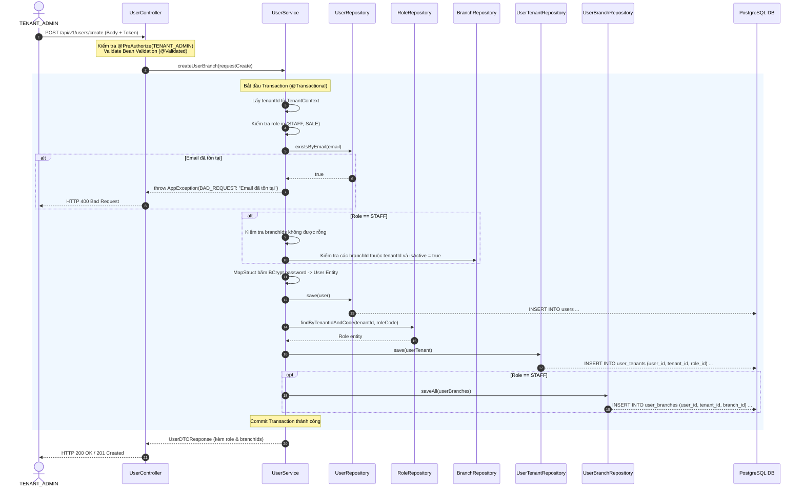

# Design Spec: Chủ Nhà Xe Tạo Tài Khoản Nhân Viên & Phân Quyền Chi Nhánh (Tenant Admin Create User & Branch Assignment)

**Ngày tạo:** 2026-10-20  
**Trạng thái:** DRAFT / APPROVED  
**Tác giả:** Dev Team & AI Assistant  
**Module:** `account-management`  

---

## 1. Tổng Quan (Overview)

Trong mô hình **SaaS Multi-Tenant & Multi-Branch** của nền tảng Car Rental:
- **Tenant (Nhà xe):** Đại diện cho một doanh nghiệp độc lập được quản lý toàn diện bởi Chủ nhà xe (`TENANT_ADMIN`).
- Sau khi nhận quyền quản trị nhà xe, `TENANT_ADMIN` chịu trách nhiệm vận hành nội bộ bằng cách tuyển dụng và cấp tài khoản cho 2 nhóm nhân sự:
  1. **Nhân viên nghiệp vụ (`STAFF` - User cấp Branch):** Trực tiếp quản lý phương tiện, bàn giao xe cho khách và nhận xe về tại các bãi xe/chi nhánh cụ thể. Do đó, nhân viên này **bắt buộc phải được phân công vào ít nhất một chi nhánh hoạt động** (`user_branches`).
  2. **Cộng tác viên kinh doanh (`SALE` - User cấp Tenant):** Tiếp cận khách hàng, tạo các đơn đặt xe (Booking) và nhận hoa hồng. Nhóm này tác nghiệp linh hoạt, không cố định bãi xe nên **không bắt buộc gán chi nhánh**.

Tài liệu này đặc tả chi tiết nghiệp vụ và thiết kế kỹ thuật của tính năng: **`TENANT_ADMIN` tạo tài khoản nhân sự trong Tenant và phân quyền chi nhánh làm việc**.

---

## 2. Yêu Cầu Nghiệp Vụ (Requirements)

### 2.1 Yêu Cầu Chức Năng (Functional Requirements)

1. **Phân quyền người gọi API (Authorization bằng Authority):**
   - Hệ thống áp dụng kiểm soát quyền chi tiết theo nguyên tử (Atomic Permissions): người gọi API quản lý tài khoản phải có quyền tương ứng (ví dụ: **`account:create`**).
   - Tuyệt đối phân lập: Nhà xe tự quản lý tài khoản nhân sự nội bộ, không dùng quyền `SUPER_ADMIN` can thiệp.
   - Cú pháp chuẩn trên Controller: `@PreAuthorize("hasAuthority('account:create')")`.
   - Các vai trò hoặc người dùng không có quyền này bị chặn ngay ở tầng Controller với mã `403 Forbidden` / `401 Unauthorized`.

2. **Cách ly dữ liệu Multi-Tenant (Data Isolation):**
   - Tuyệt đối **không nhận `tenantId` từ Request Body** của client để tránh nguy cơ tấn công IDOR.
   - Hệ thống luôn lấy `tenantId` an toàn từ phiên đăng nhập hiện tại thông qua `TenantContext.getTenantId()`.

3. **Quy tắc phân vai trò (Role Assignment Rules):**
   - Khi tạo tài khoản nhân sự, `TENANT_ADMIN` chỉ được phép chọn 1 trong 2 vai trò:
     - **`STAFF` (Giá trị: 2):** Nhân viên nghiệp vụ chi nhánh.
     - **`SALE` (Giá trị: 3):** Cộng tác viên kinh doanh.
   - **Chặn phân quyền vượt cấp:** Tuyệt đối không cho phép tạo tài khoản có vai trò `TENANT_ADMIN` hoặc `SUPER_ADMIN` qua luồng này. Nếu gửi lên sẽ bị từ chối bằng lỗi `400 Bad Request`.

4. **Quy tắc phân công chi nhánh (`user_branches`):**
   - **Đối với vai trò `STAFF`:**
     - Danh sách `branchIds` **bắt buộc không được rỗng** (`branchIds.size() >= 1`).
     - Tất cả các `branchId` gửi lên **phải thuộc quyền sở hữu của chính Nhà xe đó** (`branches.tenant_id = currentTenantId`) và đang trong trạng thái hoạt động (`is_active = true`).
     - Nếu truyền `branchId` không tồn tại hoặc thuộc nhà xe khác ➔ Báo lỗi `400 Bad Request`.
   - **Đối với vai trò `SALE`:**
     - Trường `branchIds` là tùy chọn (optional). Bỏ qua việc lưu vào bảng `user_branches`.

5. **Xử lý tài khoản & Tính toàn vẹn giao dịch (Atomic Transaction):**
   - Kiểm tra Email: Nếu email đã tồn tại trong hệ thống (`users.email`) ➔ Ném lỗi `400 Bad Request` ("Email đã tồn tại trên hệ thống").
   - Mật khẩu: Tự động mã hóa an toàn bằng thuật toán **BCrypt** thông qua MapStruct (`PasswordEncoderMapper`) trước khi ghi xuống Database.
   - Ghi dữ liệu đồng thời vào 3 bảng trong một `@Transactional`:
     1. Bảng `users`: Lưu hồ sơ người dùng (`is_active = true`, `is_super_admin = false`).
     2. Bảng `user_tenants`: Liên kết User với Nhà xe hiện tại kèm `role_id` tương ứng.
     3. Bảng `user_branches`: Lưu các chi nhánh phân công (nếu là `STAFF`).
   - Nếu có bất kỳ lỗi nào ở bước lưu chi nhánh ➔ Tự động **Rollback** toàn bộ dữ liệu của bước 1 và 2.

6. **Dữ liệu phản hồi (Response):**
   - Trả về mã HTTP `200 OK` (hoặc `201 Created`) với đầy đủ:
     - Thông tin tài khoản (`id`, `email`, `fullname`, `phone`, `isActive`).
     - Vai trò được gán (`roleCode`: "STAFF" hoặc "SALE", `roleName`).
     - Danh sách ID hoặc tóm tắt các chi nhánh đã phân công (`branchIds` / `branches`).

---

### 2.2 Ràng Buộc Dữ Liệu Đầu Vào (Input Validations)

| Trường dữ liệu | Bắt buộc | Quy tắc kiểm tra (Validation Rule) | Thông báo lỗi |
| :--- | :---: | :--- | :--- |
| **`email`** | Có | `@NotBlank`, `@Email`, độ dài <= 255 | Email không được để trống và phải đúng định dạng |
| **`password`** | Có | `@NotBlank`, `@Size(min = 8)`, tối thiểu 8 ký tự | Mật khẩu không được để trống và tối thiểu 8 ký tự |
| **`fullname`** | Có | `@NotBlank`, `@Size(max = 255)` | Họ và tên không được để trống |
| **`phone`** | Có | `@NotBlank`, Regex: `^0[35789]\d{8}$` | Số điện thoại không đúng định dạng VN (10 chữ số) |
| **`role`** | Có | `@NotNull`, chỉ nhận giá trị `2 (STAFF)` hoặc `3 (SALE)` | Vai trò không hợp lệ |
| **`branchIds`** | Với STAFF | Không được rỗng khi role = STAFF, các UUID phải hợp lệ | Nhân viên phải được gán vào ít nhất 1 chi nhánh |

---

## 3. Thiết Kế Kỹ Thuật (Technical Design)

### 3.1 Khế Ước Giao Tiếp RESTful API (API Contract)

* **Phương thức:** `POST`
* **Đường dẫn:** `/api/v1/users/create` *(hoặc chuẩn RESTful: `POST /api/v1/users`)*
* **Quyền yêu cầu:** `@PreAuthorize("hasAuthority('account:create')")`
* **Header:** `Authorization: Bearer <token>`, `Content-Type: application/json`

#### Bảng Danh Mục Quyền (Permissions) của Module Account:
| Mã quyền (`code`) | Tên quyền | Category | Gán cho Role |
| :--- | :--- | :--- | :--- |
| `account:read` | Xem thông tin nhân sự | `ACCOUNT` | `TENANT_ADMIN` |
| `account:create` | Tạo mới nhân sự | `ACCOUNT` | `TENANT_ADMIN` |
| `account:update` | Cập nhật nhân sự | `ACCOUNT` | `TENANT_ADMIN` |
| `account:delete` | Thu hồi / Xóa nhân sự | `ACCOUNT` | `TENANT_ADMIN` |
| `account:manage` | Quản trị nhân sự toàn diện | `ACCOUNT` | `TENANT_ADMIN` |

> *Lưu ý: Các quyền trên được khởi tạo và liên kết qua file migration [V7__add_account_permissions.sql](file:///d:/project%20ve%20xe/car-rental-saas/backend/src/main/resources/db/migration/V7__add_account_permissions.sql).*

#### Request Body mẫu (Tạo Nhân viên STAFF gắn chi nhánh):
```json
{
  "email": "lan.staff@rentcarhanoi.vn",
  "password": "Password123!",
  "fullname": "Trần Thị Lan",
  "phone": "0924141961",
  "avatarUrl": null,
  "role": 2,
  "branchIds": [
    "33b5b9fe-c6bc-42fa-978e-8e0ea092dc6a",
    "ea0ecc7d-bffa-40ea-9d52-3325703e7787"
  ]
}
```

#### Request Body mẫu (Tạo Cộng tác viên SALE không gắn chi nhánh):
```json
{
  "email": "ha.sale@rentcarhanoi.vn",
  "password": "Password123!",
  "fullname": "Lê Thu Hà",
  "phone": "0938334105",
  "avatarUrl": null,
  "role": 3,
  "branchIds": []
}
```

#### Response Body thành công (HTTP 200 OK / 201 Created):
```json
{
  "success": true,
  "data": {
    "id": "45fb938e-26c0-499f-abca-3e298ee0bafa",
    "email": "lan.staff@rentcarhanoi.vn",
    "fullname": "Trần Thị Lan",
    "phone": "0924141961",
    "avatarUrl": null,
    "isActive": true,
    "isSuperAdmin": false,
    "roleCode": "STAFF",
    "branchIds": [
      "33b5b9fe-c6bc-42fa-978e-8e0ea092dc6a",
      "ea0ecc7d-bffa-40ea-9d52-3325703e7787"
    ],
    "createdAt": "2026-10-20T08:30:00Z"
  },
  "message": "Thành công"
}
```

---

### 3.2 Sơ Đồ Trình Tự Nghiệp Vụ (Sequence Diagram)



---

## 4. Ma Trận Mã Lỗi (Error Matrix)

| Mã lỗi HTTP | ErrorCode | Trường hợp kích hoạt | Thông báo hiển thị |
| :---: | :--- | :--- | :--- |
| **401** | `UNAUTHORIZED` | Không có Bearer Token hoặc Token hết hạn | Chưa xác thực hoặc Token không hợp lệ |
| **403** | `FORBIDDEN` | Tài khoản gọi API không phải là `TENANT_ADMIN` | Bạn không có quyền thực hiện thao tác này |
| **400** | `BAD_REQUEST` | Email đã có tài khoản trên hệ thống | Email đã tồn tại trên hệ thống |
| **400** | `VALIDATION_ERROR` | Chọn `STAFF` nhưng danh sách `branchIds` để trống | Nhân viên phải được gán vào ít nhất 1 chi nhánh |
| **400** | `BAD_REQUEST` | Cố tình truyền role `TENANT_ADMIN` hoặc `SUPER_ADMIN` | Không được phép tạo vai trò quản trị qua luồng này |
| **400** | `RESOURCE_NOT_FOUND` | Chi nhánh trong `branchIds` không tồn tại hoặc khác Tenant | Chi nhánh được phân công không hợp lệ |

---

## 5. Rà Soát Code Hiện Tại & Danh Sách Việc Cần Làm (Code Gap & Action Items)

| Thành phần | Hiện trạng code | Việc cần điều chỉnh để khớp 100% Spec |
| :--- | :--- | :--- |
| [UserController.java](file:///d:/project%20ve%20xe/car-rental-saas/backend/src/main/java/com/carrental/car_rental_backend/account/controller/UserController.java) | Đã cập nhật `@PreAuthorize` | Đã cấu hình chuẩn `hasAuthority('account:...')` cho cả 4 endpoints (search, create, update, delete) |
| [UserService.java](file:///d:/project%20ve%20xe/car-rental-saas/backend/src/main/java/com/carrental/car_rental_backend/account/service/UserService.java#L65-L70) | Đang ném `RuntimeException("Email đã tồn tại")` | Đổi thành `throw new AppException(ErrorCode.BAD_REQUEST, "Email đã tồn tại")` |
| [UserService.java](file:///d:/project%20ve%20xe/car-rental-saas/backend/src/main/java/com/carrental/car_rental_backend/account/service/UserService.java#L68) | Chưa chặn tạo vai trò `TENANT_ADMIN` | Thêm kiểm tra: nếu `role == UserRole.TENANT_ADMIN` ➔ Báo lỗi `BAD_REQUEST` |
| [UserDTOResponse.java](file:///d:/project%20ve%20xe/car-rental-saas/backend/src/main/java/com/carrental/car_rental_backend/account/dto/UserDTOResponse.java) | Chưa có `roleCode` và `branchIds` | Bổ sung 2 trường `roleCode` và `branchIds` vào DTO |
| [UserService.java](file:///d:/project%20ve%20xe/car-rental-saas/backend/src/main/java/com/carrental/car_rental_backend/account/service/UserService.java#L90) | Chỉ trả về thông tin bảng `users` | Gán thêm `roleCode` và `branchIds` vào `UserDTOResponse` trước khi trả về |

