# 📋 ĐẶC TẢ API: MODULE TENANT

> **Phạm vi:** 9 API quản lý nhà xe (tenant) dưới `/api/v1/tenants`, chỉ dành cho **Super Admin**.
> **Cách dùng:** tra cứu đầu vào, đầu ra, lỗi của từng API. Muốn hiểu **bối cảnh, quyết định thiết kế và cách xây dựng** thì xem [kế hoạch module](2026-10-06-tenant-crud-implementation-guide.md).
> **Nguồn:** đọc từ code (`TenantController`, các DTO, `TenantServiceImpl`, `ErrorCode`). Tên biến, cấu trúc phản hồi và mã lỗi đã được **đối chiếu với phản hồi thật** khi chạy ứng dụng trên PostgreSQL thật. Mục nào chỉ suy ra từ code được ghi rõ "chưa kiểm chứng".
> **Tra nhanh:** [Luồng chủ nhà xe](#15-luồng-xử-lý-một-chủ-nhà-xe-dùng-chung-cho-api-1-và-api-8) · [Chi tiết từng API](#2-chi-tiết-từng-api) · Phụ lục: [A. Cấu trúc phản hồi](#a-cấu-trúc-phản-hồi-chung) · [B. Mã lỗi](#b-mã-lỗi-dùng-chung) · [C. Kiểu dữ liệu](#c-kiểu-dữ-liệu-dùng-chung) · [D. Đối tượng Tenant](#d-đối-tượng-tenant-xuất-hiện-ở-nhiều-phản-hồi)

---

## 1. TỔNG QUAN

### 1.1 Tổng quan 9 API

| # | Việc | Method | Đường dẫn | Mã thành công |
| :-: | :--- | :---: | :--- | :---: |
| 1 | Tạo nhà xe (kèm chủ) | `POST` | `/api/v1/tenants` | 201 |
| 2 | Danh sách nhà xe | `GET` | `/api/v1/tenants` | 200 |
| 3 | Xem một nhà xe | `GET` | `/api/v1/tenants/{tenantId}` | 200 |
| 4 | Sửa thông tin nhà xe | `PUT` | `/api/v1/tenants/{tenantId}` | 200 |
| 5 | Khóa hoặc mở khóa | `PATCH` | `/api/v1/tenants/{tenantId}/status` | 200 |
| 6 | Xóa (xóa mềm) | `DELETE` | `/api/v1/tenants/{tenantId}` | 200 |
| 7 | Xem các chủ nhà xe | `GET` | `/api/v1/tenants/{tenantId}/admins` | 200 |
| 8 | Thêm chủ nhà xe | `POST` | `/api/v1/tenants/{tenantId}/admins` | 201 |
| 9 | Tra cứu email chủ nhà xe | `POST` | `/api/v1/tenants/admin-lookup` | 200 |

### 1.2 Xác thực và phân quyền
- Mọi API cần header `Authorization: Bearer <accessToken>`.
- Token phải của tài khoản **Super Admin** (`ROLE_SUPER_ADMIN`). Chủ nhà xe, nhân viên, Sale gọi sẽ bị **403**.
- Body gửi lên dạng `Content-Type: application/json`.

### 1.3 Mỗi API đọc và ghi bảng nào

| API | `tenants` | `tenant_configs` | `roles` | `role_permissions` | `permissions` | `users` | `user_tenants` |
| :--- | :--- | :--- | :--- | :--- | :--- | :--- | :--- |
| 1. Tạo nhà xe | đọc và ghi | ghi | đọc và ghi | ghi | đọc | đọc, ghi nếu email mới | đọc và ghi |
| 2. Danh sách | đọc | | | | | | |
| 3. Xem một nhà xe | đọc | | | | | | |
| 4. Sửa | đọc và ghi | | | | | | |
| 5. Khóa hoặc mở khóa | đọc, ghi nếu đổi | | | | | | |
| 6. Xóa mềm | đọc, ghi nếu đổi | | | | | | |
| 7. Xem chủ nhà xe | đọc | | đọc | | | đọc | đọc |
| 8. Thêm chủ nhà xe | đọc | | đọc | | | đọc, ghi nếu email mới | đọc và ghi |
| 9. Tra cứu email chủ | đọc nếu có `tenantId` | | | | | đọc | đọc nếu có `tenantId` |

Ô trống nghĩa là API không chạm bảng đó. Chỉ API 1 ghi vào `tenant_configs`, `roles` và `role_permissions`.

### 1.4 Luồng chung của một request

Mọi API đều đi qua cùng các bước bảo vệ trước khi tới nghiệp vụ. Sơ đồ từng API ở mục 2 chỉ vẽ phần **từ Controller trở đi**.

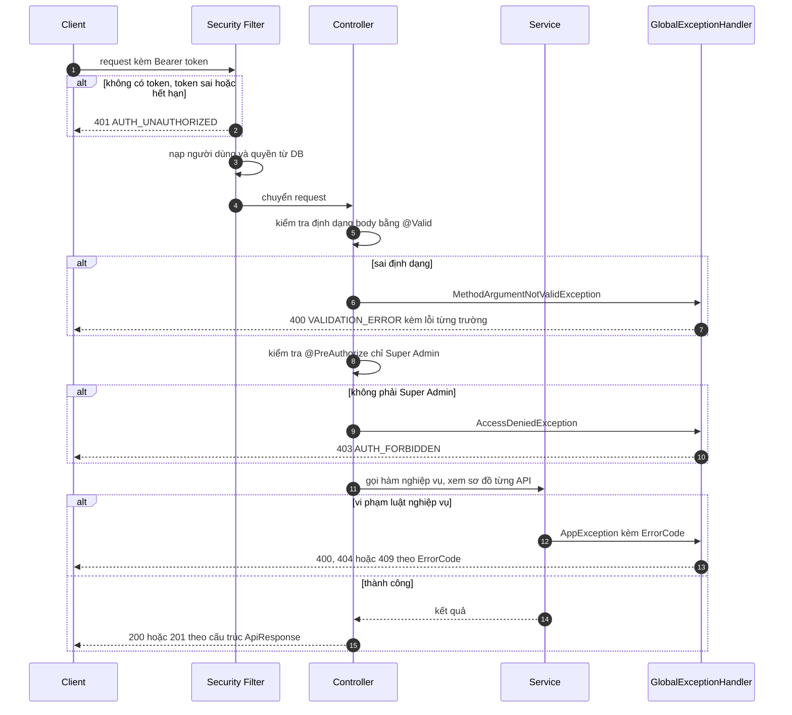

> **Chú ý thứ tự:** kiểm tra định dạng body (bước 5) chạy **trước** kiểm tra quyền (bước 8), nên người không có quyền gửi body sai nhận 400 chứ chưa phải 403.

### 1.5 Luồng xử lý một chủ nhà xe (dùng chung cho API 1 và API 8)

Việc gán chủ nhà xe dài và nhiều nhánh (luật nằm ở lớp `TenantAdminAssigner`, được `TenantServiceImpl` gọi), dùng chung cho **tạo nhà xe** (API 1) và **thêm chủ** (API 8), nên được vẽ riêng một lần ở đây. Sơ đồ của hai API chỉ ghi "xem sơ đồ mục 1.5".

Hai bước **tách rời nhau**, vẽ cho **một** chủ:
- **Bước kiểm tra** (`TenantAdminAssigner.prepareAll`): chưa ghi gì vào DB. Khi tạo nhà xe, bước này chạy cho **tất cả** chủ trước khi ghi bất cứ thứ gì.
- **Bước ghi** (`TenantAdminAssigner.assign`): tạo tài khoản nếu email mới, rồi liên kết vào nhà xe với vai trò `TENANT_ADMIN`.

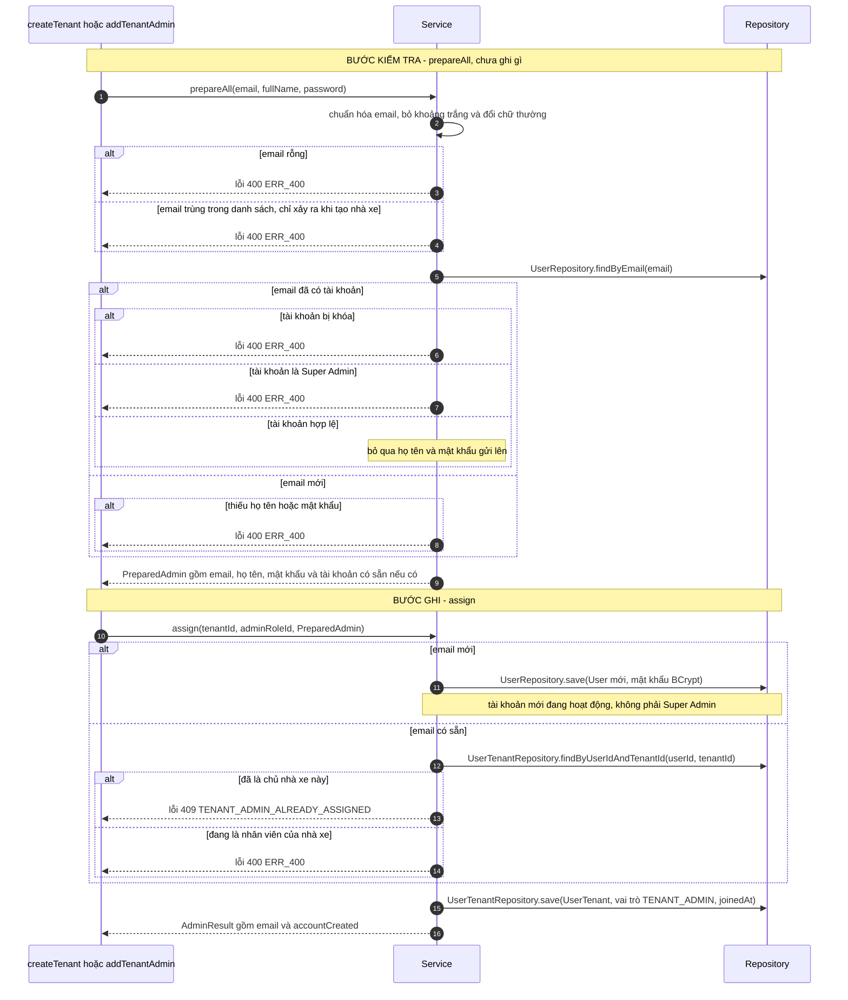
---

## 2. CHI TIẾT TỪNG API

## API 1. Tạo nhà xe: `POST /api/v1/tenants`

**Mô tả:** tạo nhà xe mới cùng cấu hình mặc định, 3 vai trò mặc định và một hoặc nhiều chủ nhà xe, trong **một giao dịch** (lỗi giữa chừng thì không lưu gì).

### Luồng xử lý

> Sơ đồ vẽ tắt: lỗi nghiệp vụ do `GlobalExceptionHandler` đổi thành phản hồi lỗi, nên mũi tên lỗi được vẽ thẳng về Client.

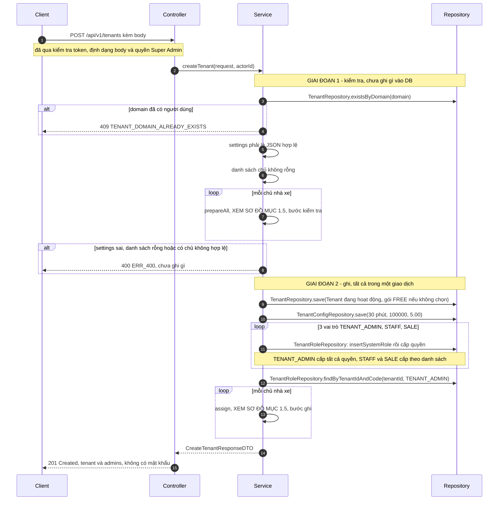

### Đầu vào (body)

| Tên biến | Kiểu | Bắt buộc | Ràng buộc | Mô tả |
| :--- | :--- | :-: | :--- | :--- |
| `name` | string | Có | Không rỗng, tối đa 255 ký tự | Tên nhà xe |
| `domain` | string | Có | Tối đa 255 ký tự; mẫu `^[a-z0-9]+([.-][a-z0-9]+)*$` (chữ thường, số, dấu chấm, gạch ngang; không bắt đầu hoặc kết thúc bằng dấu, không có hai dấu liền nhau) | Domain duy nhất toàn hệ thống |
| `planTier` | PlanTier | Không | `FREE`, `BASIC`, `PRO`, `ENTERPRISE` | Gói dịch vụ. Thiếu thì mặc định `FREE` |
| `logoUrl` | string | Không | Tối đa 500 ký tự | Địa chỉ logo |
| `contactEmail` | string | Không | Đúng dạng email | Email liên hệ |
| `contactPhone` | string | Không | Tối đa 20 ký tự | Số điện thoại liên hệ |
| `settings` | string | Không | Phải là JSON hợp lệ. Trống thì lưu `"{}"` | Cấu hình tự do, truyền dưới dạng **chuỗi** JSON |
| `admins` | array | Có | Ít nhất 1 phần tử; email không trùng nhau (không phân biệt hoa thường) | Danh sách chủ nhà xe |

**Phần tử của `admins`:**

| Tên biến | Kiểu | Bắt buộc | Ràng buộc | Mô tả |
| :--- | :--- | :-: | :--- | :--- |
| `email` | string | Có | Không rỗng, đúng dạng email, tối đa 255 ký tự | Email chủ nhà xe. Dùng để tìm tài khoản có sẵn |
| `fullName` | string | **Có điều kiện** | Tối đa 255 ký tự | Bắt buộc **khi email chưa có tài khoản**. Bị bỏ qua nếu email đã có tài khoản |
| `password` | string | **Có điều kiện** | 8 đến 72 ký tự, có ít nhất 1 chữ và 1 số | Bắt buộc **khi email chưa có tài khoản**. Bị bỏ qua nếu email đã có tài khoản |

**Ví dụ yêu cầu** (một chủ mới, một chủ đã có tài khoản):
```json
{
  "name": "Bình An Car",
  "domain": "binhan-car",
  "planTier": "BASIC",
  "contactEmail": "lienhe@binhan.vn",
  "contactPhone": "0900000001",
  "admins": [
    { "email": "chu1@binhan.vn", "fullName": "Nguyễn Văn Bình", "password": "Matkhau123" },
    { "email": "minh.admin@rentcarhanoi.vn" }
  ]
}
```

### Đầu ra: `201 Created`

| Tên biến | Kiểu | Mô tả |
| :--- | :--- | :--- |
| `data.tenant` | Tenant | Nhà xe vừa tạo (xem Phụ lục D) |
| `data.admins` | array | Kết quả từng chủ, cùng thứ tự gửi lên |
| `data.admins[].email` | string | Email đã chuẩn hóa (chữ thường, bỏ khoảng trắng) |
| `data.admins[].accountCreated` | boolean | `true` nếu tạo tài khoản mới, `false` nếu chỉ liên kết tài khoản có sẵn |

`message`: "Tạo nhà xe thành công !". **Phản hồi không bao giờ chứa mật khẩu**, kể cả bản băm.

```json
{
  "success": true,
  "data": {
    "tenant": { "id": "3f2c1b7e-...", "name": "Bình An Car", "domain": "binhan-car", "planTier": "BASIC", "isActive": true },
    "admins": [
      { "email": "chu1@binhan.vn", "accountCreated": true },
      { "email": "minh.admin@rentcarhanoi.vn", "accountCreated": false }
    ]
  },
  "message": "Tạo nhà xe thành công !"
}
```

### Lỗi

| HTTP | `error.code` | Khi nào | Thông báo |
| :-: | :--- | :--- | :--- |
| 400 | `VALIDATION_ERROR` | Dữ liệu không hợp lệ (tên rỗng, domain sai mẫu, email sai dạng, mật khẩu yếu, thiếu `admins`...) | Chi tiết theo từng trường trong `data` |
| 400 | `ERR_400` | `admins` rỗng | "Cần ít nhất một chủ nhà xe !" |
| 400 | `ERR_400` | Email trùng trong danh sách | "Email chủ nhà xe bị trùng trong danh sách: {email}" |
| 400 | `ERR_400` | Tài khoản có sẵn đang bị khóa | "Tài khoản đang bị khóa !" |
| 400 | `ERR_400` | Tài khoản có sẵn là Super Admin | "Tài khoản Super Admin không thể làm chủ nhà xe" |
| 400 | `ERR_400` | Email mới thiếu họ tên | "Vui lòng nhập họ tên cho tài khoản mới: {email}" |
| 400 | `ERR_400` | Email mới thiếu mật khẩu | "Vui lòng nhập mật khẩu cho tài khoản mới: {email}" |
| 400 | `ERR_400` | `settings` không phải JSON | "Trường settings không phải JSON hợp lệ !" |
| 409 | `TENANT_DOMAIN_ALREADY_EXISTS` | Domain đã có nhà xe khác dùng | "Domain đã được sử dụng" |
| 401, 403 | | Xem Phụ lục B | |

### Dữ liệu ghi
`tenants` (1 dòng), `tenant_configs` (1 dòng: giữ chỗ 30 phút, phí trả trễ 100000 đồng mỗi giờ, hoa hồng 5.00%), `roles` (3 dòng), `role_permissions` (22 dòng), `users` (mỗi email mới 1 dòng), `user_tenants` (mỗi chủ 1 dòng, vai trò `TENANT_ADMIN`).

---

## API 2. Danh sách nhà xe: `GET /api/v1/tenants`

**Mô tả:** liệt kê nhà xe, có tìm kiếm, lọc trạng thái và phân trang. Sắp xếp **mới nhất trước** (theo `createdAt`), không cho chọn cách sắp xếp.

### Luồng xử lý

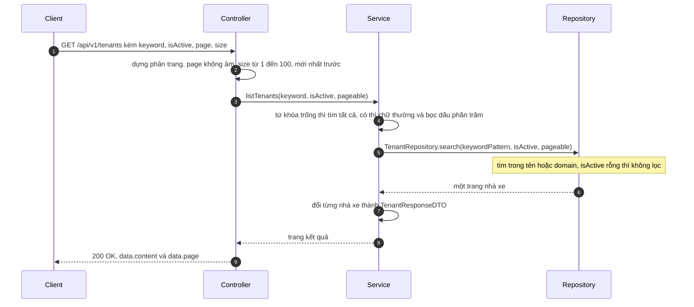

### Đầu vào (query string)

| Tên biến | Kiểu | Bắt buộc | Mặc định | Mô tả |
| :--- | :--- | :-: | :--- | :--- |
| `keyword` | string | Không | (tìm tất cả) | Tìm trong **tên hoặc domain**, không phân biệt hoa thường |
| `isActive` | boolean | Không | (không lọc) | `true` chỉ nhà xe đang hoạt động, `false` chỉ nhà xe đã khóa |
| `page` | integer | Không | `0` | Số trang, bắt đầu từ 0. Giá trị âm được đổi thành 0 |
| `size` | integer | Không | `10` | Số dòng mỗi trang, bị kẹp trong khoảng **1 đến 100** |

Ví dụ: `GET /api/v1/tenants?keyword=binh&isActive=true&page=0&size=10`

### Đầu ra: `200 OK`

| Tên biến | Kiểu | Mô tả |
| :--- | :--- | :--- |
| `data.content` | array of Tenant | Các nhà xe của trang hiện tại |
| `data.page.size` | integer | Số dòng mỗi trang đã áp dụng |
| `data.page.number` | integer | Số trang hiện tại |
| `data.page.totalElements` | integer | Tổng số nhà xe khớp điều kiện |
| `data.page.totalPages` | integer | Tổng số trang |

`message`: "Lấy danh sách nhà xe thành công !"

### Lỗi
401, 403 (xem Phụ lục B). Tham số sai kiểu (ví dụ `isActive=abc`) hiện trả **500** thay vì 400 (lỗi đã biết, xem mục 3).

---

## API 3. Xem một nhà xe: `GET /api/v1/tenants/{tenantId}`

### Luồng xử lý

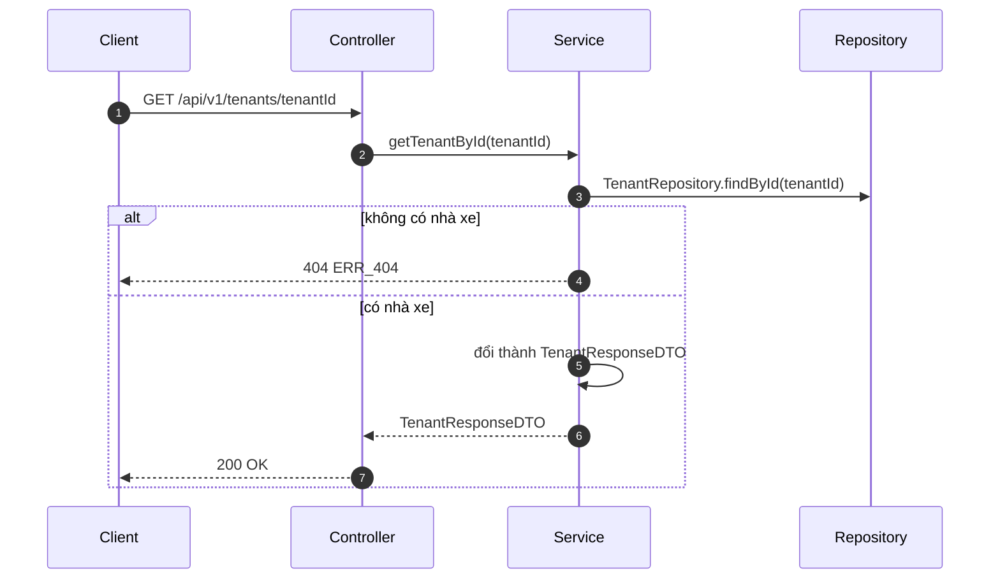

### Đầu vào (đường dẫn)

| Tên biến | Kiểu | Bắt buộc | Mô tả |
| :--- | :--- | :-: | :--- |
| `tenantId` | uuid | Có | Mã nhà xe |

### Đầu ra: `200 OK`
`data` là một đối tượng **Tenant** (xem Phụ lục D). `message`: "Lấy thông tin nhà xe thành công !"

### Lỗi
| HTTP | `error.code` | Khi nào |
| :-: | :--- | :--- |
| 404 | `ERR_404` | Không có nhà xe với mã này |
| 500 | `ERR_500` | `tenantId` không phải UUID (lỗi đã biết, nên là 400) |

---

## API 4. Sửa nhà xe: `PUT /api/v1/tenants/{tenantId}`

**Mô tả:** sửa thông tin nhà xe. **Không** sửa cấu hình vận hành (`tenant_configs`), vì cấu hình do chủ nhà xe tự sửa.

### Luồng xử lý

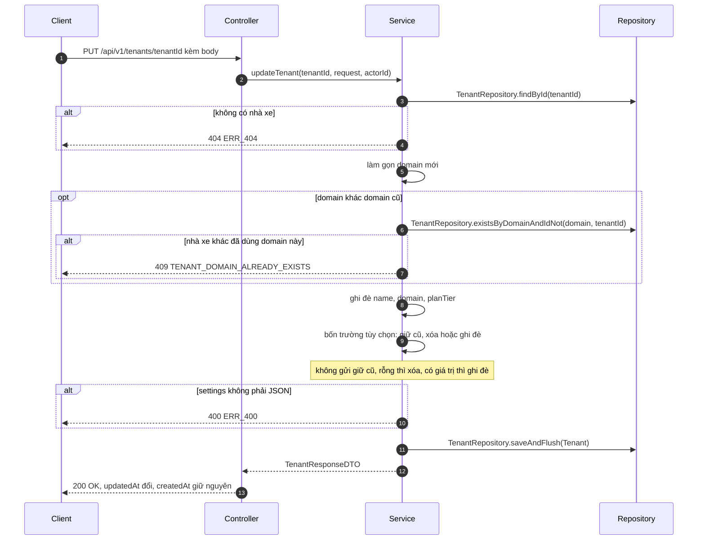

### Đầu vào (đường dẫn và body)

| Tên biến | Kiểu | Bắt buộc | Ràng buộc | Mô tả |
| :--- | :--- | :-: | :--- | :--- |
| `tenantId` (đường dẫn) | uuid | Có | | Mã nhà xe |
| `name` | string | Có | Không rỗng, tối đa 255 ký tự | Tên nhà xe. Luôn ghi đè |
| `domain` | string | Có | Như API 1 | Domain. Không đổi thì không kiểm tra trùng; đổi thì không được trùng nhà xe **khác** |
| `planTier` | PlanTier | Có | `FREE`, `BASIC`, `PRO`, `ENTERPRISE` | Gói dịch vụ. Luôn ghi đè |
| `logoUrl` | string | Không | Tối đa 500 ký tự | Xem quy tắc bên dưới |
| `contactEmail` | string | Không | Đúng dạng email | Xem quy tắc bên dưới |
| `contactPhone` | string | Không | Tối đa 20 ký tự | Xem quy tắc bên dưới |
| `settings` | string | Không | JSON hợp lệ | Xem quy tắc bên dưới |

**Quy tắc cho 4 trường không bắt buộc** (`logoUrl`, `contactEmail`, `contactPhone`, `settings`):

| Cách gửi | Kết quả |
| :--- | :--- |
| **Không gửi** hoặc `null` | **Giữ nguyên** giá trị cũ |
| **Chuỗi rỗng** hoặc toàn dấu cách | **Xóa** (thành `null`; riêng `settings` thành `"{}"`) |
| **Có giá trị** | **Ghi đè** (riêng `settings` phải là JSON hợp lệ) |

Ví dụ chỉ đổi tên và gói (4 trường kia giữ nguyên):
```json
{ "name": "Bình An Car Hà Nội", "domain": "binhan-car", "planTier": "PRO" }
```

### Đầu ra: `200 OK`
`data` là đối tượng **Tenant** sau khi sửa. `createdAt` giữ nguyên, `updatedAt` đổi. `message`: "Cập nhật nhà xe thành công !"

### Lỗi
| HTTP | `error.code` | Khi nào | Thông báo |
| :-: | :--- | :--- | :--- |
| 400 | `VALIDATION_ERROR` | Dữ liệu không hợp lệ (thiếu tên, domain, gói...) | Theo từng trường |
| 400 | `ERR_400` | `settings` không phải JSON | "Trường settings không phải JSON hợp lệ !" |
| 404 | `ERR_404` | Không có nhà xe | "Không tìm thấy nhà xe !" |
| 409 | `TENANT_DOMAIN_ALREADY_EXISTS` | Domain mới trùng nhà xe khác | "Domain đã được sử dụng" |

---

## API 5. Khóa hoặc mở khóa: `PATCH /api/v1/tenants/{tenantId}/status`

### Luồng xử lý

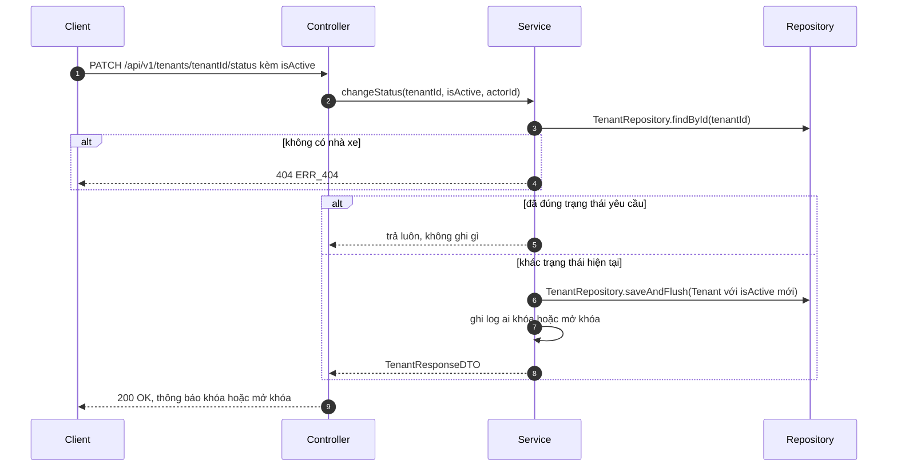

### Đầu vào

| Tên biến | Kiểu | Bắt buộc | Ràng buộc | Mô tả |
| :--- | :--- | :-: | :--- | :--- |
| `tenantId` (đường dẫn) | uuid | Có | | Mã nhà xe |
| `isActive` (body) | boolean | Có | Không được `null` | `false` để khóa, `true` để mở khóa |

Ví dụ: `{ "isActive": false }`

### Đầu ra: `200 OK`
`data` là đối tượng **Tenant** với `isActive` mới. `message`: "Khóa nhà xe thành công !" hoặc "Mở khóa nhà xe thành công !".

**Gọi lại cùng giá trị vẫn thành công** (không đổi gì, không đổi `updatedAt`). Nhà xe bị khóa: người của nhà xe không đăng nhập hoặc chọn nhà xe được; không thêm được chủ mới.

### Lỗi
| HTTP | `error.code` | Khi nào |
| :-: | :--- | :--- |
| 400 | `VALIDATION_ERROR` | Thiếu `isActive` |
| 404 | `ERR_404` | Không có nhà xe |

---

## API 6. Xóa nhà xe (xóa mềm): `DELETE /api/v1/tenants/{tenantId}`

**Mô tả:** **không xóa dòng nào**, chỉ đặt `is_active = false` (giống khóa). Lý do: xóa thật kéo theo xóa sạch chi nhánh, xe, khách, đơn của nhà xe.

### Luồng xử lý

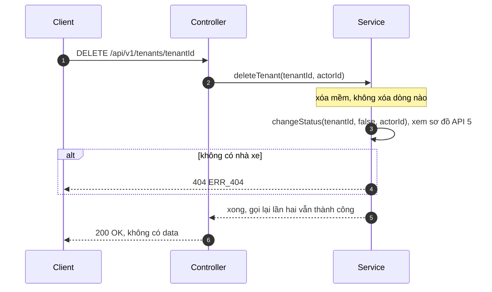

### Đầu vào

| Tên biến | Kiểu | Bắt buộc | Mô tả |
| :--- | :--- | :-: | :--- |
| `tenantId` (đường dẫn) | uuid | Có | Mã nhà xe |

### Đầu ra: `200 OK`
Không có `data`. `message`: "Đã khóa nhà xe (xóa mềm) thành công !". Gọi lần hai vẫn thành công.

### Lỗi
| HTTP | `error.code` | Khi nào |
| :-: | :--- | :--- |
| 404 | `ERR_404` | Không có nhà xe |

---

## API 7. Xem các chủ nhà xe: `GET /api/v1/tenants/{tenantId}/admins`

**Mô tả:** liệt kê các thành viên có vai trò `TENANT_ADMIN` của nhà xe, xếp theo ngày tham gia. **Chỉ xem chủ nhà xe**, không có nhân viên hay Sale.

### Luồng xử lý

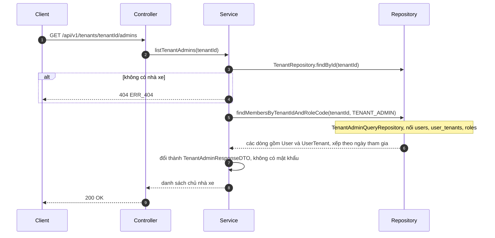

### Đầu vào

| Tên biến | Kiểu | Bắt buộc | Mô tả |
| :--- | :--- | :-: | :--- |
| `tenantId` (đường dẫn) | uuid | Có | Mã nhà xe |

### Đầu ra: `200 OK`
`data` là mảng, mỗi phần tử:

| Tên biến | Kiểu | Mô tả |
| :--- | :--- | :--- |
| `userId` | uuid | Mã tài khoản |
| `email` | string | Email |
| `fullName` | string | Họ tên |
| `isActive` | boolean | Tài khoản còn hoạt động không |
| `joinedAt` | instant | Ngày tham gia nhà xe này |

Không có mật khẩu. `message`: "Lấy danh sách chủ nhà xe thành công !"

```json
{
  "success": true,
  "data": [
    { "userId": "9b1d...", "email": "chu1@binhan.vn", "fullName": "Nguyễn Văn Bình", "isActive": true, "joinedAt": "2026-10-19T03:00:00.200000Z" }
  ],
  "message": "Lấy danh sách chủ nhà xe thành công !"
}
```

### Lỗi
| HTTP | `error.code` | Khi nào |
| :-: | :--- | :--- |
| 404 | `ERR_404` | Không có nhà xe |

---

## API 8. Thêm chủ nhà xe: `POST /api/v1/tenants/{tenantId}/admins`

**Mô tả:** thêm một chủ cho nhà xe đã có. Dùng cùng quy tắc "tìm hoặc tạo tài khoản rồi liên kết" như lúc tạo nhà xe.

### Luồng xử lý

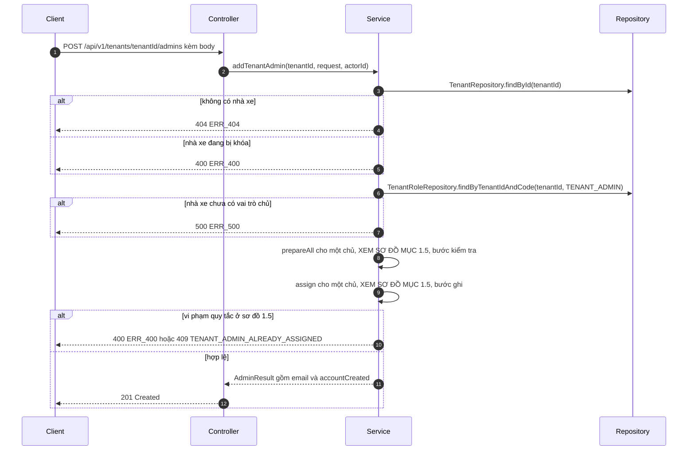

### Đầu vào

| Tên biến | Kiểu | Bắt buộc | Ràng buộc | Mô tả |
| :--- | :--- | :-: | :--- | :--- |
| `tenantId` (đường dẫn) | uuid | Có | | Mã nhà xe |
| `email` (body) | string | Có | Không rỗng, đúng dạng email, tối đa 255 ký tự | Email chủ nhà xe |
| `fullName` (body) | string | **Có điều kiện** | Tối đa 255 ký tự | Bắt buộc khi email chưa có tài khoản |
| `password` (body) | string | **Có điều kiện** | 8 đến 72 ký tự, có chữ và số | Bắt buộc khi email chưa có tài khoản |

Ví dụ: `{ "email": "chu2@binhan.vn", "fullName": "Trần Thị Hai", "password": "Matkhau456" }`

### Đầu ra: `201 Created`

| Tên biến | Kiểu | Mô tả |
| :--- | :--- | :--- |
| `data.email` | string | Email đã chuẩn hóa |
| `data.accountCreated` | boolean | `true` nếu tạo tài khoản mới, `false` nếu chỉ liên kết |

`message`: "Thêm chủ nhà xe thành công !"

### Lỗi
| HTTP | `error.code` | Khi nào | Thông báo |
| :-: | :--- | :--- | :--- |
| 400 | `VALIDATION_ERROR` | Dữ liệu không hợp lệ | Theo từng trường |
| 400 | `ERR_400` | Nhà xe đang bị khóa | "Nhà xe đang bị khóa, không thể thêm chủ nhà xe !" |
| 400 | `ERR_400` | Tài khoản có sẵn bị khóa | "Tài khoản đang bị khóa !" |
| 400 | `ERR_400` | Tài khoản có sẵn là Super Admin | "Tài khoản Super Admin không thể làm chủ nhà xe" |
| 400 | `ERR_400` | Người này đang là nhân viên (STAFF, SALE) của nhà xe | "Người này đang là nhân viên của nhà xe, chưa hỗ trợ nâng quyền" |
| 400 | `ERR_400` | Email mới thiếu họ tên | "Vui lòng nhập họ tên cho tài khoản mới: {email}" |
| 400 | `ERR_400` | Email mới thiếu mật khẩu | "Vui lòng nhập mật khẩu cho tài khoản mới: {email}" |
| 404 | `ERR_404` | Không có nhà xe | "Không tìm thấy nhà xe !" |
| 409 | `TENANT_ADMIN_ALREADY_ASSIGNED` | Đã là chủ nhà xe này | "Người này đã là chủ nhà xe của nhà xe này" |
| 500 | `ERR_500` | Nhà xe chưa có vai trò chủ (dữ liệu hỏng, ví dụ nhà xe tạo tay không qua API) | "Nhà xe chưa có nhóm quyền chủ nhà xe !" |

### Dữ liệu ghi
`users` (1 dòng nếu email mới), `user_tenants` (1 dòng, vai trò `TENANT_ADMIN`).

---

## API 9. Tra cứu email chủ nhà xe: `POST /api/v1/tenants/admin-lookup`

**Mô tả:** hỏi trước một email đã có tài khoản chưa, để giao diện biết có cần hiện ô họ tên và mật khẩu hay không, và báo sớm các trường hợp chắc chắn bị từ chối. **Chỉ đọc, không ghi gì.** Gọi trước khi gửi API 1 hoặc API 8; hai API đó vẫn tự kiểm tra lại khi nhận yêu cầu.

> **Vì sao POST dù chỉ đọc:** để email nằm trong body, không lọt vào log truy cập của máy chủ và proxy như khi nằm trên đường dẫn.

### Luồng xử lý

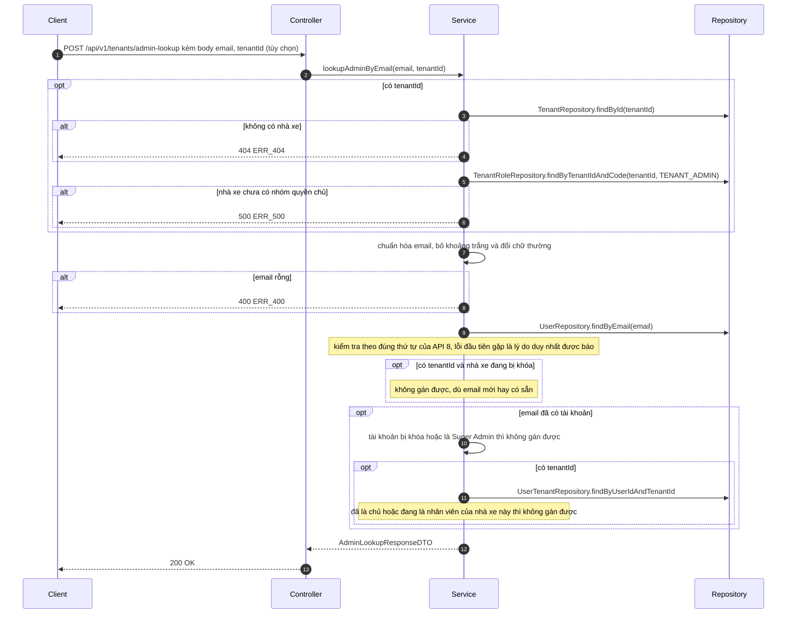

### Đầu vào (body)

| Tên biến | Kiểu | Bắt buộc | Mô tả |
| :--- | :--- | :-: | :--- |
| `email` | string | Có | Email cần tra, không rỗng, tối đa 255 ký tự. Tự bỏ khoảng trắng và đổi chữ thường |
| `tenantId` | uuid | Không | Có thì kiểm tra thêm quan hệ với nhà xe này: đã là chủ, đang là nhân viên, nhà xe bị khóa. Không có thì chỉ xét tài khoản (dùng khi tạo nhà xe mới) |

Ví dụ: `{ "email": "minh.admin@rentcarhanoi.vn", "tenantId": "3f2c1b7e-..." }`

### Đầu ra: `200 OK`

| Tên biến | Kiểu | Mô tả |
| :--- | :--- | :--- |
| `data.email` | string | Email đã chuẩn hóa |
| `data.accountExists` | boolean | Email đã có tài khoản trong hệ thống |
| `data.fullName` | string hoặc null | Họ tên của tài khoản có sẵn, `null` nếu email chưa có tài khoản |
| `data.canBeAdmin` | boolean | Gán được làm chủ nhà xe không. Email chưa có tài khoản thì `true` (sẽ tạo tài khoản mới) |
| `data.reason` | string hoặc null | Lý do không gán được, **cùng câu** với lỗi 400 hoặc 409 khi gửi API 1 hoặc API 8 (các câu này không kèm email, vì giao diện đã hiện email ở ô nhập). `null` nếu gán được |

`message`: "Tra cứu email thành công !"

**Cách giao diện dùng kết quả:**

| `accountExists` | `canBeAdmin` | Giao diện |
| :-: | :-: | :--- |
| `false` | `true` | Hiện ô họ tên và mật khẩu (bắt buộc) để tạo tài khoản mới |
| `true` | `true` | Báo "Đã có tài khoản {họ tên}", **không** hiện họ tên và mật khẩu |
| bất kỳ | `false` | Hiện `reason`, không cho gửi |

```json
{ "success": true, "data": { "email": "minh.admin@rentcarhanoi.vn", "accountExists": true, "fullName": "Nguyễn Văn Minh", "canBeAdmin": true, "reason": null }, "message": "Tra cứu email thành công !" }
```

### Lỗi
| HTTP | `error.code` | Khi nào |
| :-: | :--- | :--- |
| 400 | `VALIDATION_ERROR` | `email` rỗng hoặc quá dài |
| 400 | `MALFORMED_JSON` | Body không phải JSON hợp lệ, hoặc `tenantId` không phải UUID |
| 404 | `ERR_404` | Có `tenantId` nhưng không có nhà xe |
| 500 | `ERR_500` | Có `tenantId` nhưng nhà xe chưa có nhóm quyền chủ (dữ liệu hỏng, ví dụ nhà xe tạo tay không qua API). Xảy ra với mọi email, vì nhóm quyền chủ được lấy trước khi tra email |
| 401, 403 | | Xem Phụ lục B |

Lưu ý: kết quả chỉ để gợi ý cho giao diện. Giữa lúc tra cứu và lúc gửi, dữ liệu có thể đổi, nên API 1 và API 8 vẫn kiểm tra lại đầy đủ.

---

## 3. GIỚI HẠN ĐÃ BIẾT

Các giới hạn hiện biết (tham số sai kiểu trả 500 thay vì 400, trùng domain đồng thời, các API chưa có) được ghi ở mục [Phụ thuộc người khác](2026-10-06-tenant-crud-implementation-guide.md#5-phụ-thuộc-người-khác) của kế hoạch.

---

## PHỤ LỤC: QUY ƯỚC DÙNG CHUNG

Bốn bảng tra cứu dùng cho mọi API ở mục 2.

### A. Cấu trúc phản hồi chung
Mọi phản hồi đều có chung một cấu trúc:

| Tên biến | Kiểu | Có khi | Mô tả |
| :--- | :--- | :--- | :--- |
| `success` | boolean | Luôn có | `true` nếu thành công, `false` nếu lỗi |
| `data` | object, array hoặc null | Thành công (hoặc lỗi kiểm tra dạng) | Dữ liệu trả về. **Vắng mặt** khi không có dữ liệu |
| `message` | string | Thành công | Thông báo ngắn |
| `error` | object | Lỗi | `{ "code": string, "message": string }` |
| `timestamp` | string (ISO-8601, UTC) | Luôn có | Thời điểm tạo phản hồi |

Ví dụ thành công:
```json
{
  "success": true,
  "data": { "...": "..." },
  "message": "Tạo nhà xe thành công !",
  "timestamp": "2026-10-19T03:00:00.123456Z"
}
```
Ví dụ lỗi:
```json
{
  "success": false,
  "error": { "code": "TENANT_DOMAIN_ALREADY_EXISTS", "message": "Domain đã được sử dụng" },
  "timestamp": "2026-10-19T03:00:00.123456Z"
}
```

### B. Mã lỗi dùng chung

| HTTP | `error.code` | Khi nào | Ghi chú |
| :-: | :--- | :--- | :--- |
| 401 | `AUTH_UNAUTHORIZED` | Không có token, token sai hoặc hết hạn | Thông báo: "Bạn cần đăng nhập để thực hiện tác vụ này hoặc Token đã hết hạn !" |
| 403 | `AUTH_FORBIDDEN` | Có token nhưng không phải Super Admin | Thông báo: "Bạn không có quyền thực hiện thao tác này" |
| 400 | `VALIDATION_ERROR` | Body không hợp lệ | Có **cả** `error` (thông báo "Dữ liệu đầu vào không hợp lệ") và `data`. `data` là bản đồ `{ tên trường: thông báo lỗi }`, ví dụ `{"domain": "Domain chỉ gồm chữ thường, số, dấu chấm và gạch ngang"}`. Trường trong danh sách có dạng `admins[0].email` |
| 400 | `MALFORMED_JSON` | Body không phải JSON hợp lệ, hoặc `planTier` ngoài 4 giá trị cho phép (ví dụ `"GOLD"`) | Thông báo: "Dữ liệu JSON gửi lên không đúng định dạng" |
| 400 | `ERR_400` | Vi phạm luật nghiệp vụ | Thông báo cụ thể ghi ở từng API |
| 404 | `ERR_404` | Không tìm thấy nhà xe | Thông báo: "Không tìm thấy nhà xe !" |
| 409 | `TENANT_DOMAIN_ALREADY_EXISTS` | Domain đã có nhà xe khác dùng | Thông báo: "Domain đã được sử dụng" |
| 409 | `TENANT_ADMIN_ALREADY_ASSIGNED` | Người này đã là chủ của nhà xe này | |
| 500 | `ERR_500` | Lỗi hệ thống | Cũng là kết quả của tham số đường dẫn hoặc query sai kiểu. Xem "Lỗi đã biết" ở cuối |

> **Thứ tự kiểm tra:** Spring kiểm tra **định dạng body** (`VALIDATION_ERROR`) **trước** khi kiểm tra quyền. Người không có quyền gửi body sai sẽ nhận 400 chứ chưa phải 403.

### C. Kiểu dữ liệu dùng chung

| Kiểu | Định dạng | Ví dụ |
| :--- | :--- | :--- |
| `uuid` | Chuỗi UUID | `"3f2c1b7e-9a4d-4c11-8e5a-0d6b7c1a2f90"` |
| `instant` | ISO-8601, giờ UTC | `"2026-10-19T03:00:00.123456Z"` |
| `PlanTier` | Chuỗi, một trong: `FREE`, `BASIC`, `PRO`, `ENTERPRISE` | `"BASIC"` |

### D. Đối tượng `Tenant` (xuất hiện ở nhiều phản hồi)

| Tên biến | Kiểu | Mô tả |
| :--- | :--- | :--- |
| `id` | uuid | Mã nhà xe |
| `name` | string | Tên nhà xe |
| `domain` | string | Domain duy nhất của nhà xe |
| `planTier` | PlanTier | Gói dịch vụ |
| `logoUrl` | string hoặc null | Địa chỉ logo |
| `contactEmail` | string hoặc null | Email liên hệ |
| `contactPhone` | string hoặc null | Số điện thoại liên hệ |
| `settings` | string | Chuỗi JSON cấu hình tự do. Mặc định `"{}"` |
| `isActive` | boolean | `true` đang hoạt động, `false` đã khóa hoặc xóa mềm |
| `createdAt` | instant | Ngày tạo |
| `updatedAt` | instant | Ngày cập nhật gần nhất |

Ví dụ:
```json
{
  "id": "3f2c1b7e-9a4d-4c11-8e5a-0d6b7c1a2f90",
  "name": "Bình An Car",
  "domain": "binhan-car",
  "planTier": "BASIC",
  "logoUrl": null,
  "contactEmail": "lienhe@binhan.vn",
  "contactPhone": "0900000001",
  "settings": "{}",
  "isActive": true,
  "createdAt": "2026-10-19T03:00:00.123456Z",
  "updatedAt": "2026-10-19T03:00:00.123456Z"
}
```
