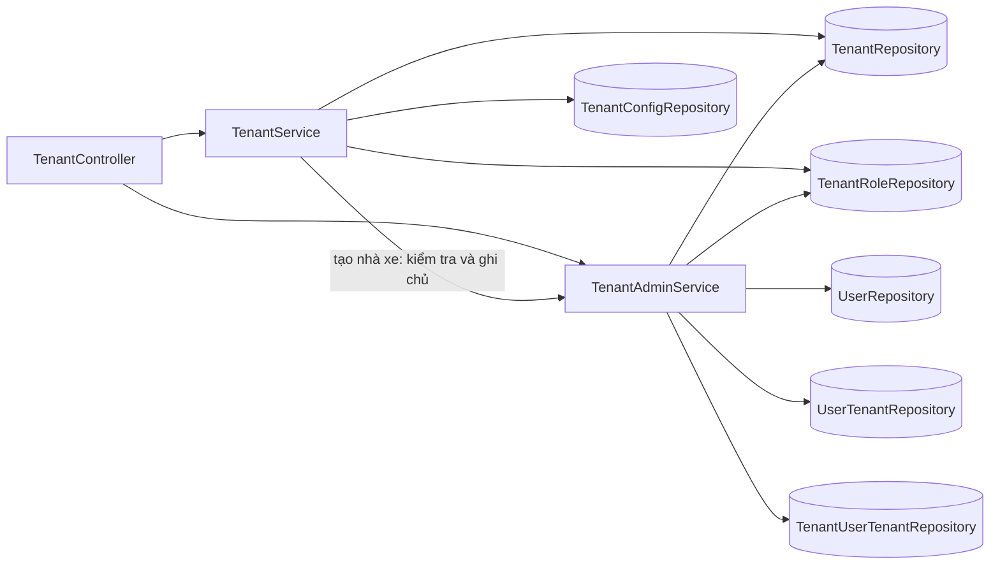
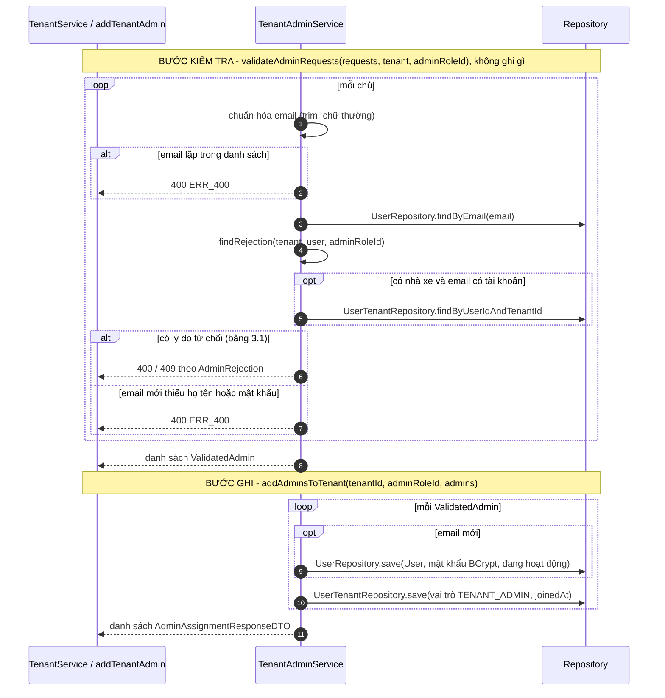
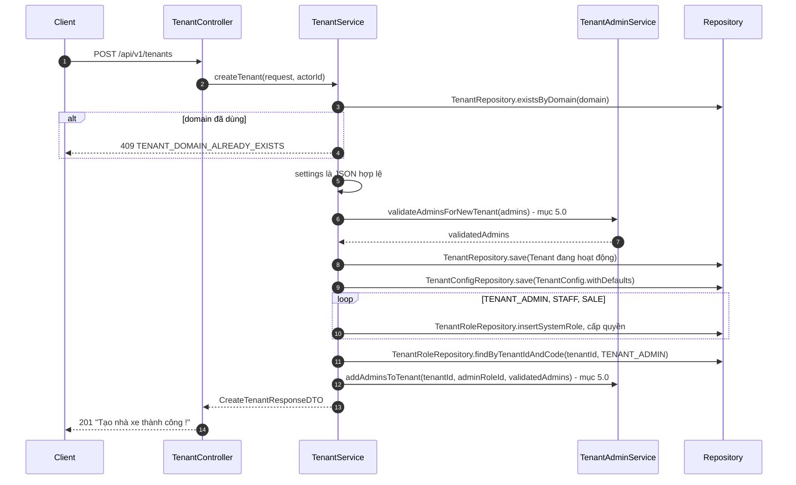
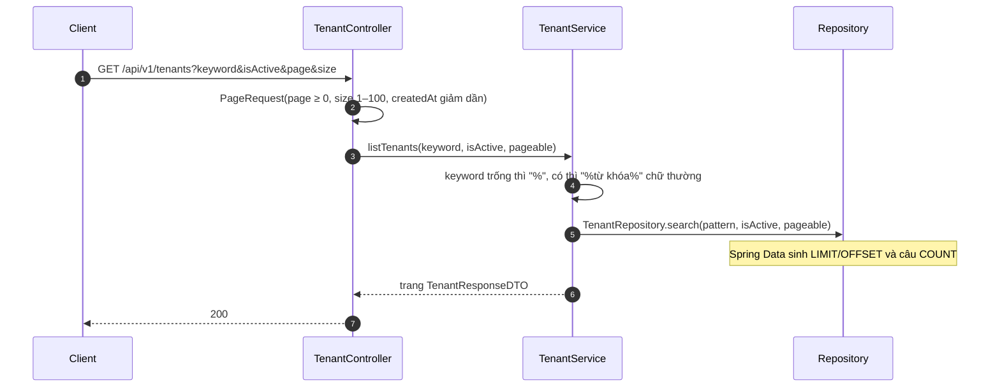
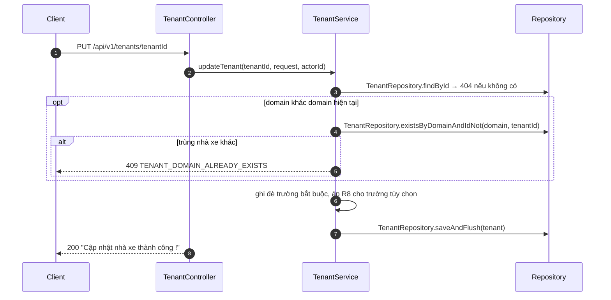
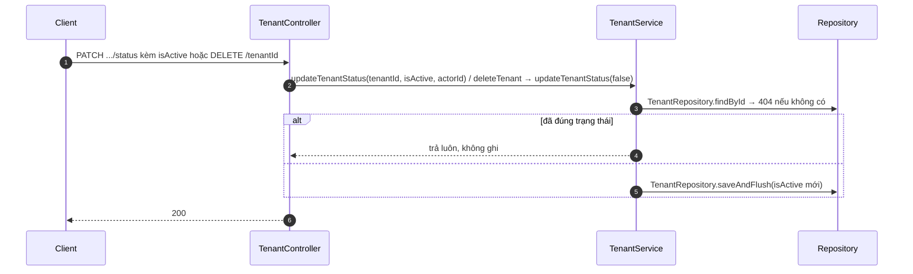
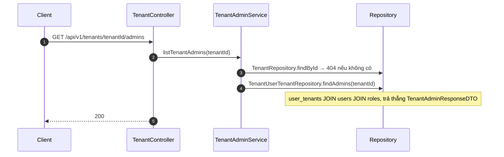
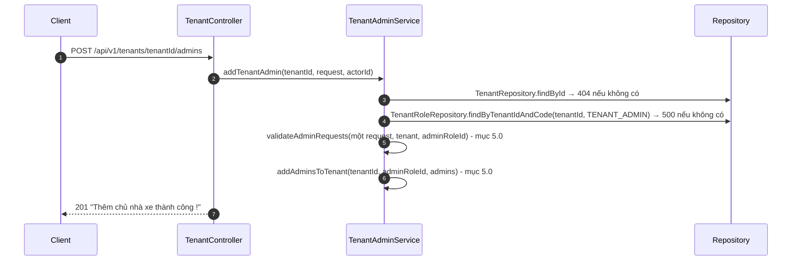
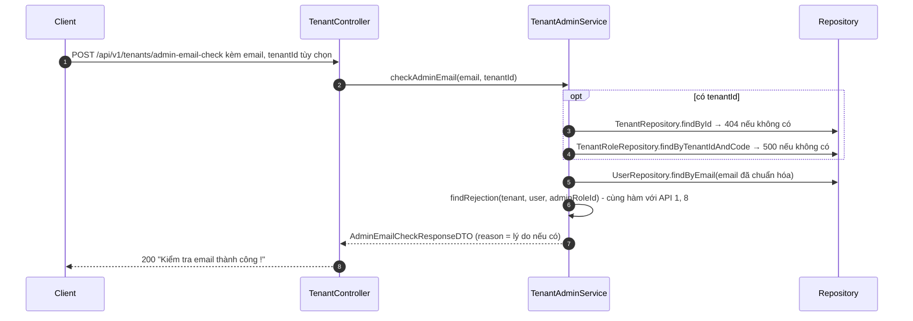

# THIẾT KẾ CHI TIẾT: MODULE TENANT

> **Phiên bản:** 1.1 · **Ngày:** 19/10/2026 · **Đối chiếu code:** 30/10/2026 · **Trạng thái:** Đã triển khai, cập nhật sau review
> **Kế hoạch triển khai:** [2026-10-06-tenant-implementation-plan.md](2026-10-06-tenant-implementation-plan.md)

---

## 1. TỔNG QUAN

**Mục đích:** Super Admin tạo và quản lý nhà xe (tenant) cùng chủ nhà xe (TENANT_ADMIN).
**Ngoài phạm vi:** cấu hình vận hành `tenant_configs` (chủ nhà xe tự sửa), quản lý nhân viên, đổi vai trò thành viên.
Cấu hình vận hành do chủ nhà xe chỉnh, quota theo gói, gỡ/đổi chủ và audit dạng bảng không thuộc 9 API hiện tại; cần thiết kế riêng trước khi triển khai.

| # | API | Method | Đường dẫn | Thành công |
| :-: | :--- | :-: | :--- | :-: |
| 1 | Tạo nhà xe kèm chủ | `POST` | `/api/v1/tenants` | 201 |
| 2 | Danh sách nhà xe | `GET` | `/api/v1/tenants` | 200 |
| 3 | Chi tiết nhà xe | `GET` | `/api/v1/tenants/{tenantId}` | 200 |
| 4 | Sửa nhà xe | `PUT` | `/api/v1/tenants/{tenantId}` | 200 |
| 5 | Khóa / mở khóa | `PATCH` | `/api/v1/tenants/{tenantId}/status` | 200 |
| 6 | Xóa mềm | `DELETE` | `/api/v1/tenants/{tenantId}` | 200 |
| 7 | Danh sách chủ nhà xe | `GET` | `/api/v1/tenants/{tenantId}/admins` | 200 |
| 8 | Thêm chủ nhà xe | `POST` | `/api/v1/tenants/{tenantId}/admins` | 201 |
| 9 | Kiểm tra email trước khi thêm chủ | `POST` | `/api/v1/tenants/admin-email-check` | 200 |

### 1.1 Quy tắc nghiệp vụ

| Mã | Quy tắc | API |
| :-: | :--- | :-: |
| R1 | Domain duy nhất toàn hệ thống | 1, 4 |
| R2 | Tạo nhà xe kèm cấu hình mặc định và 3 vai trò có quyền, trong một giao dịch | 1 |
| R3 | Nhà xe mới có từ 1 đến 10 chủ; email không lặp trong cùng một lần gửi | 1 |
| R4 | Email mới: bắt buộc họ tên, mật khẩu, tạo tài khoản. Email có sẵn: chỉ liên kết, không đổi họ tên hay mật khẩu | 1, 8 |
| R5 | Không làm chủ được nếu: tài khoản bị khóa, là Super Admin, nhà xe bị khóa, đã là chủ (409), đã có vai trò khác trong nhà xe (STAFF, SALE hoặc vai trò tự tạo) | 1, 8, 9 |
| R6 | Kiểm tra hết mọi chủ rồi mới ghi | 1 |
| R7 | Xóa là xóa mềm (`is_active = false`); đặt trạng thái đang có vẫn thành công | 5, 6 |
| R8 | Khi sửa: trường tùy chọn `null` giữ nguyên, chuỗi rỗng xóa | 4 |
| R9 | Kiểm tra email trả lý do giống hệt lỗi thật của API 1, 8 | 9 |

---

## 2. THIẾT KẾ DỮ LIỆU

Không thay đổi schema.

| Bảng | Ràng buộc liên quan |
| :--- | :--- |
| `tenants` | `domain` UNIQUE; `plan_tier` 1–4; khóa ngoại từ bảng khác `ON DELETE CASCADE` (lý do xóa mềm) |
| `tenant_configs` | PK `tenant_id` (1–1 với `tenants`) |
| `roles` | Duy nhất theo `(tenant_id, code)`; mỗi nhà xe một bộ vai trò |
| `role_permissions`, `permissions` | Quyền dùng chung, gán theo vai trò |
| `users` | `email` UNIQUE |
| `user_tenants` | PK `(user_id, tenant_id)`: mỗi người một vai trò trong một nhà xe |

**Dữ liệu khởi tạo khi tạo nhà xe (API 1):**
- `tenant_configs`: giữ chỗ 30 phút, phí trễ 100.000 đ/giờ, hoa hồng 5,00%.
- `roles` + `role_permissions`: TENANT_ADMIN (toàn bộ danh mục quyền hiện tại), STAFF (7 quyền), SALE (4 quyền). Với seed V5 hiện tại: 11 + 7 + 4 = 22 liên kết; 11/22 không phải hạn mức cố định.

**Bảng bị ghi theo API:**

| API | Ghi |
| :-: | :--- |
| 1 | `tenants`, `tenant_configs`, `roles`, `role_permissions`, `users` (email mới), `user_tenants` |
| 4, 5, 6 | `tenants` (5, 6 chỉ ghi khi trạng thái đổi) |
| 8 | `users` (email mới), `user_tenants` |
| 2, 3, 7, 9 | Chỉ đọc |

---

## 3. THIẾT KẾ THÀNH PHẦN



| Thành phần | Trách nhiệm |
| :--- | :--- |
| `TenantController` | HTTP, `@Valid`, chỉ Super Admin (`@PreAuthorize` cấp lớp), dựng phân trang |
| `TenantService` | API 1–6: nhà xe, cấu hình mặc định, vai trò mặc định |
| `TenantAdminService` | API 7–9 và hai bước dùng chung cho API 1: **kiểm tra** chủ, **ghi** chủ |
| `AdminRejection` (enum) | Các lý do không thể làm chủ, kèm mã lỗi và thông báo (bảng 3.1) |
| `ValidatedAdmin` (record lồng trong `TenantAdminService`) | Một chủ đã qua kiểm tra, truyền từ bước kiểm tra sang bước ghi: email đã chuẩn hóa, họ tên, mật khẩu, tài khoản có sẵn hoặc `null` |

**Repository cho bảng của module account:** truy vấn chỉ module tenant dùng trên `roles`, `user_tenants` đặt trong module tenant (`TenantRoleRepository`, `TenantUserTenantRepository`), không thêm vào repository của account đang phát triển song song. Quy tắc tên: entity của module mình `<Entity>Repository`, entity của module khác `Tenant<Entity>Repository` (không trùng tên để tránh trùng bean).

**Giao dịch:** hai service gắn `@Transactional` cấp lớp, hàm chỉ đọc dùng `readOnly = true`. API 1 gọi sang `TenantAdminService` trong cùng giao dịch, lỗi ở bất kỳ bước nào thì rollback toàn bộ.

**Tài khoản có sẵn:** chỉ cần gửi `email`. `fullName`/`password` có thể không gửi hoặc `null`; nếu gửi giá trị thì vẫn phải qua validation DTO (tên ≤255, mật khẩu 8–72 ký tự có chữ và số, tối đa 72 byte UTF-8). Sau validation, Service chỉ liên kết, không đổi họ tên/mật khẩu của tài khoản. Chuỗi mật khẩu rỗng, yếu hoặc vượt giới hạn byte vẫn trả 400 `VALIDATION_ERROR`, kể cả email đã tồn tại.

**Validation và log mật khẩu:** `@MaxUtf8Bytes(72)` dùng validator trong `tenant/validation`, đo số byte UTF-8 trước khi gọi Service. `null` được bỏ qua ở validator; điều kiện mật khẩu bắt buộc cho email mới vẫn do Service kiểm tra. DTO dùng `@ToString.Exclude` của Lombok cho `password`, áp dụng cả khi DTO nằm trong `admins` của request tạo nhà xe. Đây là bảo vệ `toString()`, không thay thế việc tránh ghi body thô và dữ liệu validation nhạy cảm vào log. Không thay đổi exception dùng chung.

**Luồng tạo dễ đọc:** `createTenant` gọi `validateAdminsForNewTenant(request.getAdmins())`; helper chuyển sang bước kiểm tra dùng chung với ngữ cảnh tenant/role chưa có. Danh sách đầu ra tên `validatedAdmins`. `createDefaultRoles` trả `void`; lấy `adminRoleId` bằng `findAdminRoleOrThrow` ở bước kế tiếp. Vòng lặp enum dùng tên `defaultRole`.

### 3.1 `AdminRejection`: lý do không thể làm chủ (R5)

Kiểm tra theo thứ tự dưới, gặp lý do đầu tiên thì dừng. API 1, 8 ném lỗi; API 9 trả lý do trong `reason`.

| Thứ tự | Lý do | Điều kiện | HTTP | `error.code` | Thông báo |
| :-: | :--- | :--- | :-: | :--- | :--- |
| 1 | `TENANT_LOCKED` | Có nhà xe và nhà xe bị khóa | 400 | `ERR_400` | Nhà xe đang bị khóa, không thể thêm chủ nhà xe ! |
| 2 | `ACCOUNT_LOCKED` | Email có tài khoản, tài khoản bị khóa | 400 | `ERR_400` | Tài khoản đang bị khóa ! |
| 3 | `SUPER_ADMIN` | Tài khoản là Super Admin | 400 | `ERR_400` | Tài khoản Super Admin không thể làm chủ nhà xe |
| 4 | `ALREADY_ADMIN` | Đã là chủ của nhà xe này | 409 | `TENANT_ADMIN_ALREADY_ASSIGNED` | Người này đã là chủ nhà xe của nhà xe này |
| 5 | `HAS_OTHER_ROLE` | Đã có vai trò khác TENANT_ADMIN trong nhà xe này (STAFF, SALE hoặc vai trò tự tạo) | 400 | `ERR_400` | Người này đang là nhân viên của nhà xe, chưa hỗ trợ nâng quyền |

Lý do 1, 4, 5 chỉ xét khi có nhà xe (API 8, API 9 có `tenantId`). Khi tạo nhà xe mới chỉ xét 2, 3.

---

## 4. QUY ƯỚC CHUNG

- **Xác thực:** header `Authorization: Bearer <accessToken>` của tài khoản Super Admin. Body dạng `application/json`.
- **Thứ tự kiểm tra:** token → định dạng body (`@Valid`) → quyền → nghiệp vụ. Người không có quyền gửi body sai nhận 400 trước 403.

**Cấu trúc phản hồi:**
```json
{ "success": true, "data": {}, "message": "...", "timestamp": "2026-10-19T03:00:00Z" }
{ "success": false, "error": { "code": "TENANT_DOMAIN_ALREADY_EXISTS", "message": "Domain đã được sử dụng" }, "timestamp": "..." }
```
`data` vắng mặt khi không có dữ liệu. Lỗi `VALIDATION_ERROR` có thêm `data` là `{ tên trường: thông báo }`, ví dụ `admins[0].email`.

**Lỗi dùng chung cho mọi API** (không nhắc lại ở mục 5):

| HTTP | `error.code` | Khi nào |
| :-: | :--- | :--- |
| 400 | `VALIDATION_ERROR` | Body vi phạm ràng buộc ở bảng đầu vào |
| 400 | `MALFORMED_JSON` | Body không phải JSON, `planTier` ngoài 4 giá trị, `tenantId` trong body không phải UUID |
| 400 | `ERR_400` | Tham số đường dẫn hoặc query sai kiểu (`tenantId` không phải UUID, `isActive=abc`) |
| 401 | `AUTH_UNAUTHORIZED` | Không có token, token sai hoặc hết hạn |
| 403 | `AUTH_FORBIDDEN` | Không phải Super Admin |
| 404 | `ERR_404` | Không có nhà xe (mọi API có `tenantId`): "Không tìm thấy nhà xe !" |

**Xung đột ghi đồng thời — phụ thuộc module chung:** hai request có thể cùng qua bước kiểm tra rồi va chạm UNIQUE của DB. Giao dịch thất bại được rollback, nhưng hiện lỗi tại bước ghi trả 500 `ERR_500`. Trùng domain hoặc trùng chủ được Service phát hiện trước khi ghi vẫn trả 409 như đặc tả. Không sửa `GlobalExceptionHandler` hoặc `ErrorCode` trong phạm vi Tenant vì thuộc phần của người khác. Việc ánh xạ lỗi DB sang 409 cần phối hợp với người phụ trách module chung trước khi triển khai; không cam kết 409 cho tranh chấp tại bước ghi ở phiên bản hiện tại.

**Kiểu dữ liệu:** `uuid`; `instant` (ISO-8601, UTC); `PlanTier` = `FREE` \| `BASIC` \| `PRO` \| `ENTERPRISE`.

**Đối tượng `Tenant`** (dùng trong phản hồi API 1–5):

| Trường | Kiểu | Ghi chú |
| :--- | :--- | :--- |
| `id` | uuid | |
| `name`, `domain` | string | |
| `planTier` | PlanTier | |
| `logoUrl`, `contactEmail`, `contactPhone` | string \| null | |
| `settings` | string | Chuỗi JSON, mặc định `"{}"` |
| `isActive` | boolean | `false` = đã khóa hoặc xóa mềm |
| `createdAt`, `updatedAt` | instant | |

---

## 5. ĐẶC TẢ API

### 5.0 Luồng dùng chung: kiểm tra và ghi chủ nhà xe (API 1, API 8)



**Lỗi của luồng này** (ngoài bảng 3.1):

| HTTP | `error.code` | Thông báo |
| :-: | :--- | :--- |
| 400 | `ERR_400` | Email chủ nhà xe bị trùng trong danh sách: {email} |
| 400 | `ERR_400` | Vui lòng nhập họ tên cho tài khoản mới: {email} |
| 400 | `ERR_400` | Vui lòng nhập mật khẩu cho tài khoản mới: {email} |

---

### API 1. Tạo nhà xe: `POST /api/v1/tenants` → 201

| Trường | Kiểu | Bắt buộc | Ràng buộc |
| :--- | :--- | :-: | :--- |
| `name` | string | Có | ≤ 255 |
| `domain` | string | Có | ≤ 255, mẫu `^[a-z0-9]+([.-][a-z0-9]+)*$` |
| `planTier` | PlanTier | Không | Mặc định `FREE` |
| `logoUrl` | string | Không | ≤ 500 |
| `contactEmail` | string | Không | Định dạng email, tối đa 255 ký tự (áp dụng cả API sửa) |
| `contactPhone` | string | Không | ≤ 20 |
| `settings` | string | Không | JSON hợp lệ; trống thì `"{}"` |
| `admins` | array | Có | 1–10 phần tử, mỗi phần tử là object không null |
| `admins[].email` | string | Có | Định dạng email, ≤ 255 |
| `admins[].fullName` | string | Khi email mới | ≤ 255 nếu gửi; không cập nhật tài khoản có sẵn |
| `admins[].password` | string | Khi email mới | 8–72 ký tự, có chữ và số, tối đa 72 byte UTF-8 nếu gửi; không cập nhật tài khoản có sẵn |

```json
{
  "name": "Bình An Car", "domain": "binhan-car", "planTier": "BASIC",
  "admins": [
    { "email": "chu1@binhan.vn", "fullName": "Nguyễn Văn Bình", "password": "Matkhau123" },
    { "email": "minh.admin@rentcarhanoi.vn" }
  ]
}
```

**Đầu ra:** `data.tenant` (Tenant), `data.admins[]` gồm `email` (đã chuẩn hóa) và `accountCreated` (`true` nếu tạo tài khoản mới), cùng thứ tự gửi lên. Không bao giờ trả mật khẩu.

**Lỗi riêng:** 409 `TENANT_DOMAIN_ALREADY_EXISTS` "Domain đã được sử dụng"; 400 `ERR_400` "Trường settings không phải JSON hợp lệ !"; lỗi của luồng 5.0 và bảng 3.1 (lý do 2, 3).



---

### API 2. Danh sách nhà xe: `GET /api/v1/tenants` → 200

| Query | Kiểu | Mặc định | Ghi chú |
| :--- | :--- | :--- | :--- |
| `keyword` | string | tất cả | Tìm trong tên hoặc domain, không phân biệt hoa thường |
| `isActive` | boolean | không lọc | |
| `page` | integer | 0 | Âm thì về 0 |
| `size` | integer | 10 | Kẹp trong 1–100 |

Sắp xếp `createdAt` giảm dần, cố định.
**Đầu ra:** `data.content[]` (Tenant), `data.page` gồm `size`, `number`, `totalElements`, `totalPages`.



---

### API 3. Chi tiết nhà xe: `GET /api/v1/tenants/{tenantId}` → 200

**Đầu ra:** `data` là Tenant. Tìm `TenantRepository.findById`, không có thì 404.

---

### API 4. Sửa nhà xe: `PUT /api/v1/tenants/{tenantId}` → 200

| Trường | Bắt buộc | Cập nhật |
| :--- | :-: | :--- |
| `name`, `domain`, `planTier` | Có | Luôn ghi đè. Ràng buộc như API 1 |
| `logoUrl`, `contactEmail`, `contactPhone`, `settings` | Không | `null` / không gửi: giữ nguyên · chuỗi rỗng: xóa (`settings` thành `"{}"`) · có giá trị: ghi đè |

**Đầu ra:** Tenant sau khi sửa (`updatedAt` mới).
**Lỗi riêng:** 409 `TENANT_DOMAIN_ALREADY_EXISTS`; 400 `ERR_400` settings không phải JSON.



---

### API 5. Khóa / mở khóa: `PATCH /api/v1/tenants/{tenantId}/status` → 200
### API 6. Xóa mềm: `DELETE /api/v1/tenants/{tenantId}` → 200

- API 5: body `{ "isActive": boolean }` (bắt buộc). Trả Tenant; thông báo "Khóa nhà xe thành công !" hoặc "Mở khóa nhà xe thành công !".
- API 6: không có body. Gọi API 5 với `isActive = false`, không trả `data`; thông báo "Đã khóa nhà xe (xóa mềm) thành công !".
- Nhà xe bị khóa: thành viên không đăng nhập/chọn được nhà xe, không thêm được chủ mới. Request mới mang access token của tenant bị khóa cũng bị `CustomUserDetailsServiceImpl` từ chối 403 `AUTH_FORBIDDEN`, kể cả token chưa hết hạn. Không hủy ngược request đã qua filter trước thời điểm khóa; không ảnh hưởng token của nhà xe khác hoặc Super Admin.



---

### API 7. Danh sách chủ nhà xe: `GET /api/v1/tenants/{tenantId}/admins` → 200

**Đầu ra:** `data[]` gồm `userId` (uuid), `email`, `fullName`, `isActive` (boolean), `joinedAt` (instant), sắp theo `joinedAt` tăng dần. Chỉ vai trò TENANT_ADMIN.



---

### API 8. Thêm chủ nhà xe: `POST /api/v1/tenants/{tenantId}/admins` → 201

**Đầu vào:** `email`, `fullName`, `password`, ràng buộc như `admins[]` của API 1.
**Đầu ra:** `data.email`, `data.accountCreated`.
**Lỗi riêng:** lỗi của luồng 5.0, bảng 3.1 (cả 5 lý do); 500 `ERR_500` "Nhà xe chưa có nhóm quyền chủ nhà xe !" nếu dữ liệu nhà xe thiếu vai trò TENANT_ADMIN.



---

### API 9. Kiểm tra email: `POST /api/v1/tenants/admin-email-check` → 200

Chỉ đọc. Kết quả phản ánh thời điểm gọi, không giữ chỗ email; API 1/8 vẫn validation và kiểm tra lại khi ghi. Giao diện gọi trước khi gửi API 1 hoặc 8 để biết có cần nhập họ tên, mật khẩu không. Dùng POST để email nằm trong body, không lộ vào log đường dẫn.

| Trường | Kiểu | Bắt buộc | Ghi chú |
| :--- | :--- | :-: | :--- |
| `email` | string | Có | ≤ 255 |
| `tenantId` | uuid | Không | Có thì xét thêm lý do 1, 4, 5 (bảng 3.1). Không có: dùng khi tạo nhà xe mới |

| Đầu ra | Kiểu | Ghi chú |
| :--- | :--- | :--- |
| `email` | string | Đã chuẩn hóa |
| `accountExists` | boolean | Email đã có tài khoản |
| `fullName` | string \| null | Họ tên tài khoản có sẵn |
| `canBeAdmin` | boolean | `true` khi không gặp lý do từ chối ở bảng 3.1; email mới kèm tenant bị khóa vẫn là `false` |
| `reason` | string \| null | Thông báo theo bảng 3.1 khi `canBeAdmin = false` |

**Lỗi riêng:** 500 `ERR_500` khi có `tenantId` mà nhà xe thiếu vai trò TENANT_ADMIN.



---

## 6. GIỚI HẠN ĐÃ BIẾT VÀ VIỆC CẦN QUYẾT ĐỊNH

| # | Vấn đề | Hiện trạng | Đề xuất |
| :-: | :--- | :--- | :--- |
| 1 | Hai yêu cầu đồng thời trùng domain/email/thành viên | UNIQUE chặn dữ liệu trùng, rollback giao dịch; lỗi tại bước ghi hiện trả 500 | Phối hợp người phụ trách module chung về ánh xạ 409; không sửa exception chung trong module Tenant |
| 2 | Hai người cùng sửa một nhà xe | Người ghi sau ghi đè | Thêm `@Version` (cần migration) |
| 3 | `settings` | Giao diện đã bỏ ô nhập, backend vẫn nhận | Giữ cho sau này hay bỏ khỏi API? |
| 4 | API 5 (`isActive=false`) và API 6 làm cùng một việc | Giữ cả hai | Giữ `DELETE` cho đúng REST, hay bỏ? |
| 5 | Đổi Entity sang DTO bằng tay | | Chuyển sang MapStruct (thêm dependency cho cả dự án) |
| 6 | 4/5 lý do ở bảng 3.1 dùng chung `ERR_400` | Client không phân biệt được nếu không so câu chữ | Mã riêng: `TENANT_LOCKED`, `ACCOUNT_LOCKED`, `INVALID_OPERATION` (Super Admin, có vai trò khác; theo mục 8.1 onboarding). Frontend và test hiện không phụ thuộc `ERR_400` |
| 7 | Câu thông báo của `HAS_OTHER_ROLE` gọi cả SALE là "nhân viên" | | "Người này đã có vai trò khác trong nhà xe, chưa hỗ trợ đổi vai trò" (đổi câu là đổi API) |
