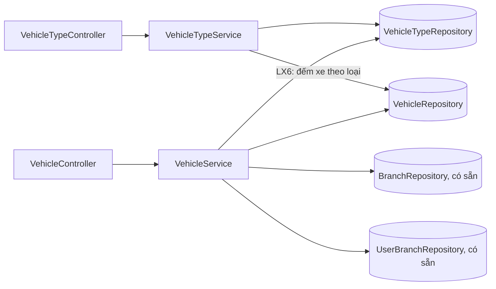
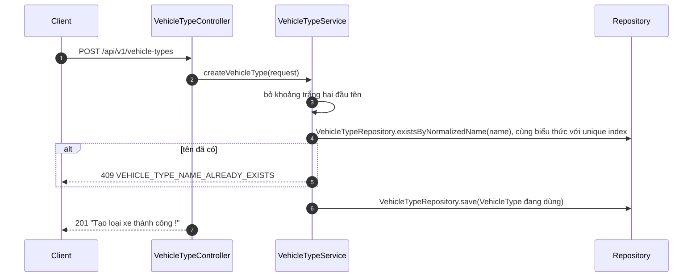
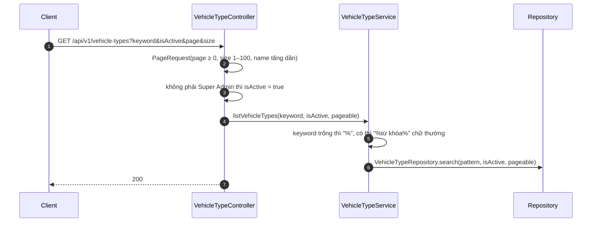
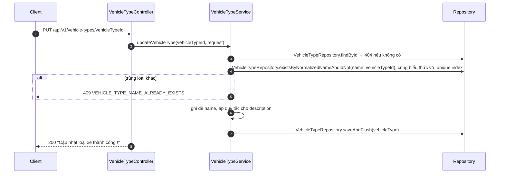
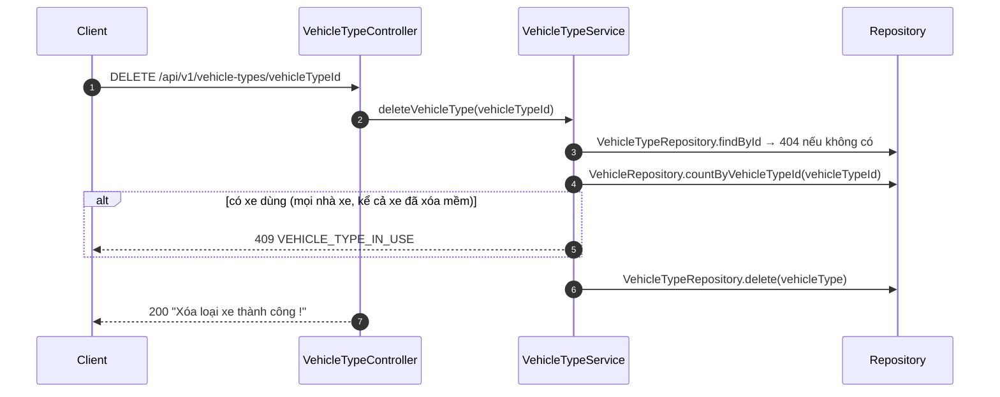
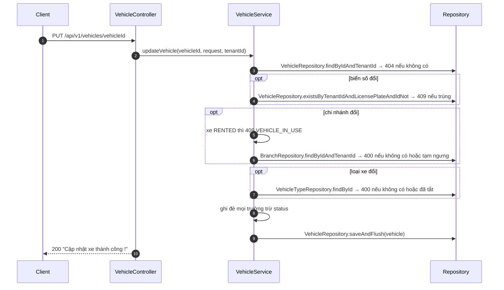
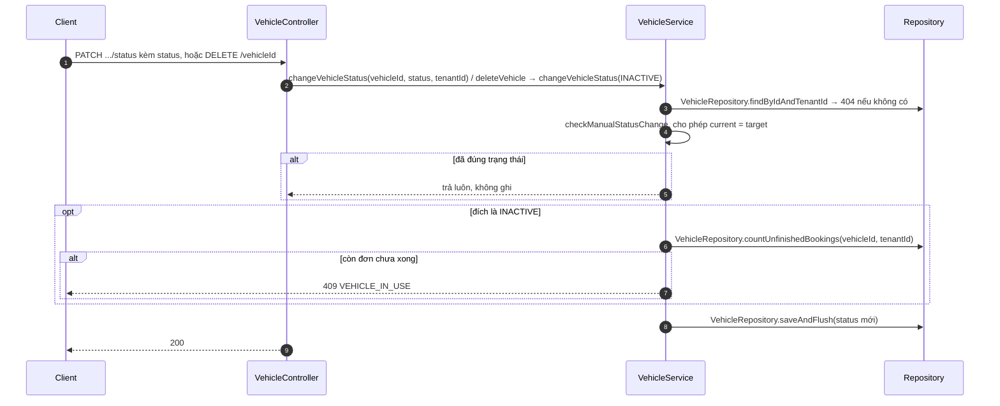

# THIẾT KẾ CHI TIẾT: MODULE LOẠI XE VÀ XE

> **Phiên bản:** 0.3 · **Ngày:** 05/11/2026 · **Cập nhật:** 09/11/2026, bổ sung quyền chi nhánh STAFF, bảo đảm tên loại xe duy nhất và thống nhất giữ nguyên trạng thái · **Trạng thái:** Bản nháp, chưa triển khai, chờ nhóm xác nhận mục 7
> **Đặc tả API:** [2026-11-05-vehicle-api-spec.md](2026-11-05-vehicle-api-spec.md) · **Kế hoạch triển khai:** [2026-11-05-vehicle-implementation-plan.md](2026-11-05-vehicle-implementation-plan.md)
> **Khuôn tham khảo:** bộ tài liệu module tenant trong `docs/plans/tenant/`

---

> **Nguồn chuẩn:** hợp đồng API và quy tắc nghiệp vụ theo file này; khi các tài liệu khác nhau thì theo file này. Mục 6 liệt kê chỗ khác với `onboarding.md` §9.4 và lý do.

## 1. TỔNG QUAN

**Mục đích:**
- **Loại xe** (`vehicle_types`): danh mục phân khúc dùng chung toàn hệ thống (Sedan, SUV...). Super Admin quản lý, người của nhà xe chỉ xem để chọn khi khai báo xe.
- **Xe** (`vehicles`): xe vật lý của từng nhà xe. Chủ nhà xe quản lý; nhân viên và Sale xem trong phạm vi được phép.

**Ngoài phạm vi:** quota số xe theo gói cước, upload ảnh lên S3 (API chỉ nhận danh sách URL), kiểm tra xe trống theo khoảng thời gian (module booking), đổi trạng thái `RENTED` (module booking), odo và mức nhiên liệu (đã bỏ khỏi schema ở XE5), widget thống kê số xe theo trạng thái.

| # | API | Method | Đường dẫn | Ai gọi | Thành công |
| :-: | :--- | :-: | :--- | :--- | :-: |
| LX1 | Tạo loại xe | `POST` | `/api/v1/vehicle-types` | Super Admin | 201 |
| LX2 | Danh sách loại xe | `GET` | `/api/v1/vehicle-types` | Super Admin, có quyền `vehicle:read` | 200 |
| LX3 | Chi tiết loại xe | `GET` | `/api/v1/vehicle-types/{vehicleTypeId}` | Super Admin, có quyền `vehicle:read` | 200 |
| LX4 | Sửa loại xe | `PUT` | `/api/v1/vehicle-types/{vehicleTypeId}` | Super Admin | 200 |
| LX5 | Bật / tắt loại xe | `PATCH` | `/api/v1/vehicle-types/{vehicleTypeId}/status` | Super Admin | 200 |
| LX6 | Xóa loại xe chưa dùng | `DELETE` | `/api/v1/vehicle-types/{vehicleTypeId}` | Super Admin | 200 |
| XE1 | Thêm xe | `POST` | `/api/v1/vehicles` | Có quyền `vehicle:manage` | 201 |
| XE2 | Danh sách xe | `GET` | `/api/v1/vehicles` | Có quyền `vehicle:read` | 200 |
| XE3 | Chi tiết xe | `GET` | `/api/v1/vehicles/{vehicleId}` | Có quyền `vehicle:read` | 200 |
| XE4 | Sửa xe | `PUT` | `/api/v1/vehicles/{vehicleId}` | Có quyền `vehicle:manage` | 200 |
| XE5 | Đổi trạng thái xe | `PATCH` | `/api/v1/vehicles/{vehicleId}/status` | Có quyền `vehicle:manage` | 200 |
| XE6 | Xóa mềm xe | `DELETE` | `/api/v1/vehicles/{vehicleId}` | Có quyền `vehicle:manage` | 200 |

Với seed hiện tại (V5): TENANT_ADMIN có cả `vehicle:read` và `vehicle:manage`; STAFF và SALE chỉ có `vehicle:read`. Super Admin không có mã quyền nào ngoài `ROLE_SUPER_ADMIN` và không thuộc nhà xe nào, nên không gọi được API XE1–XE6.

### 1.1 Quy tắc nghiệp vụ: loại xe

| Mã | Quy tắc | API |
| :-: | :--- | :-: |
| LX-R1 | Tên loại xe duy nhất toàn hệ thống, so sánh không phân biệt hoa thường, sau khi bỏ khoảng trắng hai đầu | LX1, LX4 |
| LX-R2 | Người của nhà xe chỉ thấy loại xe đang dùng (`is_active = true`); Super Admin thấy tất cả và lọc được theo trạng thái | LX2, LX3 |
| LX-R3 | Tắt loại xe: xe đang dùng loại này giữ nguyên; không chọn được loại này khi thêm xe hoặc khi đổi loại của xe | LX5, XE1, XE4 |
| LX-R4 | Chỉ xóa được loại xe chưa có xe nào dùng (tính mọi nhà xe, kể cả xe đã xóa mềm). Đã có xe thì báo số xe, gợi ý tắt thay vì xóa | LX6 |
| LX-R5 | Đặt trạng thái đang có vẫn thành công, không ghi | LX5 |

### 1.2 Quy tắc nghiệp vụ: xe

| Mã | Quy tắc | API |
| :-: | :--- | :-: |
| XE-R1 | Mọi truy vấn lọc theo `tenant_id` lấy từ token. Xe của nhà xe khác coi như không tồn tại (404, không phải 403) | Tất cả |
| XE-R2 | Biển số duy nhất trong một nhà xe, lưu dạng chữ in hoa, bỏ khoảng trắng hai đầu | XE1, XE4 |
| XE-R3 | Chi nhánh phải thuộc nhà xe và đang hoạt động khi thêm xe hoặc khi đổi chi nhánh | XE1, XE4 |
| XE-R4 | Loại xe phải tồn tại và đang dùng khi thêm xe hoặc khi đổi loại. Giữ nguyên loại đã tắt thì vẫn sửa được xe | XE1, XE4 |
| XE-R5 | Phạm vi xem: TENANT_ADMIN thấy mọi xe của nhà xe, kể cả xe đã xóa mềm. STAFF chỉ thấy xe ở chi nhánh đang làm việc (`active_branch_id`), không thấy xe đã xóa mềm. Vai trò khác (SALE, vai trò tự tạo có `vehicle:read`) thấy mọi xe của nhà xe trừ xe đã xóa mềm | XE2, XE3 |
| XE-R6 | Xe mới luôn ở `AVAILABLE` | XE1 |
| XE-R7 | Chuyển trạng thái bằng tay theo bảng 3.2. `RENTED` chỉ do module booking đặt và gỡ | XE5 |
| XE-R8 | Xóa là xóa mềm (`status = INACTIVE`). Chặn khi xe đang `RENTED` hoặc còn đơn chưa xong (HOLD, CONFIRMED, HANDED_OVER). Xóa xe đã xóa vẫn thành công | XE5, XE6 |
| XE-R9 | Sửa xe là ghi đè cả form: trường tùy chọn không gửi hoặc `null` thì thành rỗng | XE4 |
| XE-R10 | Không đổi được chi nhánh khi xe đang `RENTED` | XE4 |
| XE-R11 | Mỗi request xem xe của STAFF phải kiểm tra chi nhánh đang làm việc còn thuộc nhà xe, đang hoạt động và phân công của người gọi trong `user_branches` còn ACTIVE. Token cũ có chi nhánh hết quyền nhận 403 | XE2, XE3 |

---

## 2. THIẾT KẾ DỮ LIỆU

Giữ cấu trúc cột của V1–V7 và bổ sung một unique index theo tên loại xe đã chuẩn hóa bằng migration mới trước khi triển khai LX1/LX4. Các bảng bên dưới mô tả trạng thái sau V1–V7; phần bổ sung được ghi riêng ngay dưới bảng `vehicle_types`.

**`vehicle_types`** (V1 tạo, V4 bỏ `base_price`, V5 bỏ `tenant_id` và gộp tên trùng)

| Cột | Kiểu | Ràng buộc | Ảnh hưởng tới code |
| :--- | :--- | :--- | :--- |
| `id` | UUID | PK | |
| `name` | VARCHAR(50) | NOT NULL, UNIQUE (phân biệt hoa thường) trong V1–V7 | LX-R1 cần thêm unique index trên `UPPER(BTRIM(name))` để bảo vệ cả khi ghi đồng thời |
| `description` | TEXT | | |
| `is_active` | BOOLEAN | DEFAULT TRUE | Phải đặt trong Java, Hibernate ghi đủ cột |
| `created_at`, `updated_at` | TIMESTAMPTZ | | `@CreationTimestamp`, `@UpdateTimestamp` như `Tenant` |

**Bổ sung để bảo đảm LX-R1 khi ghi đồng thời:**

```sql
CREATE UNIQUE INDEX idx_vehicle_types_normalized_name
    ON vehicle_types (UPPER(BTRIM(name)));
```

Migration mới kiểm tra dữ liệu hiện có theo cùng biểu thức `UPPER(BTRIM(name))`. Nếu có nhiều ID cùng khóa chuẩn hóa, dừng migration và báo các nhóm trùng để người phụ trách quyết định cách hợp nhất và chuyển FK `vehicles.vehicle_type_id`. Các trường hợp trùng cần được xử lý trước khi tạo index. Phối hợp số version còn trống với nhóm, dự kiến V8 nếu chưa được dùng.

Service cắt khoảng trắng hai đầu của tên trước khi ghi, giữ cách viết hoa thường để hiển thị. Các truy vấn kiểm tra trùng dùng chính phép so sánh PostgreSQL `UPPER(BTRIM(name)) = UPPER(BTRIM(:name))`, khi sửa thêm điều kiện loại trừ ID hiện tại. Hai hàm `existsByNormalizedName` và `existsByNormalizedNameAndIdNot` phải khai báo `@Query` native SQL theo biểu thức này. Nhờ vậy Service và index dùng cùng quy tắc so sánh, kể cả với tên cũ có khoảng trắng hai đầu.

Nguồn kỹ thuật về unique index theo biểu thức gồm [PostgreSQL — Indexes on Expressions](https://www.postgresql.org/docs/15/indexes-expressional.html). Migration và các hàm repository này thuộc kế hoạch triển khai, chưa có trong V1–V7.

Khóa ngoại `vehicles.vehicle_type_id → vehicle_types(id)` không có `ON DELETE`, nên DB tự chặn xóa loại xe đang dùng. LX-R4 kiểm tra trước để trả 409 rõ ràng thay vì 500.

Seed: V2 tạo 3 loại cho mỗi nhà xe, V5 gộp còn 3 loại dùng chung: `Sedan`, `SUV`, `Pickup`.

**`vehicles`** (V1 tạo, V4 thêm giá, V5 thêm hạn đăng kiểm/bảo hiểm, bỏ `current_km`, `fuel_level`, `is_active`)

| Cột | Kiểu | Ràng buộc | Ảnh hưởng tới code |
| :--- | :--- | :--- | :--- |
| `id` | UUID | PK; UNIQUE `(id, tenant_id)` | Đích của composite FK từ `bookings` |
| `tenant_id` | UUID | NOT NULL, FK `tenants` CASCADE | XE-R1 |
| `branch_id` | UUID | Cho phép NULL; FK `(branch_id, tenant_id) → branches` `ON DELETE SET NULL (branch_id)` | DB chặn gán chi nhánh của nhà xe khác. Xe có thể mất chi nhánh khi chi nhánh bị xóa cứng |
| `vehicle_type_id` | UUID | NOT NULL, FK `vehicle_types` | XE-R4 |
| `license_plate` | VARCHAR(20) | NOT NULL; UNIQUE `(tenant_id, license_plate)` | XE-R2 |
| `model` | VARCHAR(100) | | |
| `color` | VARCHAR(30) | | |
| `year` | INTEGER | | |
| `price_per_day` | DECIMAL(12,2) | NOT NULL DEFAULT 0 | Tối đa 10 chữ số phần nguyên |
| `weekend_price_per_day` | DECIMAL(12,2) | | |
| `parking_location` | TEXT | | |
| `inspection_expiry_date`, `insurance_expiry_date` | DATE | | `LocalDate` |
| `description` | TEXT | | |
| `status` | **INTEGER** | NOT NULL DEFAULT 1, CHECK 1–5 | Enum phải dùng `Integer`, không dùng `Short` như `PlanTierTenant`, vì `ddl-auto: validate` (suy ra từ cấu hình, chưa chạy thử) |
| `images` | JSONB | DEFAULT `'[]'` | `@JdbcTypeCode(SqlTypes.JSON)` như `Tenant.settings` |
| `created_at`, `updated_at` | TIMESTAMPTZ | | |

Seed: V2 tạo 60 xe (10 xe mỗi chi nhánh, 30 xe mỗi nhà xe Hà Nội và Sài Gòn), đều `status = 1`. Hai điểm cần biết:
- Mọi dòng có cùng `created_at` vì chèn trong một giao dịch, nên **không sắp xếp danh sách xe theo `created_at`** (trang sẽ không ổn định).
- `price_per_day` của cả 60 xe là `0`, vì V4 thêm cột với DEFAULT 0 sau khi V2 đã chèn. XE2, XE3 vẫn đọc được; sửa xe seed bằng XE4 thì phải nhập giá > 0.

**Trạng thái xe (`VehicleStatus`):**

| Giá trị DB | Mã | Nghĩa |
| :-: | :--- | :--- |
| 1 | `AVAILABLE` | Sẵn sàng cho thuê |
| 2 | `RENTED` | Đang thuê (module booking đặt) |
| 3 | `MAINTENANCE` | Bảo dưỡng, hỏng |
| 4 | `TRANSFERRED` | Đang điều chuyển giữa chi nhánh |
| 5 | `INACTIVE` | Ngừng khai thác (xóa mềm) |

**Bảng bị ghi theo API:**

| API | Ghi |
| :-: | :--- |
| LX1, LX4 | `vehicle_types` |
| LX5 | `vehicle_types` (chỉ khi trạng thái đổi) |
| LX6 | Xóa 1 dòng `vehicle_types` |
| XE1, XE4 | `vehicles` |
| XE5, XE6 | `vehicles` (chỉ khi trạng thái đổi) |
| LX2, LX3, XE2, XE3 | Chỉ đọc |

Bảng chỉ đọc từ module khác: `branches` (XE-R3, tên chi nhánh, XE-R11), `user_branches` (phân công hiện tại của STAFF, XE-R11), `bookings` (XE-R8, đếm đơn chưa xong; chưa có entity booking nên dùng native query).

---

## 3. THIẾT KẾ THÀNH PHẦN



| Thành phần | Package | Trách nhiệm |
| :--- | :--- | :--- |
| `VehicleTypeController` | `vehicle_type` | HTTP, `@Valid`, `@PreAuthorize` theo từng hàm (đọc và ghi khác quyền), dựng phân trang |
| `VehicleTypeService` | `vehicle_type` | LX1–LX6 |
| `VehicleController` | `vehicle` | HTTP, `@Valid`, `@PreAuthorize` theo quyền `vehicle:read` / `vehicle:manage`, dựng `VehicleScope` |
| `VehicleService` | `vehicle` | XE1–XE6 |
| `VehicleStatus` + `VehicleStatusConverter` | `common/enums/vehicle_status` | Enum `BaseEnum<Integer>`, theo khuôn `PlanTierTenant` |
| `VehicleScope` (record) | `vehicle` | Người gọi và phạm vi xem: `userId`, `tenantId`, `branchId` (null là cả nhà xe), `includeInactive` |

**Entity chỉ lưu id**, không dùng `@ManyToOne` (giống quy ước module tenant). `Vehicle` lưu `branchId`, `vehicleTypeId`. Danh sách và chi tiết xe lấy tên chi nhánh, tên loại xe bằng một câu JPQL `JOIN ... ON` trả thẳng DTO, tránh N+1.

**Repository của module khác:** dùng lại `BranchRepository.findByIdAndTenantId` (đã có, do module auth dùng), không thêm hàm vào đó. Nếu cần truy vấn mới trên `branches`, đặt trong module vehicle với tên `VehicleBranchRepository` (quy tắc đặt tên của module tenant).

XE-R11 dùng lại `UserBranchRepository.findByTenantIdAndUserIdAndBranchId`, truy vấn theo đủ ba ID. `VehicleServiceImpl` nhận hai repository có sẵn qua constructor và kiểm tra quyền chi nhánh trước khi đọc xe.

**Hai module dùng chung một repository:** `VehicleTypeService` cần đếm xe theo loại (LX-R4), gọi `VehicleRepository.countByVehicleTypeId`. Chỉ phụ thuộc ở tầng repository, không có vòng phụ thuộc giữa hai service.

**Giao dịch:** hai service gắn `@Transactional` cấp lớp, hàm chỉ đọc dùng `readOnly = true`. Mỗi API chỉ ghi một bảng, nên không có giao dịch nhiều bước như tạo nhà xe.

### 3.1 `VehicleScope`: phạm vi xem (XE-R5)

Controller dựng từ `UserPrincipal` (`id`, `tenantId`, `roleCode`) và `TenantContext.getBranchId()`. `userId` lấy từ người đã xác thực. Service nhận `VehicleScope`, không tự đọc `TenantContext`, để unit test không phụ thuộc ThreadLocal.

| Vai trò (`roleCode`) | `branchId` | `includeInactive` | Ghi chú |
| :--- | :--- | :-: | :--- |
| `TENANT_ADMIN` | `null` (cả nhà xe) | `true` | Lọc chi nhánh bằng query `branchId` |
| `STAFF` | `active_branch_id` trong token | `false` | Token chưa chọn chi nhánh thì 400. Query `branchId` bị bỏ qua. Service kiểm tra quyền hiện tại theo XE-R11 trước khi đọc xe |
| Vai trò khác | `null` | `false` | SALE và vai trò tự tạo có `vehicle:read` |

Xe nằm ngoài phạm vi (chi nhánh khác với STAFF, xe đã xóa mềm với người không phải chủ) trả 404 ở XE3, giống xe không tồn tại.

**Kiểm tra quyền hiện tại trước khi đọc xe (XE-R11):**

1. Controller dựng scope theo bảng trên. `branchId` khác null trong scope biểu thị phạm vi STAFF, còn bộ lọc chi nhánh của query được giữ riêng.
2. Ở đầu cả `listVehicles()` và `getVehicleById()`, Service gọi `checkStaffBranchAccess(scope)` trong transaction chỉ đọc. Với scope có `branchId = null`, tiếp tục theo phạm vi đã xác định cho chủ hoặc vai trò khác.
3. Với STAFF, dùng `BranchRepository.findByIdAndTenantId(scope.branchId(), scope.tenantId())`. Không tìm thấy hoặc chi nhánh ngừng hoạt động thì trả 403 `AUTH_FORBIDDEN`, thông báo "Chi nhánh của bạn không còn tồn tại hoặc đã bị ngưng hoạt động".
4. Dùng `UserBranchRepository.findByTenantIdAndUserIdAndBranchId(scope.tenantId(), scope.userId(), scope.branchId())`. Không có phân công thì trả 403 `AUTH_FORBIDDEN`, thông báo "Tài khoản của bạn không được phân công vào chi nhánh này !". Phân công có trạng thái khác `UserBranchStatus.ACTIVE` (SUSPENDED, RESIGNED hoặc null) thì trả 403 `AUTH_FORBIDDEN`, thông báo "Tài khoản của bạn đã bị thu hồi quyền nhân viên ở chi nhánh này".
5. Khi các kiểm tra đều đạt, mới chọn bộ lọc và gọi repository tìm danh sách hoặc chi tiết xe. Truy vấn vẫn lọc tenant, chi nhánh của scope và trạng thái xe theo XE-R5.

Guard chạy mỗi request, nên sau khi việc khóa chi nhánh hoặc thu hồi phân công đã commit, lần gọi tiếp theo với cùng access token cũ bị chặn. Query `branchId` khác cũng phải qua guard cho chi nhánh trong scope. XE3 kiểm tra quyền chi nhánh trước khi tìm xe, sau đó áp quy tắc 404 cho xe ngoài phạm vi.

Nguồn đối chiếu ngày 09/11/2026 gồm [JwtAuthenticationFilter](../../../backend/src/main/java/com/carrental/car_rental_backend/security/jwt/JwtAuthenticationFilter.java), [CustomUserDetailsServiceImpl](../../../backend/src/main/java/com/carrental/car_rental_backend/auth/service/impl/CustomUserDetailsServiceImpl.java) và [AuthServiceImpl](../../../backend/src/main/java/com/carrental/car_rental_backend/auth/service/impl/AuthServiceImpl.java). Filter hiện nạp lại quyền theo tenant, còn kiểm tra chi nhánh và phân công nằm ở luồng chọn chi nhánh/refresh token. Vehicle bổ sung guard đọc DB cho XE2, XE3, áp dụng cùng chính sách 403 với luồng refresh.

### 3.2 Chuyển trạng thái bằng tay (XE-R7)

| Hiện tại → Mới | `AVAILABLE` | `RENTED` | `MAINTENANCE` | `TRANSFERRED` | `INACTIVE` |
| :--- | :-: | :-: | :-: | :-: | :-: |
| `AVAILABLE` | giữ nguyên | ✗ | ✓ | ✓ | ✓ (*) |
| `RENTED` | ✗ | giữ nguyên | ✗ | ✗ | ✗ |
| `MAINTENANCE` | ✓ | ✗ | giữ nguyên | ✓ | ✓ (*) |
| `TRANSFERRED` | ✓ | ✗ | ✓ | giữ nguyên | ✓ (*) |
| `INACTIVE` | ✓ | ✗ | ✓ | ✓ | giữ nguyên |

- ✗ ở hàng `RENTED` (xe đang thuê, kể cả khi xóa mềm): 409 `VEHICLE_IN_USE`, cùng mã với XE-R8 và XE-R10.
- ✗ ở cột `RENTED` (đích là đang thuê): 400 `ERR_400` "Trạng thái Đang thuê do đơn thuê cập nhật !".
- (*) Sang `INACTIVE` áp cùng điều kiện với xóa mềm (XE-R8): còn đơn chưa xong thì 409 `VEHICLE_IN_USE`.
- "giữ nguyên": trả thành công, không ghi, `updatedAt` không đổi.

Thứ tự áp dụng là kiểm tra `current == target` trước, gồm `RENTED → RENTED` trả 200. Khi thực sự đổi trạng thái, từ RENTED sang trạng thái khác trả 409, còn từ trạng thái khác sang RENTED trả 400. Service trả phản hồi ngay cho trường hợp giữ nguyên, trước bước đếm booking và lưu.

---

## 4. QUY ƯỚC CHUNG

- **Xác thực:** header `Authorization: Bearer <accessToken>`. API xe cần token đã chọn nhà xe (`select-tenant`). Body dạng `application/json`.
- **Thứ tự kiểm tra:** token → định dạng body (`@Valid`) → quyền (`@PreAuthorize`) → nghiệp vụ. Giống module tenant: người không có quyền gửi body sai nhận 400 trước 403.
- **Cấu trúc phản hồi:** dùng `ApiResponse` như module tenant (Phụ lục A của đặc tả API tenant).

**Lỗi dùng chung cho mọi API** (không nhắc lại ở mục 5):

| HTTP | `error.code` | Khi nào |
| :-: | :--- | :--- |
| 400 | `VALIDATION_ERROR` | Body vi phạm ràng buộc ở bảng đầu vào |
| 400 | `MALFORMED_JSON` | Body không phải JSON, `status` ngoài 5 giá trị, ngày sai định dạng, UUID trong body sai |
| 400 | `ERR_400` | Tham số đường dẫn hoặc query sai kiểu |
| 401 | `AUTH_UNAUTHORIZED` | Không có token, token sai hoặc hết hạn |
| 403 | `AUTH_FORBIDDEN` | Không đủ quyền; token chưa chọn nhà xe; nhà xe bị khóa; với STAFF ở XE2/XE3, chi nhánh không còn hợp lệ hoặc phân công không còn ACTIVE |
| 404 | `ERR_404` | Không có loại xe ("Không tìm thấy loại xe !") hoặc không có xe trong phạm vi ("Không tìm thấy xe !") |

**Mã lỗi mới** (thêm vào `ErrorCode`, chỉ thêm dòng, không đổi dòng cũ, như module tenant đã thêm `TENANT_DOMAIN_ALREADY_EXISTS`):

| `error.code` | HTTP | Thông báo |
| :--- | :-: | :--- |
| `VEHICLE_TYPE_NAME_ALREADY_EXISTS` | 409 | Tên loại xe đã tồn tại |
| `VEHICLE_TYPE_IN_USE` | 409 | Loại xe đang được {n} xe sử dụng, không thể xóa. Hãy tắt loại xe thay vì xóa ! |
| `VEHICLE_LICENSE_PLATE_ALREADY_EXISTS` | 409 | Biển số đã tồn tại trong nhà xe |
| `VEHICLE_IN_USE` | 409 | Xe đang được thuê hoặc còn đơn đặt chưa hoàn tất ! |

Không dùng lại `VEHICLE_NOT_AVAILABLE` có sẵn, vì mã đó dành cho module booking (xe trùng lịch).

**Xung đột ghi đồng thời:** sau khi migration unique index chuẩn hóa được áp dụng, hai request tên loại xe có cùng `UPPER(BTRIM(name))`, kể cả `SUV` và `suv`, chỉ có thể để lại một bản ghi có khóa tên đó. Trùng được Service phát hiện trước khi ghi trả 409. Nếu hai request đã cùng vượt qua bước kiểm tra, unique index từ chối một thao tác, transaction của thao tác đó rollback và handler hiện tại trả 500 `ERR_500`. Biển số vẫn được UNIQUE `(tenant_id, license_plate)` bảo vệ. Ánh xạ lỗi ghi đồng thời sang 409 cần người phụ trách `GlobalExceptionHandler`.

**Kiểu dữ liệu:** `uuid`; `instant` (ISO-8601, UTC); `date` (`YYYY-MM-DD`); `money` (số, tối đa 2 chữ số thập phân); `VehicleStatus` = `AVAILABLE` \| `RENTED` \| `MAINTENANCE` \| `TRANSFERRED` \| `INACTIVE`.

**Đối tượng `VehicleType`:**

| Trường | Kiểu | Ghi chú |
| :--- | :--- | :--- |
| `id` | uuid | |
| `name` | string | |
| `description` | string \| null | |
| `isActive` | boolean | `false` = đã tắt |
| `createdAt`, `updatedAt` | instant | |

**Đối tượng `Vehicle`:**

| Trường | Kiểu | Ghi chú |
| :--- | :--- | :--- |
| `id` | uuid | |
| `licensePlate` | string | Chữ in hoa |
| `status` | VehicleStatus | |
| `vehicleTypeId`, `vehicleTypeName` | uuid, string | |
| `branchId`, `branchName` | uuid \| null, string \| null | `null` khi chi nhánh đã bị xóa |
| `model`, `color` | string \| null | |
| `year` | integer \| null | |
| `pricePerDay` | money | |
| `weekendPricePerDay` | money \| null | |
| `parkingLocation`, `description` | string \| null | |
| `inspectionExpiryDate`, `insuranceExpiryDate` | date \| null | |
| `images` | string[] | Mảng URL, rỗng nếu chưa có |
| `createdAt`, `updatedAt` | instant | |

---

## 5. ĐẶC TẢ API

### LX1. Tạo loại xe: `POST /api/v1/vehicle-types` → 201

| Trường | Kiểu | Bắt buộc | Ràng buộc |
| :--- | :--- | :-: | :--- |
| `name` | string | Có | Không rỗng, ≤ 50 |
| `description` | string | Không | ≤ 1000 |

**Đầu ra:** `data` là VehicleType, `isActive = true`. **Lỗi riêng:** 409 `VEHICLE_TYPE_NAME_ALREADY_EXISTS`.



---

### LX2. Danh sách loại xe: `GET /api/v1/vehicle-types` → 200

| Query | Kiểu | Mặc định | Ghi chú |
| :--- | :--- | :--- | :--- |
| `keyword` | string | tất cả | Tìm trong tên, không phân biệt hoa thường |
| `isActive` | boolean | không lọc | Chỉ Super Admin dùng được. Người của nhà xe luôn bị ép `true` (LX-R2) |
| `page` | integer | 0 | Âm thì về 0 |
| `size` | integer | 20 | Kẹp trong 1–100 |

Sắp xếp theo `name` tăng dần, cố định (tên là duy nhất nên trang ổn định).
**Đầu ra:** `data.content[]` (VehicleType), `data.page` như module tenant.



---

### LX3. Chi tiết loại xe: `GET /api/v1/vehicle-types/{vehicleTypeId}` → 200

**Đầu ra:** VehicleType. Không có thì 404. Người của nhà xe xem loại xe đã tắt cũng nhận 404 (LX-R2).

---

### LX4. Sửa loại xe: `PUT /api/v1/vehicle-types/{vehicleTypeId}` → 200

| Trường | Bắt buộc | Cập nhật |
| :--- | :-: | :--- |
| `name` | Có | Luôn ghi đè. Ràng buộc như LX1 |
| `description` | Không | `null` / không gửi: giữ nguyên · chuỗi rỗng: xóa · có giá trị: ghi đè (giống R8 của tenant) |

**Lỗi riêng:** 409 `VEHICLE_TYPE_NAME_ALREADY_EXISTS` khi trùng tên loại **khác**. Đổi hoa thường của chính tên đang có (`sedan` → `Sedan`) không báo trùng.



---

### LX5. Bật / tắt loại xe: `PATCH /api/v1/vehicle-types/{vehicleTypeId}/status` → 200

Body `{ "isActive": boolean }` (bắt buộc). Trả VehicleType. Thông báo "Bật loại xe thành công !" hoặc "Tắt loại xe thành công !". Đã đúng trạng thái thì trả luôn, không ghi (LX-R5). Tắt không ảnh hưởng xe đang dùng loại này (LX-R3).

---

### LX6. Xóa loại xe: `DELETE /api/v1/vehicle-types/{vehicleTypeId}` → 200

Xóa thật một dòng, chỉ khi chưa có xe nào dùng (LX-R4). Không có `data`, thông báo "Xóa loại xe thành công !".
**Lỗi riêng:** 409 `VEHICLE_TYPE_IN_USE` kèm số xe trong thông báo.



---

### XE1. Thêm xe: `POST /api/v1/vehicles` → 201

| Trường | Kiểu | Bắt buộc | Ràng buộc |
| :--- | :--- | :-: | :--- |
| `licensePlate` | string | Có | Không rỗng, ≤ 20, mẫu `^[0-9A-Za-z.\- ]+$`; Service đổi chữ in hoa |
| `vehicleTypeId` | uuid | Có | |
| `branchId` | uuid | Có | |
| `pricePerDay` | money | Có | > 0, tối đa 10 chữ số phần nguyên, 2 chữ số thập phân |
| `weekendPricePerDay` | money | Không | Như `pricePerDay` |
| `model` | string | Không | ≤ 100 |
| `color` | string | Không | ≤ 30 |
| `year` | integer | Không | 1990 đến năm hiện tại + 1 (kiểm tra ở Service vì phụ thuộc ngày hiện tại) |
| `parkingLocation` | string | Không | ≤ 500 |
| `inspectionExpiryDate`, `insuranceExpiryDate` | date | Không | |
| `description` | string | Không | ≤ 2000 |
| `images` | string[] | Không | Tối đa 5 phần tử, mỗi phần tử không rỗng, ≤ 500, bắt đầu bằng `http://` hoặc `https://` |

**Đầu ra:** Vehicle, `status = AVAILABLE`.
**Lỗi riêng:** 409 `VEHICLE_LICENSE_PLATE_ALREADY_EXISTS`; 400 `ERR_400`: "Không tìm thấy chi nhánh hoặc chi nhánh không thuộc nhà xe !", "Chi nhánh đang tạm ngưng hoạt động !", "Không tìm thấy loại xe !", "Loại xe đang ngừng sử dụng !", "Năm sản xuất không hợp lệ !".

```mermaid
sequenceDiagram
  autonumber
  participant C as Client
  participant K as VehicleController
  participant S as VehicleService
  participant R as Repository
  C->>K: POST /api/v1/vehicles
  K->>S: createVehicle(request, tenantId)
  S->>S: biển số: bỏ khoảng trắng hai đầu, chữ in hoa; kiểm tra năm
  S->>R: VehicleRepository.existsByTenantIdAndLicensePlate
  alt biển số đã có trong nhà xe
    S-->>C: 409 VEHICLE_LICENSE_PLATE_ALREADY_EXISTS
  end
  S->>R: BranchRepository.findByIdAndTenantId(branchId, tenantId)
  alt không có hoặc đang tạm ngưng
    S-->>C: 400 ERR_400
  end
  S->>R: VehicleTypeRepository.findById(vehicleTypeId)
  alt không có hoặc đã tắt
    S-->>C: 400 ERR_400
  end
  S->>R: VehicleRepository.saveAndFlush(Vehicle AVAILABLE)
  S->>S: dựng VehicleResponseDTO từ xe, chi nhánh, loại xe vừa đọc
  K-->>C: 201 "Thêm xe thành công !"
```

---

### XE2. Danh sách xe: `GET /api/v1/vehicles` → 200

| Query | Kiểu | Mặc định | Ghi chú |
| :--- | :--- | :--- | :--- |
| `keyword` | string | tất cả | Tìm trong biển số hoặc model, không phân biệt hoa thường |
| `status` | VehicleStatus | không lọc | Người không phải chủ lọc `INACTIVE` nhận trang rỗng |
| `branchId` | uuid | không lọc | STAFF bị bỏ qua, luôn là chi nhánh đang làm việc |
| `vehicleTypeId` | uuid | không lọc | |
| `page` | integer | 0 | Âm thì về 0 |
| `size` | integer | 10 | Kẹp trong 1–100 |

Sắp xếp theo `licensePlate` tăng dần, cố định (biển số duy nhất trong nhà xe nên trang ổn định; seed có cùng `created_at`).
**Đầu ra:** `data.content[]` (Vehicle), `data.page`.
**Lỗi riêng:** 400 `ERR_400` "Vui lòng chọn chi nhánh làm việc trước !" khi STAFF chưa gọi `switch-branch`.

STAFF đã chọn chi nhánh nhưng chi nhánh hoặc phân công hiện tại không còn hợp lệ nhận 403 `AUTH_FORBIDDEN` theo XE-R11, kể cả access token còn hạn.

```mermaid
sequenceDiagram
  autonumber
  participant C as Client
  participant K as VehicleController
  participant S as VehicleService
  participant R as Repository
  C->>K: GET /api/v1/vehicles?keyword&status&branchId&vehicleTypeId&page&size
  K->>K: dựng VehicleScope (mục 3.1); STAFF thiếu chi nhánh thì 400
  K->>K: PageRequest(page ≥ 0, size 1–100, licensePlate tăng dần)
  K->>S: listVehicles(scope, filter, pageable)
  S->>S: checkStaffBranchAccess(scope), áp dụng khi scope có branchId
  opt người gọi là STAFF
    S->>R: BranchRepository.findByIdAndTenantId và UserBranchRepository.findByTenantIdAndUserIdAndBranchId
    alt chi nhánh không hợp lệ hoặc phân công không ACTIVE
      S-->>C: 403 AUTH_FORBIDDEN, kết thúc trước khi đọc xe
    end
  end
  S->>S: branchId lọc = scope.branchId nếu có, ngược lại lấy từ query
  S->>R: VehicleRepository.search(tenantId, branchId, status, includeInactive, vehicleTypeId, pattern, pageable)
  Note over R: JPQL vehicles JOIN vehicle_types, LEFT JOIN branches, trả thẳng VehicleResponseDTO
  K-->>C: 200
```

---

### XE3. Chi tiết xe: `GET /api/v1/vehicles/{vehicleId}` → 200

**Đầu ra:** Vehicle. Service gọi `checkStaffBranchAccess(scope)` trước, lỗi quyền chi nhánh hiện tại trả 403 theo XE-R11. Khi guard đạt, tìm bằng `VehicleRepository.findDetail(vehicleId, scope)` cùng điều kiện phạm vi với XE2; không thấy thì 404 (XE-R1, XE-R5).

---

### XE4. Sửa xe: `PUT /api/v1/vehicles/{vehicleId}` → 200

Body giống XE1. Ghi đè toàn bộ (XE-R9): trường tùy chọn không gửi hoặc `null` thì thành rỗng, `images` không gửi thì thành mảng rỗng. Không đổi `status` (dùng XE5).

Khác module tenant (giữ nguyên khi `null`) vì form sửa xe gửi đủ mọi trường, và nhiều trường không phải chuỗi (ngày, giá, năm) nên quy tắc "chuỗi rỗng để xóa" không áp được.

**Lỗi riêng:** như XE1, cộng 409 `VEHICLE_IN_USE` khi đổi chi nhánh lúc xe đang `RENTED` (XE-R10).



---

### XE5. Đổi trạng thái xe: `PATCH /api/v1/vehicles/{vehicleId}/status` → 200
### XE6. Xóa mềm xe: `DELETE /api/v1/vehicles/{vehicleId}` → 200

- XE5: body `{ "status": VehicleStatus }` (bắt buộc). Áp bảng 3.2. Trả Vehicle; thông báo "Cập nhật trạng thái xe thành công !".
- XE6: không có body. Gọi XE5 với `INACTIVE`, không trả `data`; thông báo "Đã ngừng khai thác xe (xóa mềm) thành công !".
- Đơn chưa xong: `bookings.status IN (1, 2, 3)` (HOLD, CONFIRMED, HANDED_OVER) của xe này trong nhà xe này.



---

## 6. KHÁC VỚI `onboarding.md` §9.4

| Onboarding §9.4 | Thiết kế này | Lý do |
| :--- | :--- | :--- |
| TENANT_ADMIN có Full CRUD loại xe | Super Admin quản lý, người của nhà xe chỉ xem | `vehicle_types` không có `tenant_id` từ V5; `onboarding.md` dòng 26 cũng ghi Super Admin quản lý |
| Loại xe có "đơn giá thuê cơ bản/ngày" | Không có giá ở loại xe | V4 bỏ `base_price`; giá nằm ở `vehicles.price_per_day` |
| Card xe hiện odo, nhiên liệu; STAFF cập nhật odo | Không có | V5 bỏ `current_km`, `fuel_level` |
| Xóa mềm xe bằng `is_active = false` | Xóa mềm bằng `status = INACTIVE` | V5 bỏ `vehicles.is_active`; CHECK có giá trị 5 |
| 4 trạng thái xe | 5 trạng thái | Thêm `INACTIVE` (5) theo CHECK của V5 |
| STAFF cập nhật trạng thái, vị trí đỗ | Chỉ người có `vehicle:manage` (hiện là TENANT_ADMIN) | Seed chỉ cấp `vehicle:read` cho STAFF. Xem mục 7, dòng 3 |
| Quota `max_vehicles` theo gói Starter/Growth/Enterprise | Ngoài phạm vi | Không có cột lưu; tên gói không khớp `plan_tier` (FREE/BASIC/PRO/ENTERPRISE) |
| Upload 1–5 ảnh | Nhận 1–5 URL | Backend chưa có module lưu file |

---

## 7. GIỚI HẠN ĐÃ BIẾT VÀ VIỆC CẦN QUYẾT ĐỊNH

| # | Vấn đề | Hiện trạng trong thiết kế | Đề xuất / cần ai quyết |
| :-: | :--- | :--- | :--- |
| 1 | Ai quản lý loại xe | Super Admin (theo schema) | Trưởng nhóm xác nhận |
| 2 | Quota số xe theo gói | Ngoài phạm vi | Nhóm chốt cách ánh xạ `plan_tier` → số xe tối đa, rồi thêm kiểm tra ở XE1 |
| 3 | STAFF đổi trạng thái, vị trí đỗ | Không làm được | Thêm quyền mới (ví dụ `vehicle:update_status`): cần migration cấp quyền cho STAFF ở mọi nhà xe và sửa `DefaultRole` của module tenant |
| 4 | Tên package | `vehicle_type`, `vehicle`; enum ở `common/enums/vehicle_status` | Theo kiểu `plan_tier`, `user_branch_status` đang có. Docs gọi module là `fleet-management`; trưởng nhóm chốt |
| 5 | Định dạng biển số | Chỉ giới hạn ký tự, ≤ 20 | `29-101.85` và `29-10185` được coi là hai biển khác nhau. Muốn chặt hơn cần chốt mẫu biển số |
| 6 | Xe chuyển `MAINTENANCE` / `TRANSFERRED` khi còn đơn tương lai | Cho phép | Có chặn như `INACTIVE` không? Phụ thuộc thiết kế module booking |
| 7 | Mở lại xe `INACTIVE` khi chi nhánh đã bị xóa (`branch_id = null`) | Cho phép | Có bắt gán chi nhánh trước không? |
| 8 | Số xe theo loại trên danh sách loại xe | Không trả | Màn hình §9.4 có hiện; thêm thì mỗi trang tốn một câu `GROUP BY` |
| 9 | Hai request cùng tên loại / cùng biển số | Tên loại xe cần unique index `UPPER(BTRIM(name))` theo mục 2. Biển số có UNIQUE sẵn. Lỗi ghi đồng thời hiện trả 500 | Áp dụng migration tên loại xe trước LX1/LX4. Người phụ trách module chung xử lý ánh xạ 409 |
| 10 | Index `idx_vehicles_tenant_branch_status` (biên bản 22/10) | Chưa có, nằm ngoài migration bắt buộc cho tên loại xe | Thêm khi làm migration chung; phối hợp số version để tránh trùng |
| 11 | Module chi nhánh cần biết chi nhánh còn xe không (`BRANCH_HAS_ACTIVE_VEHICLES`) | Chưa có | Module vehicle cung cấp `VehicleRepository.countByBranchIdAndStatusNot(branchId, INACTIVE)` |
| 12 | Phạm vi của SALE | Mọi xe của nhà xe trừ `INACTIVE` | §9.4 ghi "xe trống"; xe trống theo ngày thuộc module booking |
| 13 | Đồng thời: hai người cùng sửa một xe | Người ghi sau ghi đè | Thêm `@Version` (cần migration), như mục 6 của DD tenant |
| 14 | Độ dài tối đa của cột `TEXT` | Bản nháp tự đặt: `description` loại xe 1000, `description` xe 2000, `parkingLocation` 500, URL ảnh 500, tối đa 5 ảnh | DB không giới hạn; nhóm và frontend xác nhận con số |
